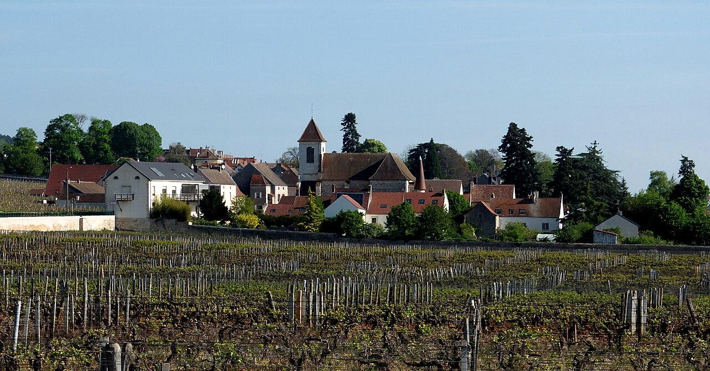

# Morey-Saint-Denis

On a label, Morey-Saint-Denis is a village name made by joining two names: "Morey" is the village itself, while "Saint-Denis" is borrowed from its Clos Saint-Denis. That detail already explains the village's position. It sits between [Gevrey-Chambertin](ref:gevrey) and [Chambolle-Musigny](ref:chambolle), often overshadowed by both, yet an unusually short stretch of slope here holds four complete grands crus and shares another two with its neighbours. Bottles are commonly 750 mL at about 12.5%–13.5% [alcohol by volume](ref:abv); [red wine](ref:red-wine) is made from [Pinot Noir](ref:pinot-noir), and [white wine](ref:white-wine) from [Chardonnay](ref:chardonnay) in very small quantities.

Figure: Morey-Saint-Denis. Image: Palauenc05, CC BY-SA 4.0, via Wikimedia Commons ([source page](https://commons.wikimedia.org/wiki/File:Morey-Saint-Denis_general_view.jpg)).

## From "Morey" to "Morey-Saint-Denis"

The commune was originally called Morey. In the late 1920s the name was formally extended with Clos Saint-Denis to become Morey-Saint-Denis, following the practice of many Burgundian villages that wrote a famous vineyard into their name. The motive is easy to understand: in the Côte de Nuits the village name is itself advertising, and putting the most resonant site name into it makes the village easier to remember on a wine list.

For drinkers, however, the long name invites two misunderstandings. The first is to assume that Clos Saint-Denis is the only grand cru in the village; in fact there are four complete grands crus, and Saint-Denis is only one of them. The second is to treat the village name and the site name as interchangeable; village, premier cru and grand cru remain three different legal tiers. Checking the tier matters more than memorising the long name.

## Limestone, marl and four complete grands crus

Morey-Saint-Denis lies in the middle Côte de Nuits in [Burgundy](ref:burgundy), [France](ref:france), north of [Chambolle-Musigny](ref:chambolle) and south of Gevrey-Chambertin. Vineyards mostly occupy east- and south-east-facing slopes above the village at moderate altitude and gradient. The base is limestone and marl, with gravel and clay mixed into the slope; the depth and drainage of the different grand cru sites vary markedly, which is the main reason for stylistic differences within one village. The official delimitation governs the boundaries.

The four complete grands crus located in the village are Clos de la Roche, Clos Saint-Denis, Clos des Lambrays and Clos de Tart. In addition, the village shares parts of Bonnes-Mares and Charmes-Chambertin. Clos de la Roche has shallow, stony soil over limestone, which is exactly what its name suggests; Clos Saint-Denis has more regular parcels with a slightly higher clay share; Clos des Lambrays and Clos de Tart each have their own position and soil mix. There is no single "Morey style" across the four; they share a village name and little else by default.

## The boundary shared with Gevrey

Most of Bonnes-Mares lies in Chambolle-Musigny, with Morey holding only a small part; most of Charmes-Chambertin lies in Gevrey-Chambertin, and Morey again takes only a narrow edge. Shared grands crus are not rare in Burgundy, but they have a practical consequence for buyers: under one grand cru name, parcels from different communes can differ in soil, gradient and ripening rhythm, and the village name on the label may say more about the wine's origin than the site name.

When you see Bonnes-Mares or Charmes-Chambertin, look beyond the site name to the village and the bottler. The Morey parcels usually sit closer to the slopes above the village and lean towards Morey's own firmness; parcels in Chambolle or Gevrey carry the character of those villages. Treating a shared grand cru as a homogeneous product is the easiest mistake to make.

## Family estates and very different ownership

Family estates dominate the village, with merchants and cooperatives also taking part. Ownership of the grands crus differs greatly: Clos de la Roche and Clos Saint-Denis are divided among many estates; Clos des Lambrays is almost a single-estate holding; Clos de Tart was long under a single owner and changed hands in recent years. The bottler information on the label is the key to telling estate wine from merchant wine.

Producer, appellation and product are three levels: the appellation answers for rules and parcel range, the producer answers for who farms, who makes and who bottles, and the product answers for vintage, tier and colour. The same grand cru made by different estates can differ greatly, and the same owner's choices in different vintages also change the wine. Read the bottler first, then discuss the site name.

## Winemaking between power and finesse

Red fruit is usually sorted after harvest, and some producers keep a proportion of whole clusters to add aromatic complexity and structure. [Fermentation](ref:fermentation) runs in temperature-controlled vessels, where maceration time and temperature shape colour, tannin and aroma. Morey cannot chase extraction like Gevrey at one extreme, nor lightness like Chambolle at the other; most estates look for a balance at medium-plus extraction. Whites are usually pressed before fermentation, and some are stirred on their lees to add texture.

The proportion of new barrels in [oak](ref:oak-ageing) varies by estate and tier, usually higher for grands crus and more restrained for village wines. Oak integrates aroma and softens tannin rather than masking the variety's finesse. Clarification and filtration before bottling depend on the producer, and that choice shows up clearly in a village whose strength is structure.

## Against Gevrey-Chambertin and Chambolle-Musigny

Typical Morey reds show red cherry, black cherry, raspberry and earth, with spice and smoke in some wines; the palate has clear acidity, medium-plus tannin and a medium body. Compared with [Gevrey-Chambertin](ref:gevrey) to the north, Morey is more restrained and leans towards red fruit and flowers, while Gevrey is heavier, firmer in tannin and darker in fruit. Compared with [Chambolle-Musigny](ref:chambolle) to the south, Morey is firmer and more structured, while Chambolle is finer, more floral and silkier. Put simply: Gevrey is burlier, Chambolle is more scented, and Morey sits between them with a slightly harder edge.

The four grands crus also differ: Clos de la Roche is usually fuller and more structured; Clos Saint-Denis is finer and more floral; Clos des Lambrays is complex in aroma and silky in texture; Clos de Tart is firm in structure with long ageing potential. Serve reds at about 15–17 degrees Celsius and whites at about 10–12 degrees Celsius.

## Warm and cool years: structure versus perfume

Warm years usually bring deeper colour, riper black fruit and a fuller body, with lower acidity and tannin that feels rounder; cool years retain higher acidity, push red fruit and flowers forward, give a firmer tannin line and a leaner body. Drainage varies across the Morey slope: stony parcels do not hold water in wet years, while parcels with more clay may ripen slowly, so even one village can show marked quality differences in a rainy season.

For buyers, warm-year Morey often shows its structure earlier, while cool-year wines need longer in bottle; comparing one estate's warm and cool years says more about vintage than comparing two estates. This section describes direction only and gives no scores.

## The price ladder across four grands crus

Village-level Morey usually sits in the middle band of Côte de Nuits village wines; premier cru moves up one step; the four complete grands crus and the shared grands crus move up again. Clos des Lambrays and Clos de Tart often occupy a higher market position because of their special ownership structures, while Clos de la Roche and Clos Saint-Denis show a wider price range because so many owners hold parcels. Judge by bottler, parcel position, vintage and back-label information rather than by the words "grand cru" alone.

The same grand cru from different estates can differ widely in price, and that gap does not automatically mean a quality gap; it more often reflects parcel position, yield and market recognition. On a limited budget, a village wine or a premier cru often shows Morey more honestly than chasing a grand cru. No specific figures are given here. For Morey-Saint-Denis, unopened bottles should be kept away from light, lying flat at about 12–15 degrees Celsius, avoiding heat and sharp temperature swings.

## Five misconceptions about shared grands crus and ownership

First, treating Morey-Saint-Denis as an appendage of Gevrey or Chambolle. It is a separate village appellation and holds four complete grands crus.
Second, assuming the village makes only red wine. The village appellation also makes a little white, though it is rarely seen on the market.
Third, attributing all of Bonnes-Mares to Morey. Most of the grand cru lies in Chambolle, and Morey holds only a small part.
Fourth, treating Clos de Tart and Clos des Lambrays as the same kind of holding. Their size, ownership structure and style all differ.
Fifth, assuming the four grand cru names guarantee uniform quality. Owner, parcel position and vintage usually matter more than the site name alone.

## Further reading

- [Red wine](ref:red-wine): the wider category to which the reds belong.
- [White wine](ref:white-wine): the wider category to which the whites belong.
- [Pinot Noir](ref:pinot-noir): the variety used for the reds.
- [Chardonnay](ref:chardonnay): the variety used for the whites.
- [France](ref:france): French wine law and appellations.
- [Burgundy](ref:burgundy): the grading framework of the region.
- [Grape](ref:grape): the basic structure of wine grapes and ripeness measures.
- [Fermentation](ref:fermentation): the logic of maceration and fermentation.
- [Oak ageing](ref:oak-ageing): the stage that integrates aroma and softens structure.
- [Alcohol by volume](ref:abv): what 12.5%–13.5% vol means on a label.
- [Gevrey-Chambertin](ref:gevrey): the village appellation to the north.
- [Chambolle-Musigny](ref:chambolle): the village appellation to the south.
