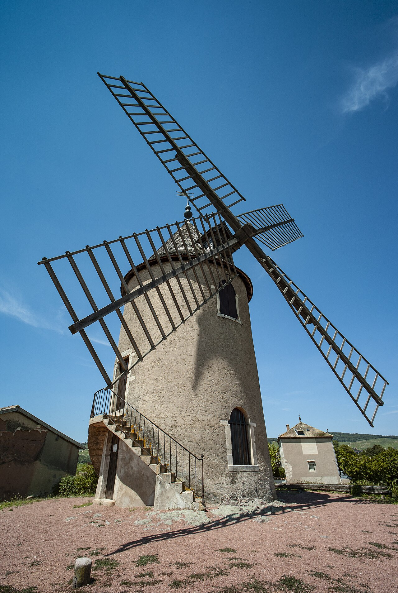

# Moulin-à-Vent

Moulin-à-Vent is a village-level cru in northern [Beaujolais](ref:beaujolais), France, making [red wine](ref:red-wine) from [Gamay](ref:gamay). Its vineyards sit on granite slopes around Romanèche-Thorins, and the name comes from an old windmill on the slope. It is commonly 750 mL at about 12.5%–14% [alcohol by volume](ref:abv).

Figure: Moulin-à-Vent. Image: Xbrindavoine, CC BY-SA 4.0, via Wikimedia Commons ([source page](https://commons.wikimedia.org/wiki/File:Moulin_%C3%A0_Vent_de_Roman%C3%A8che-Thorins.jpg)).

## Definition and position

Start with the levels: [red wine](ref:red-wine) is the category, Gamay is the variety, Moulin-à-Vent is one of the ten village crus of Beaujolais, and individual estates and wines are the producer level. Moulin-à-Vent is both a place name and an appellation name that may appear on the label alone, usually without the regional Beaujolais name.

The village has no premier or grand cru tiers, but parcel differences matter to producers. Named sites such as Thorins and La Rochelle are often labelled separately to distinguish aspect, soil and structure.

## Producer and brand

Family estates dominate the village, with merchants and cooperatives also taking part. Some estates own core parcels, while others buy grapes or wine and bottle it; the bottler information on the label is the key to telling estate wine from merchant wine.

Producer, appellation and product are three levels: the appellation answers for rules and parcel range, the producer answers for who farms, who makes and who bottles, and the product answers for vintage, site and specification. The same Moulin-à-Vent can differ noticeably by slope position and estate.

## Region and ingredients

Moulin-à-Vent lies in northern [Beaujolais](ref:beaujolais) in [France](ref:france), next to [Fleurie](ref:fleurie) and Chénas, with vineyards on the slopes around Romanèche-Thorins. The area is mostly pink weathered granite containing manganese and iron oxides, draining well and low in fertility.

Aspect and altitude produce differences in ripeness: south-facing slopes see more sun and ripen more fully, while higher parcels keep better acidity. Ripeness here is on the high side for Beaujolais crus, so the wine is fuller with more noticeable tannin. The official delimitation governs the boundaries.

The raw material is [grape](ref:grape), of the Gamay variety. Gamay is thin-skinned with high acidity, and on granite soils containing manganese it shows deeper colour, dark fruit and a tighter structure.

## Winemaking

Moulin-à-Vent often uses whole clusters, and some estates use semi-carbonic maceration: whole grapes start intracellular fermentation in a carbon-dioxide-filled vessel before pressing and a conventional fermentation. Compared with the lighter crus, maceration is more often extended here to build structure.

Fermentation temperature and maceration time shape colour, tannin and aroma. Wines aiming at ageing see longer maceration and more extraction; some wines go into [oak](ref:oak-ageing), usually with a modest proportion of new barrels so as not to mask Gamay's fruit.

## Specification and label

The common volume is 750 mL, with [alcohol by volume](ref:abv) at about 12.5%–14% vol, varying by vintage and estate. The label should be checked for the cru name, site name, vintage, bottler and importer.

Moulin-à-Vent is a standalone cru name and need not appear alongside Beaujolais. The Chinese back label, importer and anti-counterfeit information are the basis for checking identity, and the bottle on hand governs.

## Flavour and tasting

Typical aromas are black cherry, plum, raspberry, violet and earth, with some wines showing spice and minerality; the palate has clear acidity, medium-plus tannin and a medium-to-full body. It is often described as the Beaujolais cru closest to Burgundy reds, contrasting with the lighter floral style of [Fleurie](ref:fleurie).

Serve at about 15–17 degrees Celsius in a tulip-shaped or Burgundy glass. Young wines can be decanted for 30 minutes to an hour, while older wines should be decanted briefly. Watch the layering of fruit and earth; excessive oak masks the floral side.

## Drinking and pairing

It suits poultry, roast pork, roast veal, game and mushroom dishes, and also medium-strength cheese. Avoid very hot or sharply acidic dishes, which mask the fruit and structure.

Most wines are for drinking within 4–12 years, and core sites can go longer; the window depends on vintage, site and estate. After opening, refrigerate and finish within a few days. Excessive drinking harms health and minors should not drink.

## Buying and storage

Buy from reputable channels and check the cru name, site name, vintage and bottler information. Moulin-à-Vent is known among the Beaujolais crus for structure and ageing potential, and prices vary widely with site, estate and vintage, so no figure is given here.

For Moulin-à-Vent, unopened bottles should be kept away from light, lying flat in a cool place at an ideal 12–15 degrees Celsius, avoiding heat and sharp temperature swings. Cork-sealed bottles need humidity and can be stored lying down. After opening, use a vacuum or inert gas and refrigerate rather than warming and cooling repeatedly.

## Common misconceptions

First, treating Moulin-à-Vent as Beaujolais Nouveau. It is a separate village cru built on structure and ageing rather than the fruit of the current year.
Second, thinking Gamay cannot age. Core sites in Moulin-à-Vent can age noticeably.
Third, taking the windmill in the name as an estate brand. It comes from a landmark building on the slope, not a trademark.
Fourth, confusing Moulin-à-Vent with Fleurie. They are neighbours, but structure and body differ.
Fifth, judging authenticity by price or packaging. Channel, label and bottler information are more reliable.

To read Moulin-à-Vent, start with the base and the stated strength, then the sweetness or bitterness, then how it is served; no single check settles it.

[Red wine](ref:red-wine) explains style; [Beaujolais](ref:beaujolais) adds region and vintage. Put Moulin-à-Vent between them before deciding what it is.

**Short definition:** A village-level cru red wine from northern Beaujolais in France, made from Gamay, with vineyards on granite slopes around Romanèche-Thorins and named after an old windmill on the slope. Among the Beaujolais crus it is fuller with more noticeable tannin and stronger ageing potential, commonly 750 mL at about 12.5%–14% vol.

**Key facts.**

| Item | Detail |
| --- | --- |
| In one line | A village-level cru red wine from northern Beaujolais in France, made from Gamay, with vineyards on granite slopes around Romanèche-Thorins and named after an old windmill on the slope. Among the Beaujolais crus it is fu… |
| Style | Red wine |
| Region | France、Beaujolais |
| ABV | 12.5–14% vol |

**Sources and limits.** The key claims about Moulin-à-Vent are checked against the following sources: Inter Beaujolais (the cru area, main parcels and style of Moulin-à-Vent), INAO (the appellation area and cru rules), Oxford University Press (Consulted for entries on Moulin-à-Vent, the windmill landmark and Gamay; Migrated from the former reference list at the end of the article; access date not re-verified). Prices, batches and status change; the body is project-written and does not reproduce source text.

## Further reading

- [Red wine](ref:red-wine): the wider category to which Moulin-à-Vent belongs.
- [Gamay](ref:gamay): the only grape variety on this page.
- [France](ref:france): French wine law and appellations.
- [Beaujolais](ref:beaujolais): the region and its ten-cru framework.
- [Grape](ref:grape): the basic structure of wine grapes and ripeness measures.
- [Fermentation](ref:fermentation): the logic of whole-cluster fermentation and semi-carbonic maceration.
- [Oak ageing](ref:oak-ageing): the stage that integrates aroma and softens structure.
- [Alcohol by volume](ref:abv): what 12.5%–14% vol means on a label.
- [Fleurie](ref:fleurie): the neighbouring, lighter Beaujolais cru.
