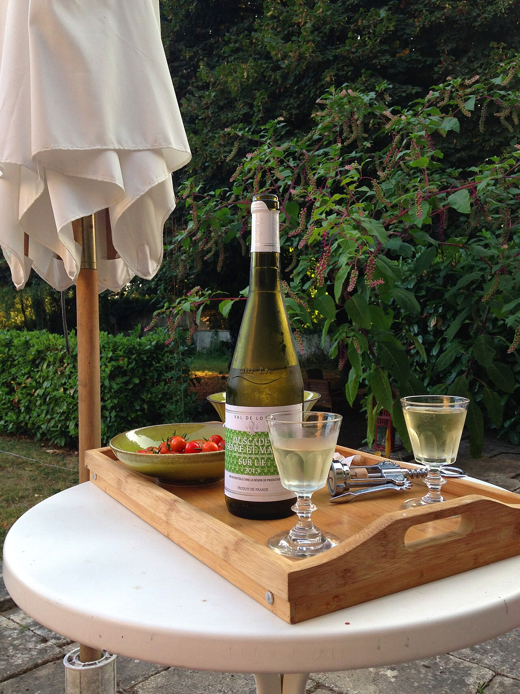

# Muscadet

Muscadet is a group of white wine appellations in the Nantes area of the [Loire Valley](ref:loire), France, made from [Melon de Bourgogne](ref:melon-de-bourgogne). It is defined by high acidity, neutral aroma and the roundness of lees ageing; commonly 750 mL at about 11%–12.5% vol.

Figure: Muscadet. Image: Julien.scavini, CC BY-SA 4.0, via Wikimedia Commons ([source page](https://commons.wikimedia.org/wiki/File:Muscadet_wine_bottle.jpg)).

## Definition and positioning

Start with the layers: [white wine](ref:white-wine) is the category, Melon de Bourgogne is the variety, Muscadet is the appellation group, and individual estates and wines are the producer level. Muscadet is both a wine name and part of several appellation names, and must not be confused with a brand.

Muscadet includes several appellations, such as Muscadet and Muscadet Sèvre et Maine. Their areas and rules differ slightly, but the variety is the same; check the full appellation name on the label rather than only the word Muscadet.

## Producers and brands

The area is dominated by family estates and cooperatives, alongside négociants. Estates vary greatly in size; some own their plots and bottle their own wine, while others buy grapes or wine to blend. The bottler information on the label is the key to telling estate wine from négociant wine.

For Muscadet, appellation, producer and product are three levels: the appellation answers the rules and geography, the producer answers who farms, ferments and bottles, and the product answers vintage and format. Estates within one appellation differ markedly, so one wine cannot stand for the whole area.

## Region and raw materials

Muscadet lies in the Nantes area of the [Loire Valley](ref:loire) in [France](ref:france), near the mouth of the Loire. The climate is oceanic, mild and humid, with a long autumn that helps retain acidity.

Soils are mainly schist, granite, sand and gravel, with different drainage and heat retention that affect ripening and minerality. The raw material is [grape](ref:grape), and the white wine is made from [Melon de Bourgogne](ref:melon-de-bourgogne), usually as a single variety.

## Winemaking

Muscadet is built on [fermentation](ref:fermentation), usually at cool temperatures to keep acidity and fruit. The typical technique is lees ageing (sur lie): after fermentation the wine stays on its yeast lees for a period, adding cream, bread and rounder texture.

Some wines use [oak ageing](ref:oak-ageing), but this is not the mainstream; most Muscadet stays in stainless steel to emphasise freshness and purity. Specific parameters belong to individual estates, so no uniform figures are given here; refer to estate material and the bottle.

## Format and labelling

The usual bottle is 750 mL at about 11%–12.5% vol. Check the full appellation name, vintage, any sur lie mention, bottler and importer on the label.

For Muscadet, label language varies by market, so the bottle itself is the reference. An appellation name is not a quality grade, and estates and vintages within one appellation differ widely, so buy on specific information.

## Flavour and tasting

Muscadet shows green apple, lemon, white flower and a faint saline note, with high acidity and a light to medium body. Lees-aged wines add cream, bread and nut notes with a rounder texture while keeping clear acidity.

Serve at about 8–10 °C. Look for balance between fruit and lees notes; excess lees makes the wine dull. Young wines are fresh, and quality wines gain layers over several years.

## Drinking and pairing

Muscadet is a classic match for seafood, especially oysters, shellfish, steamed fish and saline dishes; high acidity also balances fried food and creamy sauces. Pair by acidity rather than a fixed list.

Most wines suit drinking within 2–5 years, and quality wines can go longer; the window varies by vintage and estate. After opening, refrigerate and drink soon. Excessive drinking is harmful to health, and minors should not drink.

## Buying and storage

Buy from reputable channels and check the full appellation name, vintage and bottler. Prices vary widely with appellation, vintage and estate, so no figures are given here. An appellation name and packaging cannot replace knowing the estate and vintage.

For Muscadet, store unopened bottles away from light, lying down in a cool place at about 8–12 °C, avoiding heat and sharp temperature swings. Keep the cork moist; lie bottles down for long storage. After opening, refrigerate and drink within a few days.

## Common misconceptions

First, confusing Muscadet with Muscat. The names are similar, but the variety is Melon de Bourgogne.
Second, assuming Muscadet is only cheap seafood wine. Quality lees-aged wines have texture and ageing potential.
Third, treating sur lie as a marketing word. It describes a lees-ageing technique with a real effect on flavour.
Fourth, assuming Muscadet must use oak. Most wines are made in stainless steel.
Fifth, judging authenticity by price or packaging. Channel, back label and bottler information are more reliable.

Muscadet is made from Melon de Bourgogne, not from Muscat. It comes from the Nantes end of the Loire and is high in acidity, with a relatively neutral aroma that gains texture and saline notes from lees contact. The words “sur lie” on a label describe that ageing method, not a universal recipe. It is a seafood-friendly wine, but not a simple drink that should always be served ice-cold and cheap.

**Short definition:** A group of white wine appellations in the Nantes area of the Loire Valley, France, made from Melon de Bourgogne; high in acidity and neutral in aroma, often lees-aged, with green apple, lemon, white flower and saline notes, commonly 750 mL at about 11%–12.5% vol.

Begin with the base and the stated strength, move on to the sweetness or bitterness, and finish with how it is served. That order keeps the reading of Muscadet practical.

[White wine](ref:white-wine) and [Loire Valley](ref:loire) are the nearest useful comparisons: one clarifies style, the other tests region and vintage.

**Key facts.**

| Item | Detail |
| --- | --- |
| In one line | A group of white wine appellations in the Nantes area of the Loire Valley, France, made from Melon de Bourgogne; high in acidity and neutral in aroma, often lees-aged, with green apple, lemon, white flower and saline not… |
| Style | White wine |
| Region | France、Loire Valley |
| ABV | 11–12.5% vol |

**Sources and limits.** The key claims about Muscadet are checked against the following sources: INAO (Used to check the appellation areas, variety and lees-ageing rules), InterLoire (Used to check the soils, styles and seafood pairing tradition around Nantes), Oxford University Press (Consulted for entries on Muscadet and Melon de Bourgogne). Prices, batches and status change; the body is project-written and does not reproduce source text.

## Further reading

- [White wine](ref:white-wine): the category Muscadet belongs to.
- [Melon de Bourgogne](ref:melon-de-bourgogne): the only variety in Muscadet.
- [France](ref:france): French wine law and appellations.
- [Loire Valley](ref:loire): the region band and sub-region framework around Muscadet.
- [Grape](ref:grape): the basic structure of wine grapes and ripeness measures.
- [Fermentation](ref:fermentation): lees ageing and acid retention.
- [Oak ageing](ref:oak-ageing): a texture source used in a minority of wines.
- [Alcohol by volume](ref:abv): what 11%–12.5% vol means on a label.
