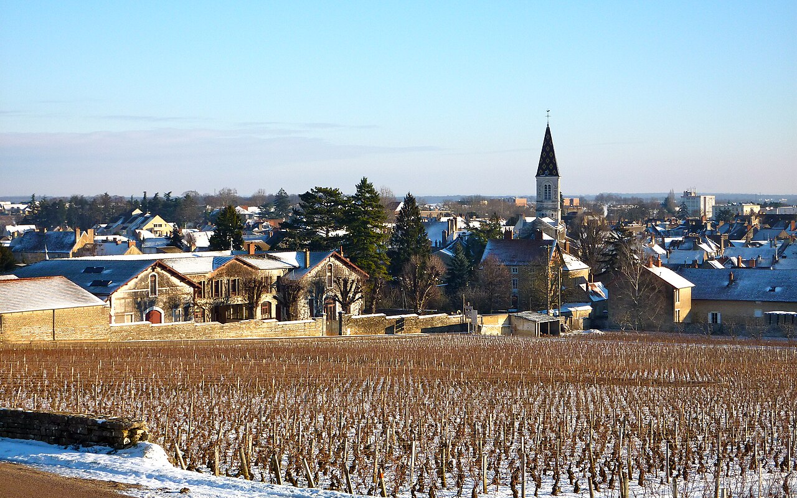

# Nuits-Saint-Georges

Nuits-Saint-Georges is a village-level red wine appellation in the Côte de Nuits of [Burgundy](ref:burgundy), France, south of Dijon and north of Beaune. It makes [red wine](ref:red-wine) from [Pinot Noir](ref:pinot-noir), with a firmer body, and the village has several premiers crus but no grand cru. Commonly 750 mL at about 12.5%–13.5% vol.

Figure: Nuits-Saint-Georges. Image: Leroy remy, CC BY-SA 3.0, via Wikimedia Commons ([source page](https://commons.wikimedia.org/wiki/File:Nuits-Saint-Georges_France_December2010.jpg)).

## Definition and positioning

Start with the layers: [red wine](ref:red-wine) is the category, Pinot Noir is the variety, Nuits-Saint-Georges is a village-level appellation (AOC), and individual estates, sites and wines are the producer level. Nuits-Saint-Georges is both a place name and an appellation name on the label, and must not be confused with a brand.

Burgundy's hierarchy has three levels: village, premier cru and grand cru. Nuits-Saint-Georges itself has no grand cru, and the village contains several premiers crus; a label naming Nuits-Saint-Georges Premier Cru or a specific premier cru site belongs to a higher tier.

## Producers and brands

For Nuits-Saint-Georges, the appellation is dominated by family estates, alongside négociants and cooperatives. Estates vary greatly in size; some own their plots and bottle their own wine, while others buy grapes or wine to blend. The bottler information on the label is the key to telling estate wine from négociant wine.

Appellation, producer and product are three levels: the appellation answers the rules and geography, the producer answers who farms, ferments and bottles, and the product answers vintage and format. Estates and sites within one village differ markedly, so one wine cannot stand for the whole village.

## Region and raw materials

Nuits-Saint-Georges lies in the Côte de Nuits of [Burgundy](ref:burgundy) in [France](ref:france), south of Dijon and north of Beaune. The climate leans continental, with a shorter growing season, and cool nights help retain acidity and aroma. Soils are mainly limestone and marl, and aspect and drainage affect ripening.

The raw material is [grape](ref:grape), and the variety is [Pinot Noir](ref:pinot-noir). Burgundy reds are almost all made from Pinot Noir, and whites mainly from Chardonnay; the exact variety and site rules are set by the appellation documents.

## Winemaking

Nuits-Saint-Georges reds are built on [fermentation](ref:fermentation), where temperature and maceration time determine colour, tannin and aroma. Burgundy traditionally uses open fermentation vats or temperature-controlled tanks, and some estates keep whole clusters for spice and structure.

[Oak ageing](ref:oak-ageing) is a major style variable: the share of new oak affects vanilla, toast and tannin texture, while older barrels preserve fruit. Specific parameters belong to individual estates, so no uniform figures are given here; refer to estate material and the bottle.

## Format and labelling

The usual bottle is 750 mL at about 12.5%–13.5% vol. Check the village name, vintage, premier cru name, bottler and importer on the label; Burgundy labels often name both the estate and the site.

For Nuits-Saint-Georges, label language varies by market, so the bottle itself is the reference. Village and premier cru names are different tiers of naming, not quality rankings; estates on the same site differ widely.

## Flavour and tasting

Young Nuits-Saint-Georges shows black cherry, blackcurrant, liquorice and earthy notes, with firmer tannin and clear acidity; compared with neighbouring villages, it leans more structural. With age it develops leather, truffle and dried flowers, and a softer texture.

Serve at about 15–17 °C. Look for layers of fruit, spice and earth; excess oak masks the delicacy of Pinot Noir. Ageing potential varies by vintage, site and estate.

## Drinking and pairing

Nuits-Saint-Georges suits red meat, poultry, mushrooms and medium-hard cheese; firmly structured wines suit stews and game. Pair by acidity and tannin rather than a fixed list.

Most village wines suit drinking within 5–12 years, and premiers crus and top vintages can go longer; the window varies by vintage, site and estate. A brief decant can help; reseal and refrigerate leftovers and drink soon. Excessive drinking is harmful to health, and minors should not drink.

## Buying and storage

Buy from reputable channels and check the village name, vintage, site and bottler. Prices vary widely with site, estate reputation and vintage, so no figures are given here. An appellation name and packaging cannot replace knowing the estate and site.

For Nuits-Saint-Georges, store unopened bottles away from light, lying down in a cool place at about 12–15 °C, avoiding heat and sharp temperature swings. Keep the cork moist; lie bottles down for long storage. After opening, reseal, refrigerate and drink within a few days.

## Common misconceptions

First, treating Nuits-Saint-Georges as a grand cru appellation. The village has premiers crus but no grand cru.
Second, treating village and premier cru as the same tier. They are different levels in the Burgundy hierarchy.
Third, assuming Pinot Noir makes only light wine. Nuits-Saint-Georges is relatively structural among Burgundy reds.
Fourth, treating earthy notes as a fault. Moderate earth and mushroom notes are typical of aged Pinot Noir.
Fifth, judging authenticity by price or packaging. Channel, back label and bottler information are more reliable.

Begin with the base and the stated strength, move on to the sweetness or bitterness, and finish with how it is served. That order keeps the reading of Nuits-Saint-Georges practical.

Read [Red wine](ref:red-wine) for the style side of Nuits-Saint-Georges, and [Burgundy](ref:burgundy) for the region and vintage side. Together they locate it.

**At a glance:** A village-level Pinot Noir red wine appellation in the Côte de Nuits of Burgundy, France, south of Dijon and north of Beaune; known for black cherry, liquorice and earthy notes with a firmer body, with several premiers crus but no grand cru in the village, commonly 750 mL at about 12.5%–13.5% vol.

**Key facts.**

| Item | Detail |
| --- | --- |
| In one line | A village-level Pinot Noir red wine appellation in the Côte de Nuits of Burgundy, France, south of Dijon and north of Beaune; known for black cherry, liquorice and earthy notes with a firmer body, with several premiers c… |
| Style | Red wine |
| Region | France、Burgundy |
| ABV | 12.5–13.5% vol |

**Sources and limits.** The key claims about Nuits-Saint-Georges are checked against the following sources: INAO (Used to check the village-level and premier cru rules of the appellation), BIVB (Used to check the villages, premiers crus and styles of Nuits-Saint-Georges), Oxford University Press (Consulted for entries on Nuits-Saint-Georges and Pinot Noir). Prices, batches and status change; the body is project-written and does not reproduce source text.

## Further reading

- [Red wine](ref:red-wine): the category Nuits-Saint-Georges belongs to.
- [Pinot Noir](ref:pinot-noir): the only red variety in Nuits-Saint-Georges.
- [France](ref:france): French wine law and appellations.
- [Burgundy](ref:burgundy): the region and hierarchy around Nuits-Saint-Georges.
- [Grape](ref:grape): the basic structure of wine grapes and ripeness measures.
- [Fermentation](ref:fermentation): the logic of maceration and extraction.
- [Oak ageing](ref:oak-ageing): one source of spice and texture.
- [Alcohol by volume](ref:abv): what 12.5%–13.5% vol means on a label.
