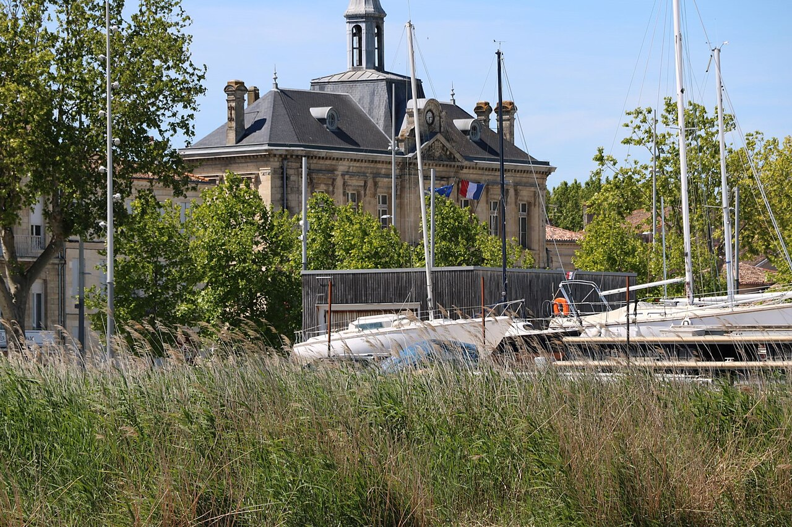

# Pauillac

Pauillac has only about 1,200 hectares of vines, yet it holds three of the five first growths in the 1855 classification: Lafite, Latour and Mouton. Eighteen classified growths are packed onto this stretch of gravel rises on the left bank of the Gironde, making it the most concentrated seat of power among the Médoc communes. It belongs to [France](ref:france), in [Bordeaux](ref:bordeaux), was granted AOC status on 14 November 1936, and produces [red wines](ref:red-wine) based overwhelmingly on [Cabernet Sauvignon](ref:cabernet-sauvignon) from [grape](ref:grape) fruit; bottles are commonly 750 mL at 12.5%–13.5% [alcohol by volume](ref:abv).

Figure: Pauillac. Image: Anthony Baratier, CC BY-SA 4.0, via Wikimedia Commons ([source page](https://commons.wikimedia.org/wiki/File:La_mairie_de_Pauillac_vue_depuis_le_port_de_plaisance.jpg)).

## Three first growths and 18 classified estates

Pauillac's classified structure is unique in the Médoc: three first growths, two second growths, no third growths, one fourth growth and twelve fifth growths — 18 in total. Lafite Rothschild, [Latour](ref:latour) and [Mouton Rothschild](ref:mouton) form the top tier, joined by Pichon Baron and Pichon Comtesse among the second growths. The 1855 list covers estates, not the appellation; beyond the 18, Pauillac still has many unclassified producers.

## 14 November 1936: a boundary drawn along the river

The Pauillac AOC was established by the decree of 14 November 1936, and its boundaries have been revised several times since. The appellation runs north to Saint-Estèphe, south to Saint-Julien and east to the Gironde estuary, with vineyards concentrated on a gravel band a few kilometres long. The AOC boundary is a product of history and cadastre, not a simple midline.

## The Carruades plateau: the highest point of the appellation

Lafite sits at the northern edge of the appellation, against the Saint-Estèphe border. Its finest land is the plateau des Carruades, about 50 hectares west of the château, which the estate calls the highest point of the Pauillac appellation. The clay-gravel soils drain well and face well, allowing Cabernet Sauvignon to ripen fully. Lafite also owns a 4.5-hectare parcel inside Saint-Estèphe whose fruit still goes into the grand vin — a reminder that "estate" and "appellation" are more complicated than a label suggests.

Mouton lies in the centre-north of the appellation, with about 90 hectares of vines. "Mouton" does not come from the French word for sheep but from Old French motte, a small hill; "Lafite" comes from "ridge". The place names are themselves a lesson in topography.

## Deep gravel, marl and the "iron fist in a velvet glove"

Pauillac's gravel croupes are deeper and more continuous than Margaux's, and the blend is dominated by Cabernet Sauvignon with [Merlot](ref:merlot) and a little [Cabernet Franc](ref:cabernet-franc). Mouton's own description is that the lean gravel extends several metres down, over a layer of marl, while the terrain consists of small hillocks usually below 40 metres, with the low ground between them handling drainage. Decanter adds a counter-intuitive detail: even the highest points in the Médoc barely reach 35 metres, most vineyards stand between 10 and 20 metres, and Latour is the lowest-lying first growth at only 13 metres. Pauillac's power comes not from altitude but from the thickness of the gravel, its drainage and its heat retention.

## Mouton in 1973: the only promotion in classification history

After 1855 the list was effectively frozen. The single exception is Mouton: after nearly twenty years of campaigning by Baron Philippe, Jacques Chirac, then Minister of Agriculture, signed a decree in 1973 raising Mouton from second to first growth. It remains the only change of rank in the 1855 list. To say today that "Pauillac has three first growths" is strictly a post-1973 statement; before that, the commune had Lafite and Latour.

## From Pichon to Lynch-Bages: where the 18 sit

Beyond the three first growths and the two Pichons, Pauillac's classified estates include the fourth growth Duhart-Milon and twelve fifth growths: Batailley, Clerc Milon, Croizet-Bages, d'Armailhac, Grand-Puy-Ducasse, Grand-Puy-Lacoste, Haut-Bages-Libéral, Haut-Batailley, Lynch-Bages, Lynch-Moussas, Pédesclaux and Pontet-Canet. This list explains why even Pauillac's "middle" wines can feel so structured: several fifth growths are priced by the market alongside second growths.

## The 57 hl/ha base and the 9,500 kg/ha gate

Pauillac's yield rules follow the Médoc communal template: 57 hl/ha as the base and 63 hl/ha as the ceiling (60 hl/ha in some row-spacing configurations). Planting density must be at least 7,000 vines per hectare, row spacing no more than 1.50 m, and each vine no more than 1.43 m²; the maximum load is 9,500 kg per hectare. Minimum natural alcohol is 11%, with minimum sugar of 189 g/L for Merlot and 180 g/L for other varieties. Wine must be aged until at least 1 June of the year after harvest, released from 1 September and bottled no later than 31 December of the third year after harvest. For Pauillac these figures are a floor, not a style guide: first growths usually crop far below the legal ceiling.

## Fermentation temperature, maceration and 15 months in new oak

Pauillac reds are built around [fermentation](ref:fermentation), where temperature control and maceration length determine extraction. At Lafite, for example, alcoholic fermentation runs at controlled temperature with regular pump-overs, maceration lasts about 22 days, and the wine then goes into French oak for roughly 15 months in new barrels; the estate even runs its own cooperage in Pauillac. Such parameters belong to individual estates and cannot be generalised into appellation law. Cabernet Sauvignon's high tannin and acidity mean that blend proportions, picking dates and the share of new [oak ageing](ref:oak-ageing) can each shift the wine's skeleton.

## Firmer than Margaux, fuller than Saint-Julien

Compared with Margaux, Pauillac's tannin is firmer and slower to open, because its gravel is deeper and more continuous and Cabernet Sauvignon accounts for a larger share. Margaux's soils carry more clay, sand and riverside silt, with more Merlot, so its tannin feels finer. Compared with Saint-Julien, Pauillac is fuller-bodied, with more pencil lead and cedar; Decanter describes Saint-Julien's gravel as the most uniform and orderly, with only a border of clay at the entrance to the appellation, which gives slightly narrower, smoother wines. These are not three adjectives but three soil-and-variety equations.

## Price bands: from $160 to $989

Wine-Searcher's November 2026 international averages for 750 ml bottles: Château Pontet-Canet about $160, Lynch-Bages about $184, Pichon Comtesse about $244, Mouton Rothschild about $786, Latour about $945 and Lafite about $989. Unclassified Pauillac commonly trades at $40–80. Prices move with vintage, scores, channel and exchange rates; the figures above are only an order of magnitude.

## Correcting "Pauillac is only about power"

Pauillac is often reduced to "powerful and tannic", but the 18 classified growths differ widely: Lafite is known for finesse and perfume, Latour for depth and longevity, Mouton has been more extroverted since 1973, and Lynch-Bages among the fifth growths offers classic Pauillac structure at a comparatively accessible price. Treating power as the only criterion misses the full spectrum from taut to generous within one appellation. A second misunderstanding equates Pauillac with its three first growths: the appellation is a geographic area, and the first growths are only three of its producers.

## Temperature, decanting and pairing

Serve Pauillac at 16–18 °C; decant young, tannic vintages for one to two hours, and shorten decanting for older bottles so the aroma does not fade. Red meat, grilled meat, game and hard cheese are safe matches, since fat buffers tannin. Reseal and refrigerate leftovers and drink within a few days; excessive drinking is harmful to health, and minors should not drink.

Pauillac is best approached through the base and the stated strength, then the sweetness or bitterness, and then how it is served. One check alone will not settle it.

[Red wine](ref:red-wine) explains style; [Bordeaux](ref:bordeaux) adds region and vintage. Put Pauillac between them before deciding what it is.
