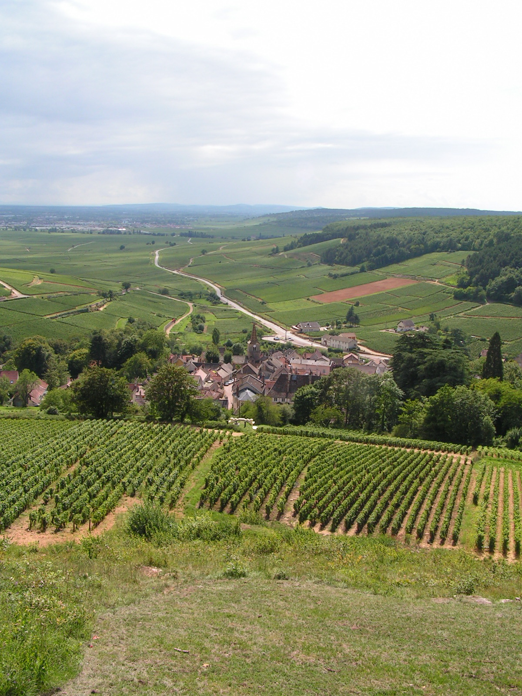

# Pernand-Vergelesses

Pernand-Vergelesses hides where two small valleys meet on the western side of the hill of Corton, its houses stacked along steep streets and its vines running from behind the rooftops up to the shoulder of the hill. It is usually introduced as one of the three villages of Corton, which is true but unhelpful: it is also a complete appellation with eight premiers crus, a white share close to half, and a piece of grand cru in its own right. Reds come from [Pinot Noir](ref:pinot-noir), whites from [Chardonnay](ref:chardonnay); bottles are typically 750 mL at 12.5%–13.5% [alcohol](ref:abv) in a normal vintage.

Figure: Pernand-Vergelesses. Image: Olivier Vanpé, CC BY-SA 2.5, via Wikimedia Commons ([source page](https://commons.wikimedia.org/wiki/File:Pernand-Vergelesses.jpg)).

## A village wedged between two combes

Coming over the ridge from Aloxe, the landscape abruptly narrows: two combes converge at the village, squeezing the vineyards between valley walls and the upper slope. The pocket has two consequences. First, holdings are fragmented, and a single premier cru can contain different gradients and soil depths. Second, cold air drains down the valleys at night, so the lowest ground is more exposed to frost and delayed ripening than mid-slope. Most of the eight premiers crus occupy the middle and upper sections of these walls.

## East-facing, yet later ripening

BIVB is precise: most vineyards face east or south, a minority north-east, at 250–300 m. So the village is not uniformly shaded, but it does contain a meaningful set of north-east parcels. Compared with Aloxe, which looks due east at 200–300 m, Pernand is higher and more enclosed, and its ripening window arrives later. That lateness is an asset here: acidity survives, white wines keep a firmer mineral spine, and red tannins stay fine.

## White wine at nearly half the surface

In 2022 Pernand had 76.62 ha of red (41.29 ha premier cru) and 69.70 ha of white (20.98 ha premier cru). White therefore accounts for 47.6% of the surface, with average annual production of 3,054 hl red and 3,040 hl white, almost a dead heat. That ratio stands out among Côte de Beaune villages that make both colours: Aloxe's village white is 1.36 ha, Savigny's white is about 14% of its surface, Santenay's about 22%. Pernand's white is not a sideline; it is half the business.

## The eight premiers crus, named

The eight climats are Clos Berthet, Creux de la Net, En Caradeux, Île des Vergelesses, Les Fichots, Sous Frétille, Vergelesses and Village de Pernand. Three of them — Sous Frétille, Clos Berthet and Village de Pernand — are white-only. That is unusual in Burgundy: the rules themselves admit that certain parcels are born for Chardonnay. Les Fichots and Vergelesses produce both colours, depending on the parcel and its ripening.

## Île des Vergelesses: an island within the vines

The name means "island of Vergelesses", because the parcel sits enclosed by neighbours like an island. It occupies a mid-slope facing east, with balanced clay-limestone soils over limestone from the Corton side. Chandon de Briailles owns 2.10 ha here, planted across 1949, 1953, 1976, 1982 and 1990, and calls it a "super premier cru". The wine is made without pumping over or added sulphites, fermented with whole clusters, and aged 14–18 months in barrels, 90% of them used and 10% new. The result is lighter and more transparent than most Côte de Beaune reds, and it speaks clearly of limestone.

## En Charlemagne belongs to Pernand

Corton-Charlemagne covers 57.70 ha shared by Aloxe, Ladoix and Pernand, with AOC status from 31 July 1937. Pernand's contribution is the climat called En Charlemagne, on a 280–330 m slope of 20%–23%, mainly south-west facing, over yellow-brown marl with alternating limestone. Pernand does not merely sit next to Corton-Charlemagne; it supplies part of it. A bottle of Corton-Charlemagne grown in En Charlemagne is not a hanger-on but a legitimate grand cru.

## Limits, yields and minimum alcohol

Village maximum yields are 57 hl/ha for white and 50 hl/ha for red; premier cru limits are 55 and 48, with butoir ceilings of 64/58 and 62/56. Minimum natural alcohol is 11% for village white and 10.5% for village red, rising to 11.5% and 11% for premier cru. Planting density must reach at least 9,000 vines per hectare. For comparison, Corton grand cru is capped at 42 hl/ha for red and 48 hl/ha for white: the higher the tier, the harder the yield is pressed down. Figures can shift when the cahier des charges is revised, so the latest text and BIVB data remain authoritative.

## Chandon de Briailles and 2.10 hectares

Based in Savigny, Chandon de Briailles farms 12 crus across Savigny, Pernand and Aloxe and has been biodynamic since 2005. Its 2.10 ha in Île des Vergelesses is the reference point for Pernand red: a high proportion of whole clusters, light extraction, little sulphur, strawberry and raspberry with violet when young, undergrowth and spice with age. Against the deeper, denser reds of Aloxe, it feels like bone wrapped in silk.

## A lighter, more floral profile

The reds are deep ruby, opening with strawberry, raspberry and violet, later showing underbrush and spice; the palate is conciliatory rather than aggressive, with fine but real tannin and medium to medium-plus body. The whites are white-gold, with hawthorn and acacia, citrus, then amber and honey with age; the palate is mineral and harmonious, with acidity as a frame rather than a spike. Compared with Aloxe's hazelnut-and-honey whites, Pernand is more linear and saline; compared with Savigny's buttery, brioche-scented whites, it is more restrained.

## Price bands

Typical European retail in 2026: €28–40 for village red, €30–45 for village white; €45–70 for premier cru red, €48–75 for premier cru white; €55–85 for Île des Vergelesses; €90–150 for Corton-Charlemagne grown in Pernand. Prices vary with vintage, producer reputation and channel; these are orders of magnitude, not quotations.

## Sushi, cream sauces and the acid test

BIVB's first food suggestion for Pernand white is sushi, which is not a gimmick: acidity and minerality cut through the fat of raw fish and the sweetness of vinegared rice. For the red, roasted veal, braised lamb, poultry in sauce and grilled pork work because the tannin is fine enough not to need a heavy sauce. This is the opposite logic to Aloxe red with steak and game: Pernand red wants flavour without fat.

## Correcting the "satellite of Corton" story

The common line is that Pernand is merely Corton's supporting act, the wine to buy when grand cru is out of reach. That misses three facts: it has its own AOC and eight premiers crus; white is nearly half its surface and behaves completely differently; and it owns En Charlemagne inside Corton-Charlemagne. The better model is two faces of one hill — Aloxe earlier and weightier, Pernand later and more transparent — with the price gap reflecting market fashion rather than a quality hierarchy.

## Ageing and label checks

Village red is usually at its best within 5–10 years, premier cru within 12–15; village white within 4–8 years, premier cru within 8–12. Store bottles lying down, away from light, at 12–15°C; once open, refrigerate and finish within two or three days. On the label, check village, premier cru, climat, colour, vintage and bottler. Note that Village de Pernand is a white-only premier cru: a red carrying that climat deserves suspicion.

To read Pernand-Vergelesses, start with the base and the stated strength, then the sweetness or bitterness, then how it is served; no single check settles it.

## Further reading

- [Red wine](ref:red-wine) and [white wine](ref:white-wine): the two categories.
- [Pinot Noir](ref:pinot-noir) and [Chardonnay](ref:chardonnay): the varieties.
- [Grape](ref:grape), [fermentation](ref:fermentation) and [oak ageing](ref:oak-ageing): material and process.
- [France](ref:france) and [Burgundy](ref:burgundy): the regional frame.
- [Alcohol by volume](ref:abv): the label term.
- [Corton](ref:corton): the grand cru on the same hill.
- [Aloxe-Corton](ref:aloxe-corton): the appellation on the other side.
