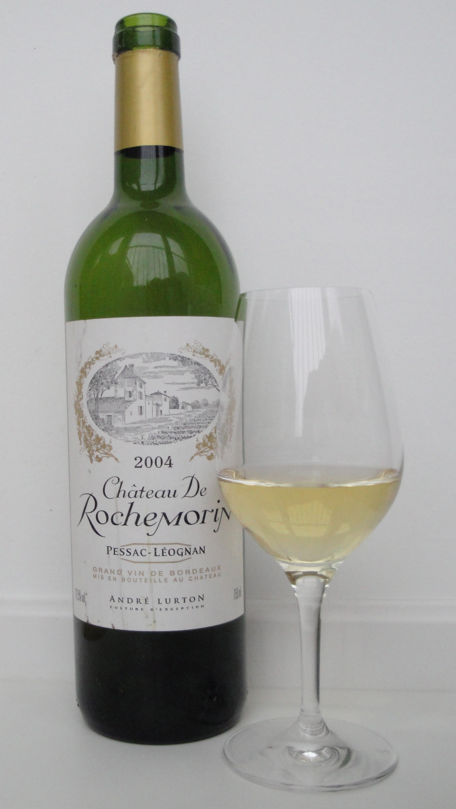

# Pessac-Léognan

Pessac-Léognan is a red and white wine appellation in northern Graves, south of Bordeaux city, [France](ref:france), separated from Graves in 1987. Reds blend [Cabernet Sauvignon](ref:cabernet-sauvignon) and [Merlot](ref:merlot), whites use Sauvignon Blanc and Sémillon, and both are known for smoky, mineral and structured notes; commonly 750 mL at about 12.5%–13.5% vol.

Figure: Pessac-Léognan. Image: Tomas er, CC BY-SA 3.0, via Wikimedia Commons ([source page](https://commons.wikimedia.org/wiki/File:Ch%C3%A2teau_de_Rochemorin_Blanc_2004.jpg)).

## Definition and positioning

Start with the layers: [red wine](ref:red-wine) is the category, Cabernet Sauvignon and Merlot are varieties, Pessac-Léognan is the appellation (AOC), and individual estates and wines are the producer level. It is both a place name and an appellation name on the label, and must not be confused with an estate or a brand.

Pessac-Léognan was formerly part of the Graves appellation and gained separate AOC status in 1987, covering only northern Graves. It differs from the rest of Graves in rules and style, so check the full appellation name on the label.

## Producers and brands

Family estates and classified growths coexist in the appellation, alongside négociants. Estates vary greatly in size; some own their plots and bottle their own wine, while others buy grapes or wine to blend. The bottler information on the label is the key to telling estate wine from négociant wine.

Appellation, producer and product are three levels: the appellation answers the rules and geography, the producer answers who farms, ferments and bottles, and the product answers vintage and format. Estates within one appellation differ markedly, so one wine cannot stand

## Region and raw materials

Pessac-Léognan lies in northern Graves, south of Bordeaux city, on the left bank of the Garonne. The climate is moderated by the ocean, mild and humid, and the microclimate around the city also affects ripening.

Soils are mainly gravel, with clay and sand in some plots and varying gravel depth; drainage and heat retention affect ripeness and body. The raw material is [grape](ref:grape); red wine blends [Cabernet Sauvignon](ref:cabernet-sauvignon) and [Merlot](ref:merlot), while white wine uses Sauvignon Blanc and Sémillon.

## Winemaking

Reds are built on [fermentation](ref:fermentation), where temperature and maceration time determine extraction; whites ferment at cooler temperatures to keep aroma and acidity. Some wines use [oak ageing](ref:oak-ageing), adding spice and structure to reds and texture and nut notes to whites.

Specific parameters belong to individual estates, so no uniform figures are given here; refer to estate material and the bottle. Red and white wines are made side by side in the same appellation, so confirm the wine type first, then look at variety and technique.

## Format and labelling

The usual bottle is 750 mL at about 12.5%–13.5% vol. Check the appellation, vintage, red or white type, estate name, classification, bottler and importer on the label.

For Pessac-Léognan, label language varies by market, so the bottle itself is the reference. An appellation name is not a quality grade, and estates and vintages within one appellation differ widely, so buy on specific information.

## Flavour and tasting

Reds show blackcurrant, cedar, tobacco and smoky minerality, with clear tannin and medium-high acidity; whites show citrus, white flower, beeswax and flint, with a fuller texture. Both carry the smoky, mineral base typical of Graves gravel.

Serve reds at about 16–18 °C and whites at about 10–12 °C. Look for layers of fruit and minerality; excess oak masks the finer aromas.

## Drinking and pairing

Reds suit red meat, poultry, mushrooms and medium-bodied stews; whites suit seafood, white meat and dishes with creamy texture. Pair by acidity and tannin rather than a fixed list.

Most reds suit drinking within 5–15 years, and whites within 3–8 years; the window varies by vintage and estate. After opening, reseal, refrigerate and drink soon. Excessive drinking is harmful to health, and minors should not drink.

## Buying and storage

Buy from reputable channels and check the appellation, vintage, red or white type and bottler. Prices vary widely with estate classification, vintage and reputation, so no figures are given here. An appellation name and packaging cannot replace knowing the estate and vintage.

For Pessac-Léognan, store unopened bottles away from light, lying down in a cool place at about 12–15 °C, avoiding heat and sharp temperature swings. Keep the cork moist; lie bottles down for long storage. After opening, reseal, refrigerate and drink within a few days.

## Common misconceptions

First, treating Pessac-Léognan and all of Graves as the same appellation. The former separated in 1987 and covers only northern Graves.
Second, assuming the appellation makes only red wine. White wine is equally important, based on Sauvignon Blanc and Sémillon.
Third, treating smoky and mineral notes as faults. They are typical of Graves gravel soils.
Fourth, assuming first growths exist only in the Médoc. [Château Haut-Brion](ref:haut-brion) is in Graves and was a first growth in the 1855 classification.
Fifth, judging authenticity by price or packaging. Channel, back label and bottler information are more reliable.

Pessac-Léognan is best read by starting with the base and the stated strength, moving to the sweetness or bitterness, and ending with how it is served.

The comparison with [Red wine](ref:red-wine) and [Bordeaux](ref:bordeaux) runs through style and region and vintage. Each answers a different question.

**Short definition:** A red and white wine appellation in northern Graves, south of Bordeaux city, France, separated from Graves in 1987; reds blend Cabernet Sauvignon and Merlot, whites use Sauvignon Blanc and Sémillon, and both show smoky, mineral and structured notes, commonly 750 mL at about 12.5%–13.5% vol.

**Key facts.**

| Item | Detail |
| --- | --- |
| In one line | A red and white wine appellation in northern Graves, south of Bordeaux city, France, separated from Graves in 1987; reds blend Cabernet Sauvignon and Merlot, whites use Sauvignon Blanc and Sémillon, and both show smoky, … |
| Style | Red wine |
| Region | France、Bordeaux |
| ABV | 12.5–13.5% vol |

**Sources and limits.** The key claims about Pessac-Léognan are checked against the following sources: INAO (Used to check the appellation area, red and white varieties and rules), CIVB (Used to check the soils, red and white styles and the 1987 separation from Graves), Oxford University Press (Consulted for entries on Pessac-Léognan and Graves). Prices, batches and status change; the body is project-written and does not reproduce source text.

## Further reading

- [Red wine](ref:red-wine): the category Pessac-Léognan reds belong to.
- [Cabernet Sauvignon](ref:cabernet-sauvignon): a main variety in the appellation's reds.
- [Merlot](ref:merlot): the other main variety in the appellation's reds.
- [Château Haut-Brion](ref:haut-brion): the Graves first growth, an estate page rather than an appellation page.
- [Bordeaux](ref:bordeaux): the region and classification framework around Pessac-Léognan.
- [France](ref:france): French wine law and appellations.
- [Grape](ref:grape): the basic structure of wine grapes and ripeness measures.
- [Fermentation](ref:fermentation): the basic difference between red and white fermentation.
- [Oak ageing](ref:oak-ageing): one source of spice and texture.
- [Alcohol by volume](ref:abv): what 12.5%–13.5% vol means on a label.
