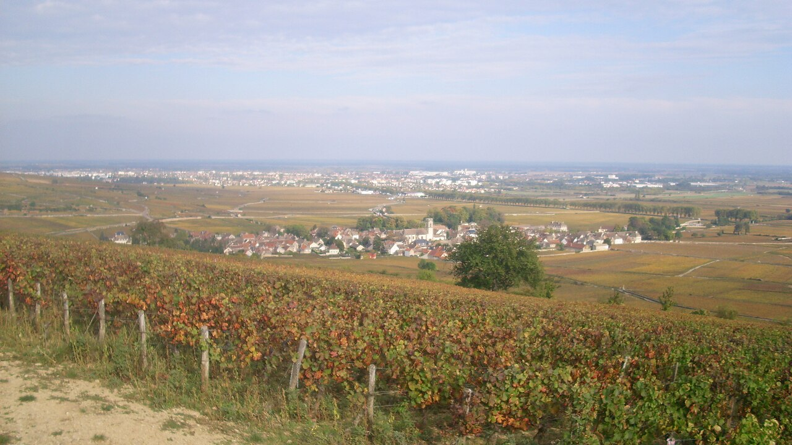

# Pommard

Pommard leaves a conspicuous blank in the Burgundy hierarchy: it has no grand cru. That blank does not mean second class; it pushes the village's attention onto a handful of premiers crus instead. A village-level [red wine](ref:red-wine) appellation in the Côte de Beaune, Pommard is made entirely from [Pinot Noir](ref:pinot-noir) and is known for red fruit, earthy notes, firmer tannin and stronger structure. The usual bottle is 750 mL at about 12.5%–13.5% vol.

Figure: Pommard. Image: Mpmpmp, CC BY-SA 3.0, via Wikimedia Commons ([source page](https://commons.wikimedia.org/wiki/File:IMG_Pommard_et_Beaune.JPG)).

## Pommard without a grand cru: outside the top tier

Within the [Burgundy](ref:burgundy) hierarchy, Pommard has only two levels, village and premier cru, and Grand Cru never appears on its labels. This does not mean the village lacks top sites; it means that when the hierarchy was drawn up, no plot here was placed in the grand cru tier. The consequence is that the best wines concentrate in premiers crus such as Les Rugiens and Les Épenots, and so do price and reputation.

Pommard is best read by starting with the base and the stated strength, moving to the sweetness or bitterness, and ending with how it is served.

## Les Rugiens and Les Épenots: two characters among the premiers crus

Les Rugiens is often split into two parts, Les Rugiens-Hauts and Les Rugiens-Bas. With iron-rich clay and thin topsoil, the wine is tight, firmly tannic and long-lived, the most "skeletal" style in the village. Les Épenots is larger and closer to the village and the direction of Beaune; the style is rounder, the fruit more outgoing, and it opens earlier.

Clos des Épeneaux is a monopole inside Les Épenots, held entirely by one estate, and it is often used as a sample of Pommard's other face: proof that the village is not only firm but can also be round and fine. The contrast between the two premiers crus carries more information than the phrase "Pommard is hard".

## Iron-rich clay and limestone: where the firm tannin comes from

Pommard's soils are mainly limestone and clay. Some plots carry enough iron to show a reddish soil colour; a high clay share holds water, while limestone debris keeps drainage open. On this [French](ref:france) slope the [grape](ref:grape) ripens slowly, the skins grow thick and tannin levels are high, so a slightly stronger extraction quickly reads as firm. The slopes mostly sit at moderate altitude, facing east or southeast, with enough sun but not too much heat; topsoil is thinner near the top and deeper at the foot, and the body moves from tight to round accordingly.

Soil also explains the split within the village: plots with more iron-rich clay are tighter and longer-lived, while plots with deeper soil and more gravel are rounder and earlier. Treating "Pommard" as one uniform style misses these differences.

## Next to Volnay, and yet the opposite

Pommard borders Volnay, yet the two are often described as opposite poles: Pommard is heavier, firmer in tannin and darker in colour, with more red fruit and earth; Volnay is lighter, finer in tannin and more floral. Two villages on the same slope give wines that read almost like two temperaments.

This does not make Pommard coarse. Its firmness is structure, the very thing that makes it age; it only needs food and time when young. When comparing with Volnay, take the same vintage and a similar tier, village or premier cru, to see the real difference.

## Against Nuits-Saint-Georges and Beaune

To the north, Nuits-Saint-Georges is also built on structure, with obvious tannin and strong dark fruit and earth, but its firmness is more muscular, while Pommard's is drier and tighter. To the south, Beaune is generally rounder, with friendlier fruit and softer tannin. On this north-south line, Pommard sits towards the firm end.

This coordinate affects pairing and drinking time. For a supple red to drink soon, Beaune is the better fit; for structure and change in the cellar, Pommard is the answer; for a heavier, more muscular build, look to Nuits-Saint-Georges. That firmness is not coarseness: the tannin is drier in texture and straighter on the finish, and fat and protein in a dish soften it more easily than drinking the wine on its own.

## Extraction and stems: how winemaking amplifies structure

Pommard reds are built on [fermentation](ref:fermentation), where maceration temperature, length and extraction decide how firm the tannin becomes. Some estates ferment with stems for extra spice and frame; [oak ageing](ref:oak-ageing) follows, with the share of new barrels and the toast level affecting vanilla, smoke and texture. Winemaking can amplify the frame given by the soil, and it can also polish it.

Specific parameters belong to estates, so no uniform figures are given here. To judge whether a Pommard is balanced, look at whether the tannin is fine, whether the fruit is still present and whether the finish is dry; asking only "is it firm enough" easily leads to a wrong call.

## Pommard vintages: when the tannin softens

Warm years usually bring riper fruit and lower acidity, the tannin turns rounder and the body fuller, but the wine can also feel heavy; cool years keep higher acidity and firmer tannin, and the wine needs longer to soften. In rainy years ripening is uneven, which can bring green notes and dry tannin.

Within the village, plots with more iron-rich clay tighten further in cool years, while the deeper soils around Les Épenots grow fleshier in warm years. This is direction only, with no vintage ratings.

## Pommard's tiers and the order of choosing

The usual bottle is 750 mL at about 12.5%–13.5% vol, measured as [alcohol by volume](ref:abv). Think in relative tiers: village wine is the entry and premier cru the top, since there is no grand cru level here. Among the premiers crus, Les Rugiens and Les Épenots usually lead on price and reputation, and monopoles such as Clos des Épeneaux carry an extra premium. No specific prices are given here.

A method: confirm whether the label says Pommard or Pommard Premier Cru, then check the site name, bottler and bottle condition. Village wine is not necessarily poor, and premier cru is not necessarily good; the three factors of vintage, site and estate have to be read together. Cheap old bottles need particular attention to storage history and fill level.

## Common misjudgements about Pommard

First, assuming Pommard has grand cru. The village has only village and premier cru levels, with no grand cru.
Second, assuming all Pommard is coarse and must be aged for years. Les Épenots can be rounder, and village wines can be drunk in the medium term.
Third, treating Les Rugiens as a single site. It is often split into upper and lower parts with different styles.
Fourth, assuming Clos des Épeneaux is a grand cru. It is a monopole within the premier cru tier, not a grand cru.
Fifth, treating earthy notes as a fault. Moderate earth and woodland notes are typical of Burgundy reds.

**Short definition:** A village-level Pinot Noir red wine appellation in the Côte de Beaune village of Pommard, Burgundy, France, south of Beaune; the village has several Premier Cru sites but no Grand Cru, and the style is known for red fruit, earth, firmer tannin and stronger structure, commonly 750 mL at about 12.5%–13.5% vol.
