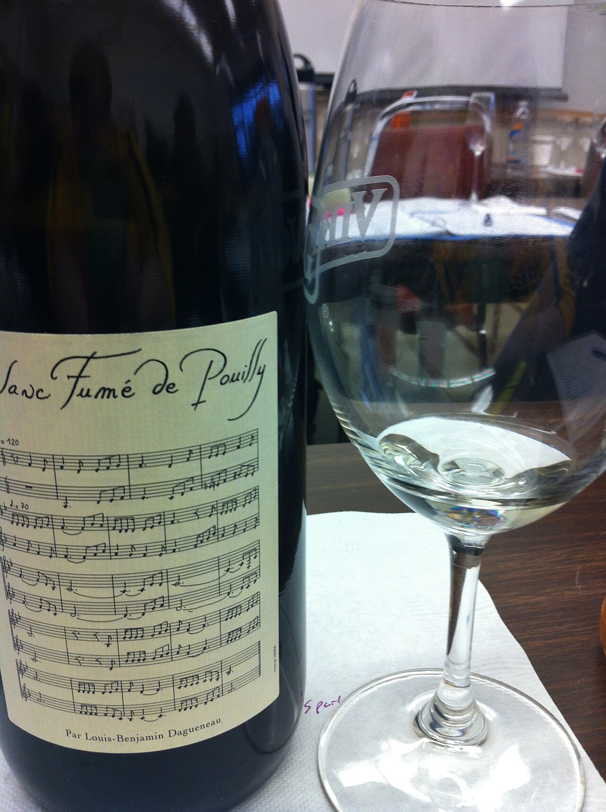

# Pouilly-Fumé

Pouilly-Fumé is a dry [Sauvignon Blanc](ref:sauvignon-blanc) [white wine](ref:white-wine) appellation in the Centre-Loire part of the [Loire](ref:loire) Valley in [France](ref:france), on the right bank opposite [Sancerre](ref:sancerre). It is known for citrus, grass and gunflint notes, typically 750 mL at 12%–13.5% [alcohol](ref:abv).

Figure: Pouilly-Fumé. Image: Agne27, CC BY-SA 3.0, via Wikimedia Commons ([source page](https://commons.wikimedia.org/wiki/File:Dageneau_Pouilly_Fume.JPG)).

## Seven villages and 1,424 hectares on the right bank

The legal area contains just seven communes: Garchy, Mesves-sur-Loire, Pouilly-sur-Loire, Saint-Andelain, Saint-Laurent-l'Abbaye, Saint-Martin-sur-Nohain and Tracy-sur-Loire. The five-year average planted area is about 1,424 ha, with 131 producers and average output of 76,219 hl, roughly 9.8 million bottles. It is a long strip along the river rather than a compact circle, and the soil differences between villages explain more about a bottle than the name Pouilly-Fumé on its own.

## Delimited in 1929, awarded the AOC in 1937

The modern history has two steps: the legal boundary was drawn in 1929, and AOC status followed in 1937. That pre-war delimitation separated Pouilly from Sancerre across the river, and split Chasselas-based Pouilly-sur-Loire from Sauvignon-based Pouilly-Fumé into two appellations. A label that says only "Pouilly" does not legally exist; it must read Pouilly-Fumé or Pouilly-sur-Loire.

## Silex: the physical origin of the gunflint note

"Fumé" is often translated as "smoky", but its original sense is the faint grey bloom on ripe grapes, which looks like a thin smoke from a distance. The gunflint note in the wine comes from silex, a silica-rich flint mixed into clay and found on the high points of Saint-Andelain, Saint-Laurent and Tracy. Silex warms quickly by day and cools at night, ripening grapes early; the soil is poor, acidic and almost calcium-free, forcing deep roots. The wines are sharper and more mineral, with wet stone and gunpowder aromas.

## Kimmeridgian marl and the "white earth"

The counterweight to silex is Kimmeridgian marl, locally "terres blanches". This is a deep-sea sediment full of fossil oysters, compact, water-retentive and cool, ripening later than silex. It gives rounder, broader wines, with citrus and white flowers and a saline rather than flinty minerality. Two limestone types complete the picture: calcaires de Villiers in the east, locally called caillottes, stony and free-draining, and calcaires du Barrois in the west, with larger stones. Four soils together make the whole appellation.

## West-facing slopes and the river as thermostat

Most vineyards face west, so they catch the longer afternoon sun and ripen more slowly and evenly; the Loire acts as a thermostat, softening spring frost and summer extremes. Centre-Loire is temperate-continental, with 600–800 mm of rain and altitudes of 100–380 m, ranging from about -1 °C in winter to 26 °C in summer. The price of a west-facing slope is higher autumn rain risk, which is why picking dates often decide a vintage more than winemaking does.

## Two expressions of Sauvignon Blanc

Pouilly-Fumé can take two paths. The first is cool fermentation in stainless steel, preserving grass, grapefruit, blackcurrant bud and gunflint, with a light body and high acid, for drinking within two to four years. The second is fermentation and lees ageing in old oak or large casks, adding texture and breadth, shifting the aroma from citrus to yellow peach, beeswax and salted butter, and extending the drinking window to eight or ten years. In both cases the [grapes](ref:grape) undergo cool [fermentation](ref:fermentation), and the second path includes [oak ageing](ref:oak-ageing). New small barrels are not the norm here because they would mask the silex; that is exactly where the "smoky oak" myth breaks down.

## A river apart from Sancerre

[Sancerre](ref:sancerre) is on the left bank, mainly on caillottes limestone, and gives a tighter, more aromatic wine of citrus and white flowers. Pouilly-Fumé is on the right bank, with more silex, a more mineral, flinty profile and a broader palate. Both use Sauvignon Blanc and their prices are close, but Pouilly-Fumé produces roughly a third of Sancerre's volume and has a stronger single-site culture. In a blind tasting, Sancerre often shows aroma first and Pouilly-Fumé shows stone and salt first.

## Pouilly-Fumé versus Pouilly-Fuissé

This is one of the most common errors on wine lists. Pouilly-Fuissé is in the Mâconnais in Burgundy, made from [Chardonnay](ref:chardonnay), full-bodied with hazelnut and cream. Pouilly-Fumé is in the Loire, made from Sauvignon Blanc, light, high in acid and flinty. The names differ by a few letters; the regions are hundreds of kilometres apart. Another easy confusion is Pouilly-sur-Loire, from the same village but made from Chasselas: lighter, simpler and cheaper.

## Estates and bottles: Dagueneau and Ladoucette

Domaine Didier Dagueneau is the appellation's legend, with Les Monts Damnés and "Silex" pushing low yields and flint to the limit, and prices with them; Domaine de Ladoucette's Château du Nozet is the historic estate, more classical and broader; Michel Redde et Fils's La Moynerie is a reliable mid-point; Henri Bourgeois's La Bourgeoisie and Alain Cailbourdin's Les Cris are also benchmarks. Négociants and cooperatives exist here too, so the bottler line is worth checking.

## What Pouilly-Fumé bottles cost

In French retail in 2026, allowing for vintage, channel and scores, entry-level bottles sit around €16–25, village or single-site wines €28–45, and names such as Dagueneau mostly €80–150. The upward pressure comes less from land than from low yields and collector demand; ordinary bottles have risen only modestly over the past decade. Around €20 is enough to find a clear gunflint signature.

## Oysters, goat cheese and asparagus

High acidity and minerality make Pouilly-Fumé a natural match for oysters, clams, steamed fish and goat cheese, especially Crottin de Chavignol. Asparagus is a classic: the wine's green notes echo the vegetable's sulfur compounds, though asparagus with cream sauce calls for an oaked version. It follows much the same pairing logic as Sancerre, but its broader texture handles buttered white fish better. Avoid very spicy, sweet or heavily spiced dishes, which reduce the minerality to "sour water". Serve at 10–12 °C; too cold and the aroma shuts down.

## "Fumé" does not mean oak smoke

The most common misconception is that "Fumé" denotes oak smoke, and therefore that every Pouilly-Fumé should smell of toast and vanilla. The opposite is true: fumé refers to the bloom on the grape skin, and the smoky mineral note comes from silex, not new barrels. A second myth is that Pouilly-Fumé is simply a copy of Sancerre; the soils and production structure differ. A third is that it must be aged; most bottles are at their best three to five years after bottling.

For Pouilly-Fumé, begin with the base and the stated strength. Then look at the sweetness or bitterness, and finally ask how it is served. The answers point to different choices, not to a single score.

[White wine](ref:white-wine) and [Loire Valley](ref:loire) answer different questions about Pouilly-Fumé: style and region and vintage. Read them as a pair, not as alternatives.

Production is split 54% for the domestic market and 46% for export.
