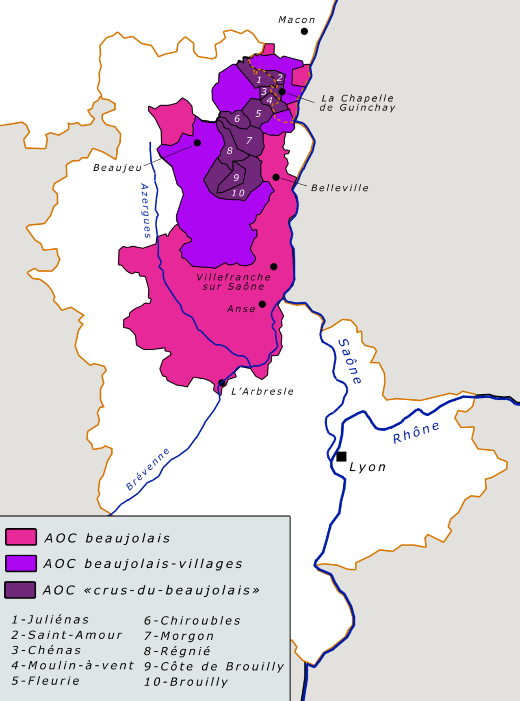

# Régnié

On the list of the ten Beaujolais crus, Régnié is often the name read last. It only gained village cru status in 1988 and is the youngest entry on the list; precisely because its record is short, it has long sat at lower prices and lower visibility on wine lists. But "young" describes institutional history, not the quality of the wine.

Figure: Régnié. Image: Cyril5555, CC BY-SA 3.0, via Wikimedia Commons ([source page](https://commons.wikimedia.org/wiki/File:Carte_vignoble_beaujolais.png)).

## 1988: the youngest name on the list

Before 1988 the wines of Régnié could only be sold under a broader Beaujolais name; after approval the village had its own village-level AOC. Inside the village there is no premier or grand cru tier: all parcels sit in the same village framework, and quality still depends on slope position, estate and vintage.

The practical consequence of that history is market perception: at similar quality, Régnié is usually less famous and less expensive than established crus such as [Morgon](ref:morgon). For buyers this is an opportunity; for those who read only famous names, it is easy to miss. The official delimitation governs the boundaries.

## The granite slopes of Régnié-Durette

Régnié lies in northern Beaujolais in [France](ref:france), with vineyards on the slopes around Régnié-Durette. The soils are mostly weathered granite sand, with some parcels containing schist; they drain well and are low in fertility, so the roots are forced deep and the bunches are usually small.

Aspect and altitude refine the picture further: south-facing parcels see enough sun and ripen more fully, while top-slope and shaded parcels keep more acidity. The raw material is [grape](ref:grape), of the [Gamay](ref:gamay) variety, thin-skinned and high in acidity, showing red cherry, raspberry and flowers on granite, with fine tannin and a light-to-medium body.

## Sharing the ridge with Morgon

Régnié borders Morgon, and the two villages share the same mass of hills, differing only in slope position and parcel ownership. The famous Morgon sites are known for a fuller, deeper style that needs ageing; Régnié lies more often at the foot and mid-slope, usually with a lighter body and more direct fruit.

This "same hill, different wine" relationship is often used to explain Régnié's value: it is close to Morgon without Morgon's fame or price. Do not judge it against Morgon's standard of weight; judge whether the fruit is clean, the acidity upright and the finish sharp.

## Between Brouilly and Morgon

On the Beaujolais style spectrum, Régnié is often placed between the directness of Brouilly and the weight of Morgon: a little more structure than Brouilly, a little less weight than Morgon. It is neither a "little Morgon" nor "another Brouilly", but a middle route between the two.

Compared with other [Beaujolais](ref:beaujolais) crus, Régnié is recognised less for intensity than for proportion: fruit, acidity and tannin are fairly balanced, with no single element dominating. That balance makes it easy to pair with food, and also makes it less eye-catching in competitions and on wine lists.

## How light extraction keeps the fruit

Régnié often uses whole clusters, and some estates use semi-carbonic maceration: whole grapes first ferment inside the berry in a carbon-dioxide-filled vessel before pressing and a conventional [fermentation](ref:fermentation). This route brings direct fruit and lighter tannin, matching the village's lighter frame.

Estates that want more structure extend maceration and extract more; most wines still use medium maceration so the fruit is not pressed into tannin. Some go into [oak](ref:oak-ageing) with a very low share of new barrels. The bottler line is worth checking: under one village name, estate wine and merchant wine can differ clearly in concentration.

## In the glass: red fruit, flowers and fine tannin

Typical aromas are red cherry, raspberry, strawberry, violet and peony, with some wines showing minerality. The palate has clear acidity, fine tannin and a light-to-medium body, a supple texture and a red-fruit finish.

The structure of [red wine](ref:red-wine) rests here on acidity and fruit rather than heavy tannin. Serve at about 14–16 degrees Celsius in a tulip-shaped or Burgundy glass; young wines can be lightly chilled and need no long decanting. Smell for fruit first and flowers second, since excessive oak would cover the lightness.

## Cool years and warm years: two wines

In cool years, Régnié acidity stands out, the red fruit leans towards sour cherry, the body is thinner and the wine suits early drinking. In warm years, the fruit moves towards strawberry and ripe raspberry, the alcohol is a little higher and the tannin more visible, though it still does not become a heavy type.

Vintage judgement does not need scores: look at alcohol, at whether the fruit is bright or ripe, and at whether the finish is clean. The same village name can be two different wines in a cool and a warm year, and slope differences enlarge that gap again.

## Temperature, pairing and drinking window

Serve at about 14–16 degrees Celsius. It suits poultry, roast pork, charcuterie, mushrooms and soft cheese; the light body also works with salads and light seafood. Avoid very hot or sharply acidic dishes, which cover the fruit.

Most wines are for drinking within 3–8 years, and the exact window depends on vintage, slope position and estate. After opening, refrigerate and finish within a few days. Excessive drinking harms health and minors should not drink.

## Price band and buying: pricing the youngest cru

Régnié usually sits in the lower-middle price range of the Beaujolais crus: dearer than ordinary Beaujolais, but generally below more famous villages such as Morgon and Fleurie. Price depends mainly on parcel, estate and vintage, and no figure is given here. The common volume is 750 mL, with [alcohol by volume](ref:abv) at about 12.5%–13.5% vol, varying by vintage and estate.

When buying, first confirm that the cru name stands alone on the label, then check whether the bottler is the estate itself; if the label also stresses being "close to Morgon", treat it as a location note rather than a quality promise. Keep unopened bottles away from light, lying flat at 12–15 degrees Celsius; after opening, use a vacuum or inert gas and refrigerate.

## Four easily misread points

First, assuming a new cru means lower quality. Régnié gained cru status only in 1988, but its style is close to neighbouring established crus, and the usual difference is fame rather than quality.

Second, treating Régnié as Beaujolais Nouveau. It is a separate village cru, not an easy wine for the year of release.

Third, thinking a light wine cannot age. Some parcels can keep for several years, but the cru is still mostly for early drinking.

Fourth, confusing Régnié with Morgon. The two villages are neighbours sharing one hill, but Régnié is usually lighter with more direct fruit, while Morgon is fuller and needs more ageing.

For Régnié, a common mistake is judging authenticity by price or packaging alone. Channel, cru name, bottler and importer information are more reliable.

**At a glance:** A Beaujolais village cru approved only in 1988 and the youngest of the ten; granite slopes around Régnié-Durette give red fruit and fine tannin, usually at a more affordable level than Morgon, commonly 750 mL at about 12.5%–13.5% vol.
