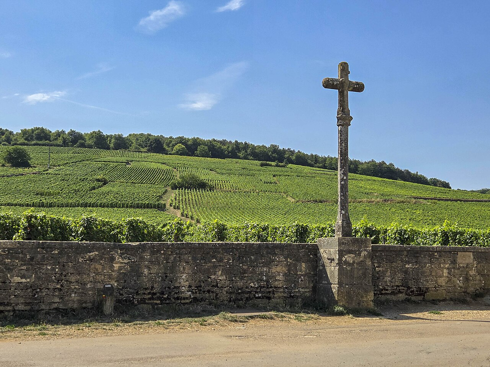

# Romanée-Conti

Romanée-Conti is a grand cru in the Vosne-Romanée commune of the Côte de Nuits, Burgundy, France, owned as a monopole by Domaine de la Romanée-Conti (DRC). The vineyard covers 1.8140 hectares and is planted entirely to Pinot Noir. The name refers at once to the vineyard, to the estate's most famous wine, and to the domaine whose abbreviated name it helps form.

Figure: Romanée-Conti. Image: Wikipedro, CC BY-SA 4.0, via Wikimedia Commons ([source page](https://commons.wikimedia.org/wiki/File:Vosne-Roman%C3%A9e,_le_Domaine_de_la_Roman%C3%A9e-Conti.jpg)).

## Definition and identity

In the Burgundy hierarchy, grand cru sits above village and premier cru levels and represents the highest category of legally defined land. Romanée-Conti is a monopole: the whole vineyard belongs to one owner, so only DRC can produce a wine named after it. Monopole does not mean "the best", but in legal and brand terms it excludes other producers from the same name.

Three concepts need separating: the Romanée-Conti vineyard, the Domaine de la Romanée-Conti, and the estate's other grand cru wines. DRC also holds La Tâche, Richebourg, Romanée-Saint-Vivant, Grands-Échézeaux, Échézeaux and Montrachet. Using "Conti" as a shorthand for every DRC wine is a common simplification.

## History

The Romanée-Conti vineyard was associated in the eighteenth century with the Prince de Conti, from whom the name derives. After the French Revolution, church and aristocratic estates were redistributed, and ownership changed several times. From the nineteenth century the tiny parcel was gradually consolidated among the families that hold it today; the estate was formally assembled as DRC in the mid-twentieth century.

In the later twentieth century DRC adjusted viticulture and winemaking: reducing chemical inputs, tightening parcel management, increasing whole-cluster fermentation and moving fully to biodynamic farming in the 2000s. Production is extremely small and has long been allocated to private clients rather than sold through ordinary retail. These institutional facts matter as much as flavour in shaping its market position.

## Region and terroir

Vosne-Romanée lies in the heart of the Côte de Nuits, with gentle slopes facing south-east and soils mixing limestone, marl and clay; drainage and water retention differ between parts of the slope. Pinot Noir is highly sensitive to soil and climate: cool years retain more acidity and red-fruit aroma, while warm years give fuller body and higher alcohol. The Romanée-Conti parcel is only 1.8140 hectares, so small differences in exposure, soil and water are magnified.

The Burgundian idea of climat emphasises the specificity of a parcel rather than a simple geographic boundary. Within one village, different grand crus can produce quite different wines. "Burgundy Pinot Noir" is therefore not a substitute for the specific site. Understanding Romanée-Conti means reading region, parcel, vintage and estate practice together.

## Process and ageing

DRC's red wines are Pinot Noir based, generally with a high proportion of whole-cluster fermentation, and with oak and new-barrel proportions adjusted each year. [Oak ageing](ref:oak-ageing) adds spice, toast and structure, but the aim is integration rather than oak dominance. Fermentation and maceration time, temperature and punch-down or pump-over choices all affect tannin and aroma extraction.

The estate stresses low yields and strict selection, with grapes sorted several times at harvest and in the winery. Biodynamics at DRC is not "doing nothing": it is a system of compost, field preparations, lunar timing and soil management that still requires ordinary disease control, pruning and harvest decisions. Treating biodynamics as "natural wine" or "zero intervention" is inaccurate.

## Flavour and tasting

Young Romanée-Conti often shows red berries, rose petal, violet, spice and mineral notes, with fine tannin; the body is not heavy so much as layered in aroma and texture. With age, fruit moves towards dried flowers, leaf litter, mushroom, leather and earth, while spice and mineral notes become more prominent. Vintages vary greatly: some are firm and need long ageing, others open earlier.

Serve at about 15–17°C in a Burgundy glass or a large tulip glass, with a small pour to concentrate the aroma. Old wines are usually not decanted for long, to avoid losing fragile aromas; younger wines can take a short decant, but taste frequently. If there is sediment, stand the bottle upright and decant carefully so that it stays out of the glass.

## Drinking and pairing

Romanée-Conti suits poultry, veal, mushroom dishes and moderately rich red meat; the fine tannin of Burgundy Pinot Noir is easily overwhelmed by heavy sauces or excessive spice. With delicate seafood or strongly acidic dishes the body can seem thin. Given the very high price, check provenance, storage and vintage before opening, and prepare suitable glassware and temperature.

Store at constant temperature and humidity, away from light and vibration. The cork, fill level and label help establish the bottle's history. If a bottle is not finished, use inert gas or a vacuum stopper and refrigerate; old wines have a short window and are not suited to being kept over several days.

## Common misconceptions

First, calling every DRC wine "Conti". Romanée-Conti is one wine; the estate has other grand crus.
Second, equating monopole with a quality ranking. Monopole is an ownership and naming structure, not a legal quality grade.
Third, assuming small size automatically means better. The scarcity of 1.8140 hectares affects price, but flavour still depends on vintage and farming.
Fourth, treating biodynamics as "no intervention". It is a codified farming system that still involves active management.
Fifth, ignoring provenance and authenticity. Extremely high prices invite counterfeit risk, so labels, bottle numbers and transaction records need professional checking.

**In brief:** A grand cru monopole in Vosne-Romanée, Burgundy, owned by Domaine de la Romanée-Conti; 1.8140 hectares planted entirely to Pinot Noir.

**Key facts.**

| Item | Detail |
| --- | --- |
| In one line | A grand cru monopole in Vosne-Romanée, Burgundy, owned by Domaine de la Romanée-Conti; 1.8140 hectares planted entirely to Pinot Noir. |
| Style | Red wine |
| Region | France |

**Sources and limits.** The key claims about Romanée-Conti are checked against the following sources: Domaine de la Romanée-Conti (the 1.8140-hectare area, the monopole status and estate philosophy), INAO (the framework of French appellations and Burgundy grand cru), Oxford University Press (Consulted for entries on Romanée-Conti, Vosne-Romanée, Pinot Noir and Burgundy classification) and 4 sources in total. Prices, batches and status change; the body is project-written and does not reproduce source text.

## Further reading

- [Red wine](ref:red-wine): the wider category to which Romanée-Conti belongs.
- [Oak ageing](ref:oak-ageing): the key process shaping structure and aroma.
- [France](ref:france): an overview of Burgundy and the French appellation system.

Further reading: [Penfolds Grange](ref:c-extra-1).
