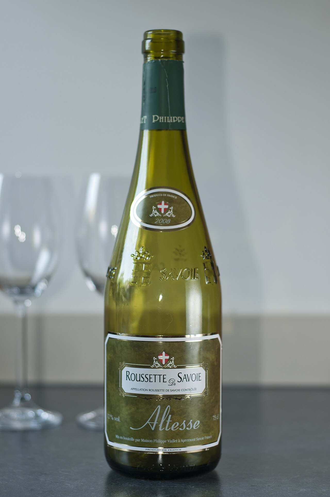

# Roussette de Savoie

Roussette de Savoie is a white-wine appellation in the [Savoie](ref:savoie) region of [France](ref:france), made from Altesse, known locally as Roussette. It includes geographical names such as Marestel, Monthoux, Monterminod and Frangy. It is commonly 750 mL at about 12.0%–13.5% [alcohol by volume](ref:abv).

Figure: Roussette de Savoie. Image: Michal Osmenda, CC BY-SA 2.0, via Wikimedia Commons ([source page](https://commons.wikimedia.org/wiki/File:Roussette_De_Savoie,_Altesse,_2008.jpg)).

## Definition and position

Start with the levels: [white wine](ref:white-wine) is the type, Altesse is the variety, Roussette de Savoie is the appellation, and specific geographical names and estates are finer levels. It sits alongside [Vin de Savoie](ref:vin-de-savoie) as a Savoie white appellation defined by its variety.

Roussette is not a separate variety but the local Savoie name for Altesse. Roussette de Savoie allows only white wine and requires Altesse, so the link between variety and style is clearer than in the regional appellation.

## Producer and brand

Family estates dominate, with cooperatives and merchants also involved. Altesse yields little and is planted on limited area, so many estates also make Jacquère, Roussanne and Altesse lines.

Producer, appellation and product are three levels: the appellation answers for rules and area, the producer answers for farming, making and bottling, and the product answers for vintage and geographical name. The same Roussette de Savoie differs clearly between villages and estates.

## Region and ingredients

Vineyards lie on slopes in Savoie and Haute-Savoie at about 250–600 metres, within the named areas of Marestel, Monthoux, Monterminod and Frangy. Soils are mainly limestone, marl and glacial deposits, well drained and low in fertility.

The raw material is [grape](ref:grape), and the only variety is Altesse. Altesse yields little and ripens mid-season; its aroma is mainly white flowers and honey, with slightly lower acidity than Jacquère but still enough structure for short-to-medium ageing.

## Winemaking

Whites usually ferment in stainless steel or old barrels, with temperature control to preserve aroma. Whether [oak](ref:oak-ageing) is used decides the direction: without oak the white flowers and minerality dominate, with old barrels or lees stirring the wine is rounder.

Altesse has moderate acidity, and estates differ on malolactic fermentation. Some wines extend lees contact to add texture. See [fermentation](ref:fermentation) for the basic process.

## Specification and label

The common volume is 750 mL, with [alcohol by volume](ref:abv) at about 12.0%–13.5% vol, varying by vintage, geographical name and estate. The label should be checked for the Roussette de Savoie name, geographical name, vintage and bottler.

A geographical name usually follows the appellation, for example Marestel or Frangy; without one the wine is a standard regional bottling. The bottle on hand governs.

## Flavour and tasting

Typical aromas are white flowers, honey, hazelnut, yellow apple and mineral notes, with some wines showing citrus and beeswax; the palate has a medium-to-full body, moderate acidity and a fairly long finish. Compared with the lean Jacquère, Roussette de Savoie has more weight and aromatic layers.

Serve at about 10–12 degrees Celsius in a tulip-shaped or Burgundy glass. Too cold masks the honey and nut notes, and too warm makes the wine feel loose.

## Drinking and pairing

It suits seafood, poultry, creamy dishes, soft cheese and dishes with nuts. The fuller body also works with medium-flavoured fish and pork dishes.

Most wines are for drinking within 4–8 years, depending on vintage, geographical name and estate. Refrigerate after opening and finish within a few days; excessive drinking harms health and minors should not drink.

## Buying and storage

For Roussette de Savoie, begin with the base and the stated strength. Then look at the sweetness or bitterness, and finally ask how it is served. The answers point to different choices, not to a single score.

For Roussette de Savoie, unopened bottles should be kept away from light, lying flat in a cool place at an ideal 12–15 degrees Celsius. After opening, use a vacuum or inert gas and refrigerate rather than warming and cooling repeatedly.

## Common misconceptions

First, treating Roussette as a separate variety. It is the local Savoie name for Altesse.
Second, treating Roussette de Savoie as a rosé. The name has nothing to do with colour, and the appellation makes only white wine.
Third, equating Roussette de Savoie with Vin de Savoie. The former is a separate variety-defined appellation.
Fourth, assuming Altesse only makes light wine. It can have a medium body and a fairly long finish.
Fifth, judging quality by price alone. Geographical name, vintage and bottling information is more specific.

Roussette de Savoie is made from Altesse, locally called Roussette; it is not the Roussanne of the Rhône. The appellation covers named sites such as Marestel, Monthoux, Monterminod and Frangy. White flowers, honey, hazelnut and mineral notes are common, and the body is fuller than Jacquère. “Roussette” can refer to the variety, the wine or a local name, so context matters.

[France](ref:france) explains style; [White wine](ref:white-wine) adds region and vintage. Put Roussette de Savoie between them before deciding what it is.

**Short definition:** A white-wine appellation in the Savoie region of France made from Altesse, known locally as Roussette, with geographical names including Marestel, Monthoux, Monterminod and Frangy; the style shows white flowers, honey, hazelnut and minerality with a fuller body than Jacquère, commonly 750 mL at about 12.0%–13.5% vol.

Roussette de Savoie is an appellation for white wines from the Roussette grape, known elsewhere as Altesse; it grows on the limestone slopes of the Savoie and gives wines with white flowers, honey, almond and a firm acidity. The appellation has four named subzones—Frangy, Marestel, Monterminod and Monthoux—and the best sites are steep and south-facing. Roussette is not the same as Roussanne, despite the similar name; Altesse is the local variety. The wines can be crisp and unoaked or richer with lees ageing, and they age better than Jacquère. A label may say Roussette de Savoie or Altesse, and the subzone name adds site information.

**Key facts.**

| Item | Detail |
| --- | --- |
| In one line | A white-wine appellation in the Savoie region of France made from Altesse, known locally as Roussette, with geographical names including Marestel, Monthoux, Monterminod and Frangy; the style shows white flowers, honey, h… |
| Style | White wine |
| Region | France、Savoie |
| ABV | 12–13.5% vol |

**Sources and limits.** The key claims about Roussette de Savoie are checked against the following sources: INAO (the area, varieties and geographical names of Roussette de Savoie), European Union (EU wine categories, geographical indications and labelling rules), Oxford University Press (Consulted for entries on Roussette de Savoie, Altesse and Savoie; Migrated from the former reference list at the end of the article; access date not re-verified). Prices, batches and status change; the body is project-written and does not reproduce source text.

## Further reading

- [Savoie](ref:savoie): the overall framework of the region to which Roussette de Savoie belongs.
- [Vin de Savoie](ref:vin-de-savoie): the broader Savoie regional appellation.
- [Chignin-Bergeron](ref:chignin-bergeron): a Savoie white geographical name made from Roussanne.
- [White wine](ref:white-wine): the category to which Roussette de Savoie belongs.
- [Grape](ref:grape): the basic structure of wine grapes and ripeness measures.
- [Fermentation](ref:fermentation) and [oak ageing](ref:oak-ageing): the basic process steps for whites.
- [Alcohol by volume](ref:abv): what 12.0%–13.5% vol means on a label.
