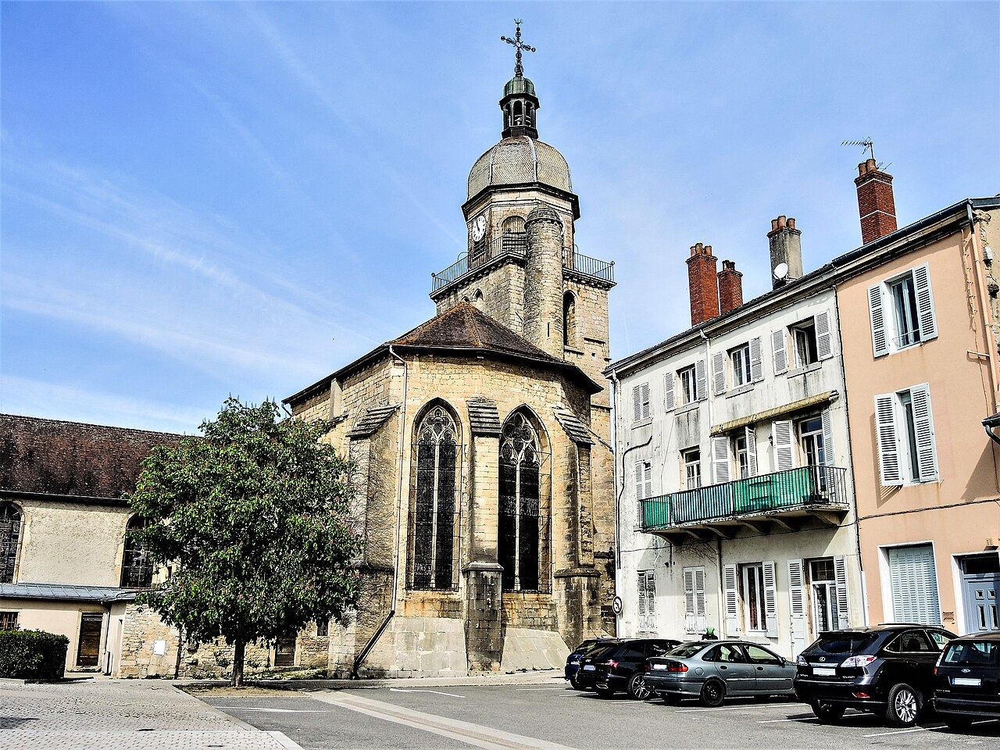

# Saint-Amour

For Saint-Amour, begin with the base and the stated strength. Then look at the sweetness or bitterness, and finally ask how it is served. The answers point to different choices, not to a single score.

Figure: Saint-Amour. Image: Espirat, CC BY-SA 4.0, via Wikimedia Commons ([source page](https://commons.wikimedia.org/wiki/File:Eglise_Saint-Amateur_et_saint-_Viateur._Saint-Amour.jpg)).

## The northernmost slope of Beaujolais

Saint-Amour sits at the northern end of the cru belt in [France](ref:france) and is the northernmost of the ten crus, with vineyards spread over the slopes around Saint-Amour-Bellevue; further north, the land gradually leaves the core of Beaujolais. The northern position brings a cooler base climate, usually a later ripening season and better acid retention, which is one reason it is often described as firmer than the southern crus.

The village has no premier or grand cru tiers, and all parcels sit inside one village-level AOC framework. The official delimitation governs the boundaries, and a line drawn on a map cannot decide them.

## One appellation across two departments

The Saint-Amour appellation spans the Saône-et-Loire and Rhône departments, which is not common among the Beaujolais crus. The parcels belong to different departments and different administrations, yet the label carries the same cru name; for the consumer, the departmental line changes nothing about style and only affects place names and administrative information.

That is also a reminder: do not judge style by department. What decides the wine is aspect, altitude and soil, not which side of the border a parcel falls on.

## Saint-Amour-Bellevue: place name and wine name

Saint-Amour-Bellevue is the official name of the village, and "Saint-Amour" is the cru name that may appear alone on the label. The "Saint" in the name comes from local religious place-name tradition and has nothing to do with Valentine's Day or romance marketing; buying it as a romantic theme makes it easy to misread and easy to overpay.

The overlap of place name and wine name is a common structure in [Beaujolais](ref:beaujolais): the village name is the appellation name, the appellation name can stand alone, and the regional "Beaujolais" name usually does not appear alongside it. The 750 mL bottle and roughly 12.5%–13.5% [alcohol](ref:abv) are a more practical identity than the Valentine imagery.

## Northern neighbours: Juliénas and Chénas

Saint-Amour borders [Juliénas](ref:julienas) and Chénas, and the three form the northernmost group of Beaujolais crus. Juliénas is usually fuller with more backbone; Chénas is lighter and more floral; Saint-Amour sits between them but shows more spice and a firmer structure.

One hillside is cut into different village names, and the differences come from slope position and winemaking rather than administrative borders. To compare these three wines, choose the same vintage and a similar price band so the differences are visible.

## Granite and schist: where the firmness comes from

The soils of Saint-Amour are mostly weathered granite sand, with some parcels containing schist and clay; they drain well and are low in fertility. Granite gives acidity and a mineral frame, while schist and clay retain water in some parcels and make ripening more even; the two together are the underlying reason it is firmer than the southern crus.

The raw material is [grape](ref:grape), of the [Gamay](ref:gamay) variety, thin-skinned and high in acidity, showing red cherry, raspberry, violet and spice on granite. Aspect and altitude refine it further: south-facing parcels ripen more fully, and parcels near the top keep more acidity.

## Gamay and the measure of whole-cluster work

Saint-Amour often uses whole clusters, and some estates use semi-carbonic maceration: whole grapes first ferment inside the berry in a carbon-dioxide-filled vessel before pressing and a conventional [fermentation](ref:fermentation). This keeps fruit and lowers tannin, but the village's own firmness means estates cannot overdo light extraction.

Fermentation temperature and maceration time decide the final outline. Extend maceration for structure or shorten it for easy drinking; some wines go into [oak](ref:oak-ageing) with a very low share of new barrels so the spice is not buried under oak. The bottler line still needs checking, since estate wine and merchant wine can differ widely.

## Firmer and spicier than the southern crus

Typical aromas are red cherry, raspberry, strawberry, violet and peony, with some wines showing pepper and liquorice-like spice and minerality. The palate has clear acidity, fine tannin and a light-to-medium body, but the finish is firmer than in many southern crus. Serve at about 14–16 degrees Celsius; most wines are for drinking within 3–8 years, and they suit poultry, roast pork and mushroom dishes.

Against Juliénas, Saint-Amour is lighter and more floral but shows more spice; against Chiroubles it has one more layer of structure and spice and is less "floating". The frame of [red wine](ref:red-wine) rests here on acidity and fine tannin rather than on alcoholic weight.

## Cool years and warm years: firmness and spice at the north

In cool years, Saint-Amour acidity is sharper, the red fruit leans towards sour cherry, the spice feels drier and the body firmer, better with food than on its own. In warm years, the fruit is riper, the spice turns sweeter and the alcohol a little higher, yet the northern position still keeps some freshness.

Vintage judgement needs no scores: look at alcohol, at whether the fruit is bright or ripe, and at whether the spice is dry or sweet. The same village name can show two different temperaments between a cool and a warm year, and slope differences enlarge that again.

## Price band and buying: the northern tier

Saint-Amour usually sits in the middle price range of the Beaujolais crus: dearer than ordinary Beaujolais, close to Juliénas and Chénas, but generally below villages known for long ageing. Price varies with parcel, estate and vintage, and no figure is given here.

When buying, first confirm that the cru name stands alone on the label, then check the bottler and the vintage; if you meet Valentine-themed packaging, treat it as packaging rather than a quality signal. Keep unopened bottles away from light, lying flat at 12–15 degrees Celsius and away from heat and sharp swings; after opening, use a vacuum or inert gas and refrigerate.

## Four misconceptions about Saint-Amour

First, treating Saint-Amour as a Valentine's Day limited edition. The name comes from the place, not from holiday marketing.

Second, assuming the northernmost cru must be the most acidic and the thinnest. Vintage and slope position vary greatly, and a warm year with a south-facing parcel can be quite full.

Third, treating Saint-Amour as Beaujolais Nouveau. It is a separate village cru, not a wine for drinking in the year of release.

Fourth, confusing Saint-Amour with Juliénas. The two villages are neighbours, but Saint-Amour is usually lighter with more visible spice, while Juliénas has more backbone.

For Saint-Amour, a common mistake is judging authenticity by price or packaging alone. Channel, cru name, bottler and importer information are more reliable.

**In brief:** The northernmost village cru of Beaujolais, its appellation spanning the Saône-et-Loire and Rhône departments; granite and schist slopes make it firmer and spicier than the southern crus, commonly 750 mL at about 12.5%–13.5% vol.
