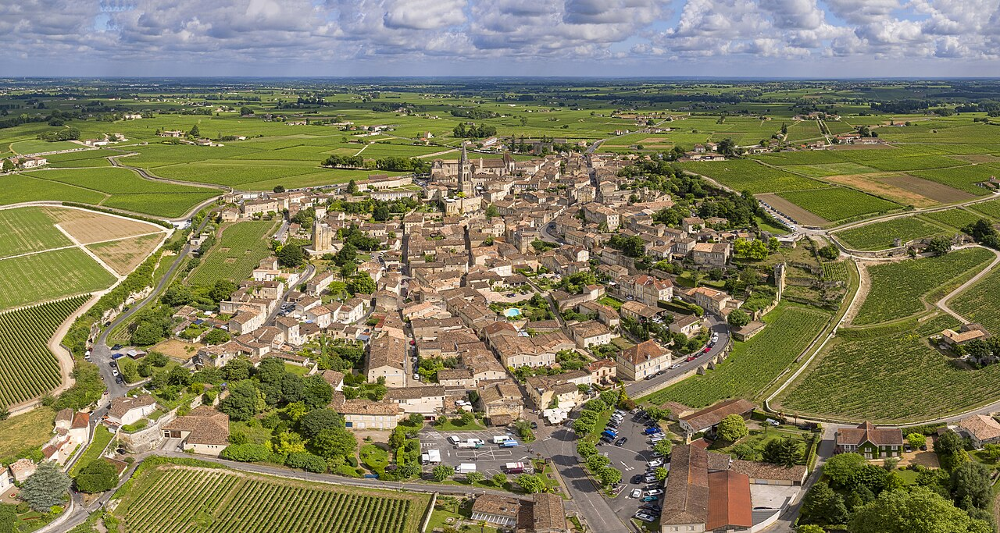

# Saint-Émilion

Saint-Émilion is a red wine appellation around the town of Saint-Émilion and neighbouring communes on the right bank of the Dordogne in [Bordeaux](ref:bordeaux), France, northeast of Libourne. It makes [red wines](ref:red-wine) based on [Merlot](ref:merlot) and often blended with [Cabernet Franc](ref:cabernet-franc), in a rounder style; commonly 750 mL at about 12.5%–13.5% vol.

Figure: Saint-Émilion. Image: Chensiyuan, CC BY-SA 4.0, via Wikimedia Commons ([source page](https://commons.wikimedia.org/wiki/File:1_Saint-%C3%89milion_aerial_pano_2016.jpg)).

## Definition and positioning

Start with the layers: [red wine](ref:red-wine) is the category, Merlot and Cabernet Franc are varieties, Saint-Émilion is the appellation (AOC), and individual estates and wines are the producer level. Saint-Émilion is both a town name and an appellation name on the label, and must not be confused with a brand.

Saint-Émilion sits on the right bank of Bordeaux, next to Pomerol and Fronsac, in a different system from the left-bank Médoc communes. It has its own estate classification, which is not the same as the 1855 Médoc classification; when comparing estates, check which classification and revision year apply.

## Producers and brands

The appellation is dominated by family estates and small properties, alongside négociants and cooperatives. Estates vary greatly in size; some own their plots and bottle their own wine, while others buy grapes or wine to blend. The bottler information on the label is the key to telling estate wine from négociant wine.

For Saint-Émilion, appellation, producer and product are three levels: the appellation answers the rules and geography, the producer answers who farms, ferments and bottles, and the product answers vintage and format. Estates within one appellation differ markedly, so one wine cannot stand for the whole area.

## Region and raw materials

Saint-Émilion lies on the right bank of [Bordeaux](ref:bordeaux) in [France](ref:france), on the right bank of the Dordogne northeast of Libourne. The climate is moderated by the ocean, mild and humid, with a long growing season, and autumn conditions shape ripeness and acidity.

Soils are mainly limestone plateau, clay-limestone slopes and gravel, with marked differences in drainage and heat retention between plots. The raw material is [grape](ref:grape), and red wine is based on [Merlot](ref:merlot), often blended with [Cabernet Franc](ref:cabernet-franc).

## Winemaking

Saint-Émilion reds are built on [fermentation](ref:fermentation), where temperature and maceration time determine extraction: gentle extraction favours supple fruit, a longer maceration gives more tannin and structure. [Oak ageing](ref:oak-ageing) follows, with the share of new barrels varying by estate and level, affecting vanilla, smoke and texture.

Specific parameters belong to individual estates, so no uniform figures are given here; refer to estate material and the bottle. Merlot has moderate tannin and ripens early, while Cabernet Franc supplies acidity and an aromatic frame, so blend proportions strongly shape the style.

## Format and labelling

The usual bottle is 750 mL at about 12.5%–13.5% vol. Check the appellation, vintage, estate name, classification, bottler and importer on the label.

For Saint-Émilion, label language varies by market, so the bottle itself is the reference. An appellation name is not a quality grade, and estates and vintages within one appellation differ widely, so buy on specific information.

## Flavour and tasting

Saint-Émilion shows plum, black cherry, chocolate, liquorice and earth, with medium-soft tannin, clear acidity and a medium-full body. With age it develops leather, tobacco and woodland notes as the structure softens.

Compared with the left-bank Médoc, Saint-Émilion is usually rounder with more forward fruit. Serve at about 16–18 °C, decanting firmly structured vintages in advance. Look for layers of fruit and earth.

## Drinking and pairing

Saint-Émilion suits red meat, poultry, mushrooms and medium-bodied stews; the rounder style also suits soft cheese and dishes with spice. Pair by acidity and tannin rather than a fixed list.

Most wines suit drinking within 5–15 years, and top vintages can go longer; the window varies by vintage and estate. Decanting can help; reseal and refrigerate leftovers and drink soon. Excessive drinking is harmful to health, and minors should not drink.

## Buying and storage

Buy from reputable channels and check the appellation, vintage, estate name and bottler. Prices vary widely with estate classification, vintage and reputation, so no figures are given here. An appellation name and packaging cannot replace knowing the estate and vintage.

For Saint-Émilion, store unopened bottles away from light, lying down in a cool place at about 12–15 °C, avoiding heat and sharp temperature swings. Keep the cork moist; lie bottles down for long storage. After opening, reseal, refrigerate and drink within a few days.

## Common misconceptions

First, confusing the Saint-Émilion classification with the 1855 Médoc classification. They are different systems.
Second, assuming Saint-Émilion is made only from Merlot. Cabernet Franc plays an important part in the blends.
Third, treating earthy notes as a fault. Moderate earth and woodland notes are typical of the appellation.
Fourth, assuming a classification never changes. The Saint-Émilion classification is revised periodically.
Fifth, judging authenticity by price or packaging. Channel, back label and bottler information are more reliable.

To read Saint-Émilion, start with the base and the stated strength, then the sweetness or bitterness, then how it is served; no single check settles it.

**Short definition:** A red wine appellation around the town of Saint-Émilion and neighbouring communes on the right bank of the Dordogne in Bordeaux, France, northeast of Libourne; based on Merlot and often blended with Cabernet Franc, rounder in style, with plum, black cherry, chocolate and earth notes, and its own classification system, commonly 750 mL at about 12.5%–13.5% vol.

Saint-Émilion is a right-bank Bordeaux appellation based on Merlot with Cabernet Franc; its classification is revised roughly every decade, unlike the fixed 1855 list.

**Key facts.**

| Item | Detail |
| --- | --- |
| In one line | A red wine appellation around the town of Saint-Émilion and neighbouring communes on the right bank of the Dordogne in Bordeaux, France, northeast of Libourne; based on Merlot and often blended with Cabernet Franc, round… |
| Style | Red wine |
| Region | France、Bordeaux |
| ABV | 12.5–13.5% vol |

**Sources and limits.** The key claims about Saint-Émilion are checked against the following sources: INAO (Used to check the appellation area, varieties and red wine rules), CIVB (Used to check the soils, style and classification system of Saint-Émilion), Oxford University Press (Consulted for entries on Saint-Émilion and Merlot). Prices, batches and status change; the body is project-written and does not reproduce source text.

## Further reading

- [Red wine](ref:red-wine): the category Saint-Émilion belongs to.
- [Merlot](ref:merlot): the main variety in Saint-Émilion blends.
- [Cabernet Franc](ref:cabernet-franc): the variety that adds acidity and aroma in Saint-Émilion blends.
- [Bordeaux](ref:bordeaux): the region and classification framework around Saint-Émilion.
- [France](ref:france): French wine law and appellations.
- [Grape](ref:grape): the basic structure of wine grapes and ripeness measures.
- [Fermentation](ref:fermentation): the logic of maceration and extraction.
- [Oak ageing](ref:oak-ageing): one source of spice and texture.
- [Alcohol by volume](ref:abv): what 12.5%–13.5% vol means on a label.
