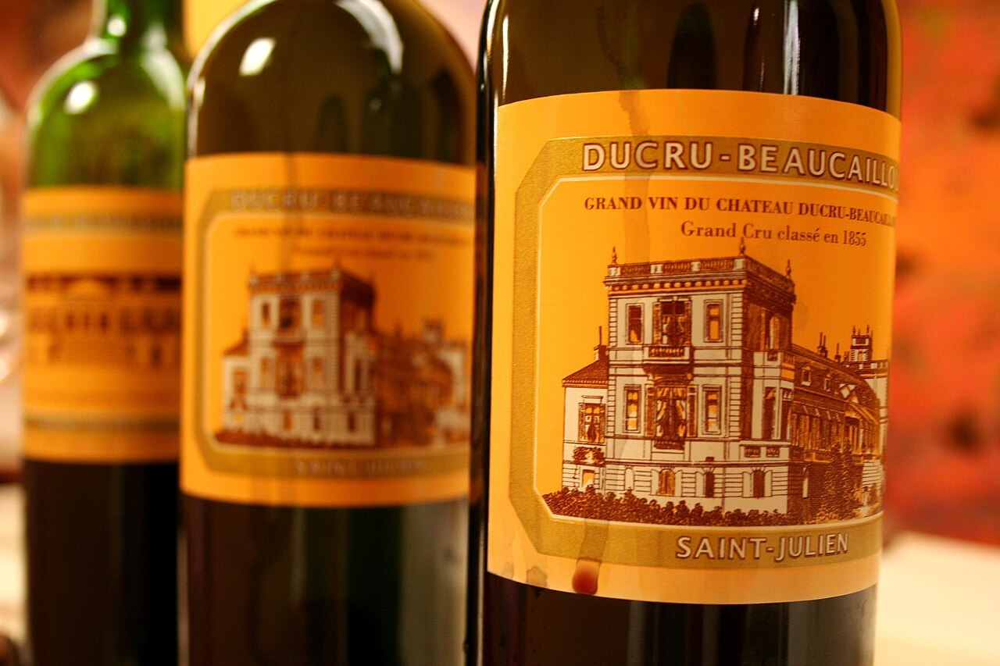

# Saint-Julien

Saint-Julien has about 910 hectares of AOC vineyard, all within the 16.3 km² commune of Saint-Julien-Beychevelle plus a few enclaves — the smallest of the four great Médoc communes. It has no first growth, yet it holds 11 classified growths from the 1855 list, and those estates produce about three-quarters of the appellation's wine. Small, without a first growth, yet densely classified: that combination is what separates it from Pauillac and Margaux. The appellation belongs to [France](ref:france), in [Bordeaux](ref:bordeaux), was recognised on 14 November 1936, makes [red wine](ref:red-wine) only, and is based on [Cabernet Sauvignon](ref:cabernet-sauvignon).

Figure: Saint-Julien. Photograph: Chateau Ducru Beaucaillou, Saint Julien bottles. Credit: Megan Mallen, CC BY 2.0, via Wikimedia Commons ([source](https://commons.wikimedia.org/w/index.php?curid=13268382)).

## 910 hectares: the smallest of the four great communes

The commune of Saint-Julien-Beychevelle covers 3,017 hectares in total, of which 100 hectares are marsh and 388 hectares pasture, with about 910 hectares of AOC vines; land rises from sea level to 28 metres. Put together, these figures show that vines occupy only around a third of the commune, with estuary wetland, grazing and woodland making up the rest. Wine-Searcher gives a slightly different figure of about 900 hectares; the difference reflects statistical scope and parcel updates, but the order of magnitude is the same.

## A 500-metre blank strip along the estuary

Saint-Julien is almost "planted from edge to edge", with one exception: a strip roughly 500 metres wide on the silted bank of the Gironde estuary. It is not that vines cannot grow there, but that the riverside alluvium is too fine and too wet, ripening on a different rhythm from the gravel croupes. The vineyard is therefore pressed onto a north–south gravel ridge, with water to the east and Saint-Laurent to the west — wine from the latter may only be labelled Haut-Médoc, not Saint-Julien. An administrative line separates two price levels.

## 14 November 1936 and three neighbouring communes

The Saint-Julien AOC was established by the decree of 14 November 1936. Its legal area is based on Saint-Julien-Beychevelle but also includes specific parcels listed in annexe 1 in Cussac-Fort-Médoc, Pauillac and Saint-Laurent-Médoc. A bottle labelled Saint-Julien therefore need not draw all its fruit from the village of the same name; if an estate is not in Saint-Julien, do not assume it is fake.

## How the Mouline valley splits two gravel ridges

The commune is cut by several small valleys: the marsh of the Beychevelle hamlet to the south, the Juillac valley to the north-east, the Riou Cla valley to the south-west, and the central Mouline valley, which separates the Beychevelle gravel ridge from the Saint-Julien ridge. The valley floors carry colluvium and finer soils; the ridges carry Quaternary "faciès à galets" — a mix of sand, gravel and often large quartz pebbles — over Oligocene limestone, marl and clay. Topography divides the vineyard into ridge-top and slope-foot parcels, with different drainage and ripening speeds.

## Eleven classified growths, no first growth

The 1855 list left Saint-Julien with 11 classified growths: five second growths (Léoville-Las Cases, Léoville-Poyferré, Léoville-Barton, Gruaud-Larose and Ducru-Beaucaillou), two third growths (Lagrange and Langoa-Barton) and four fourth growths (Beychevelle, Branaire-Druc, Talbot and Saint-Pierre). There is no first growth and no fifth growth. The three Léovilles were originally one estate, divided in the nineteenth century — which explains why one commune contains three closely related names at three price levels.

## Beyond 57/63 hl/ha: planting at 8,300–10,000 vines

The permitted varieties are Cabernet Sauvignon, [Merlot](ref:merlot), [Cabernet Franc](ref:cabernet-franc), Carmenère, Malbec (Cot) and Petit Verdot, which may be blended in any proportion. Yields work on two levels: 57 hl/ha as the base and 63 hl/ha as the ceiling (60 hl/ha in some row-spacing configurations). Planting density must be at least 7,000 vines per hectare, row spacing no more than 1.50 m and in-row spacing at least 0.80 m; the maximum load is 9,500 kg per hectare. Minimum natural [alcohol by volume](ref:abv) is 11%, with minimum sugar of 189 g/L for Merlot and 180 g/L for other varieties; wine must be aged until at least 1 June of the year after harvest and released from 1 September. The legal density is only a floor: Beychevelle plants 8,300–10,000 vines per hectare, above the threshold, which helps explain why its fruit stays small and its tannin fine.

## Beychevelle's two Pleistocene terraces

Beychevelle is a useful sample of Saint-Julien's soils: a 250-hectare property with 90 hectares of [grape](ref:grape) vines; two Pleistocene Garonne gravel terraces, with gravel and sand mixed and draining freely; an average vine age of 38 years and a density of 8,300–10,000 vines per hectare; and a varietal mix of 57% Cabernet Sauvignon, 40% Merlot and 3% Petit Verdot. That mix shows Saint-Julien is not a "pure Cabernet" appellation: Merlot at 40% is exactly the material basis for wines that are softer earlier than Pauillac yet firmer than Margaux.

## Fermentation and oak: the other side of consistency

Saint-Julien estates generally use temperature-controlled [fermentation](ref:fermentation), where maceration length governs tannin extraction; [oak ageing](ref:oak-ageing) follows, with new-barrel proportions ranging from about a third to nearly 100%. Because the gravel is uniform and the fruit ripens evenly, winemaking choices here tend to be conservative: less aggressive extraction, letting the structure speak for itself. Too much oak will still bury blackcurrant and cedar, exactly as in Margaux or Pauillac.

## Softer than Pauillac, firmer than Margaux

Decanter's Jane Anson records a precise description: Saint-Julien's gravel is the most uniform and orderly in the Médoc, with only a border of clay at the entrance to the appellation. Uniform gravel means Cabernet Sauvignon ripens at a consistent pace, so tannin is neither partly overripe nor partly green; the clay border adds a little water-holding capacity and limits drought stress. By contrast, Pauillac's gravel is deeper and more continuous, with more Cabernet Sauvignon and a fuller body; Margaux's soils carry more clay, sand and riverside silt, with more Merlot and more forward aroma. Saint-Julien sits between the two — not out of compromise, but because of the stability that geological uniformity brings.

## From $97 to $308: the classified price ladder

Wine-Searcher's November 2026 international averages for 750 ml bottles: Château Talbot about $97, Beychevelle about $123, Léoville-Poyferré about $130, Léoville-Barton about $134, Gruaud-Larose about $144, Ducru-Beaucaillou about $285 and Léoville-Las Cases about $308. Unclassified Saint-Julien commonly trades at $35–70. Prices move with vintage, scores, channel and exchange rates; the figures above are only an order of magnitude.

## Correcting "no first growth means cheaper"

No first growth does not mean no top wine. Saint-Julien's 11 classified growths account for about three-quarters of the appellation's output, and the international averages for Léoville-Las Cases and Ducru-Beaucaillou reach the upper range of many second growths; "no first growth" is a historical outcome of the 1855 list, not a verdict on quality. A second misunderstanding treats Saint-Julien as a cheaper substitute for Pauillac: its gravel is more uniform and its Merlot share higher, so its style is naturally softer and earlier-drinking. The two are not expensive and cheap versions of the same thing.

## Temperature, decanting and pairing

Serve Saint-Julien at 16–18 °C; decant young wines for about an hour, longer for firmly structured vintages, and shorten decanting for older bottles. Red meat, poultry, mushrooms and medium-bodied stews all work, while more structured wines suit grilled meat and hard cheese. Reseal and refrigerate leftovers and drink within a few days; excessive drinking is harmful to health, and minors should not drink.

**Short definition:** A communal red wine appellation in central Médoc, Bordeaux, France, recognised on 14 November 1936, with about 910 hectares of vines and 11 classified growths in the 1855 classification (five second, two third and four fourth growths, no first growth); its gravel is the most uniform in the Médoc, with a 57 hl/ha base yield and 11% minimum natural alcohol.

The appellation decree is dated 2011 (décret n°2011-1624).

Alcohol by volume is typically 12.5–13.5%.
