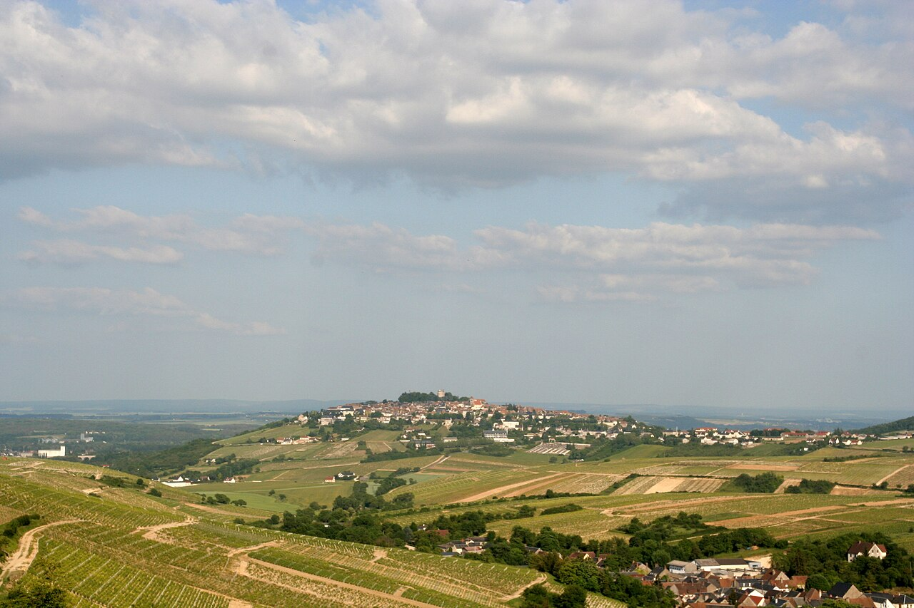

# Sancerre

Sancerre is an appellation in the upper Loire, France, whose white wines are made from Sauvignon Blanc and known for citrus, cut grass, gooseberry and flinty minerality; the area also makes a small amount of red wine from Pinot Noir. It is commonly 750 mL at about 12.5%–13.5% vol.

Figure: Sancerre. Image: Wikimedia Commons contributor, CC BY-SA 3.0, via Wikimedia Commons ([source page](https://commons.wikimedia.org/wiki/File:Sancerre_france.jpg)).

## Definition and position

Start by separating the levels: [white wine](ref:white-wine) is the category, Sauvignon Blanc is the variety, the Loire is the region, Sancerre is the appellation (AOC), and estates and individual wines are the producer level. Sancerre is not a brand, and it is not a variety name.

Sancerre and neighbouring Pouilly-Fumé are often discussed together: both are based on Sauvignon Blanc, but their delimited areas and soil mixes differ. Sancerre also makes red wine, a point often missed by drinkers who only know its whites.

## Producer and brand

The area has family estates, cooperatives and merchants of widely different scale. The estate name, bottler and village on the label are the basis for identity; Sancerre has no Burgundy-style hierarchy, so village and site names are more style clues than formal tiers.

Common villages include Sancerre, Chavignol, Bué, Ménétréol and Verdigny. Differences in aspect and soil within one village show up in aroma and minerality.

## Region and ingredients

The appellation lies in the upper Loire in central [France](ref:france), in the Cher department around the town of Sancerre, with vineyards on rolling hillsides. The climate is cool, influenced by both continental and Atlantic air, with a long growing season and autumn rain as the main harvest variable.

Soil is central to the Sancerre style: Kimmeridgian marl (known locally as caillottes and terres blanches) brings tightness and minerality, while flint (silex) gives a more pronounced gunflint note. The raw material is [grape](ref:grape), with [Sauvignon Blanc](ref:sauvignon-blanc) for the whites and [Pinot Noir](ref:pinot-noir) for the reds.

## Winemaking

Whites are usually pressed directly and fermented cool, mostly in stainless steel to preserve citrus and grassy aromas; some estates use old barrels or lees contact for texture and complexity. Malolactic conversion varies by estate.

Reds follow the Pinot Noir method with a short maceration, pale colour and fine tannin, aiming for light, approachable wine rather than long cellaring. For the whites, [fermentation](ref:fermentation) temperature and lees contact are the key variables shaping style.

## Specification and label

The common volume is 750 mL, with [alcohol by volume](ref:abv) at about 12.5%–13.5% vol, varying with vintage and estate. The label should be checked for the name Sancerre, vintage, estate name, bottler, net volume and importer information; reds usually state Rouge or are distinguishable by colour.

The Chinese back label and importer information are the entry point for checking identity. Label languages differ by market, so the bottle on hand governs; products described as "Sancerre style" outside the area are not appellation wine.

## Flavour and tasting

Typical white aromas are lemon, grapefruit, cut grass, blackcurrant bud and flint, with high acidity, a light to medium body and a mineral finish. Reds show red cherry, raspberry and herbs, with a light body and fine tannin, best served slightly cool.

Compared with New Zealand Sauvignon Blanc such as [Cloudy Bay](ref:cloudy-bay), Sancerre is usually more restrained, sharper in acidity and more citrus than passion fruit. Serve whites at about 8–11 degrees Celsius and reds at about 14–16.

## Drinking and pairing

Whites pair well with goat cheese, steamed fish, shellfish, asparagus and lemon-butter dishes; high acidity cuts through fat and dairy richness. Reds suit poultry, pork and charcuterie, and do not work with heavy sauces or long-braised dishes.

After opening, refrigerate and finish within two or three days. Most Sancerre is for drinking young, though good vintages and estates can be kept short term. Excessive drinking harms health and minors should not drink.

## Buying and storage

Buy from reputable channels and check vintage, estate name, bottler and importer information. Prices move with vintage, estate reputation and channel, so no figure is given here; ordinary wines and famous estates belong to different levels.

For Sancerre, unopened bottles should be kept away from light, standing or lying in a cool place at an ideal 10–13 degrees Celsius, avoiding heat and sharp temperature swings. After opening, refrigerate and drink soon rather than warming and cooling repeatedly.

## Common misconceptions

First, assuming Sancerre only makes white wine. It also makes red wine from Pinot Noir.
Second, treating Sancerre and Pouilly-Fumé as the same appellation. Their areas and soils differ.
Third, assuming all Sauvignon Blanc is intensely tropical. Sancerre is more restrained and mineral.
Fourth, treating high acidity as a fault. It comes from the climate and the variety together.
Fifth, looking only at the word Sancerre and ignoring vintage, estate and bottler.

Start with the base and the stated strength. From there, consider the sweetness or bitterness, then how it is served. That is how a practical judgment about Sancerre is built.

**In brief:** An appellation in the upper Loire, France, whose white wines are made from Sauvignon Blanc and known for citrus, cut grass, gooseberry and flinty minerality, with a small amount of red wine from Pinot Noir. Commonly 750 mL at about 12.5%–13.5% vol.

Sancerre is a Loire appellation for Sauvignon Blanc, with a smaller allowance for Pinot Noir red and rosé; the best whites come from the limestone hills around the town and show flint, citrus and grass rather than tropical fruit. The appellation's soils divide into caillottes, terres blanches and marne, and the three give different textures. Sancerre is not the same as Pouilly-Fumé, though both are Sauvignon Blanc and face each other across the river; Pouilly-Fumé is on the right bank. A label that says Sancerre is usually white unless it specifies rouge or rosé.

**Key facts.**

| Item | Detail |
| --- | --- |
| In one line | An appellation in the upper Loire, France, whose white wines are made from Sauvignon Blanc and known for citrus, cut grass, gooseberry and flinty minerality, with a small amount of red wine from Pinot Noir. Commonly 750 … |
| Style | White wine、Red wine |
| Region | France |
| ABV | 12.5–13.5% vol |

**Sources and limits.** The key claims about Sancerre are checked against the following sources: Syndicat des Vins de Sancerre (Used to check the area, variety make-up and soil types of Sancerre), INAO (Used to check the production rules and labelling requirements of the appellation), Oxford University Press (Consulted for entries on Sancerre, Sauvignon Blanc and the Loire). Prices, batches and status change; the body is project-written and does not reproduce source text.

## Further reading

- [White wine](ref:white-wine): white wine categories and basic winemaking.
- [Red wine](ref:red-wine): the category Sancerre reds belong to.
- [France](ref:france): the French wine map and the AOC/AOP system.
- [Loire Valley](ref:loire): the region band and sub-region framework around Sancerre.
- [Sauvignon Blanc](ref:sauvignon-blanc): the core variety of Sancerre whites.
- [Pinot Noir](ref:pinot-noir): the variety used for Sancerre reds.
- [Cloudy Bay](ref:cloudy-bay): a New Zealand Sauvignon Blanc that contrasts with Sancerre.
- [Grape](ref:grape): the basic structure of wine grapes and ripeness measures.
- [Fermentation](ref:fermentation): the role of cool fermentation and lees contact.
- [Alcohol by volume](ref:abv): what 12.5%–13.5% vol means on a label.
