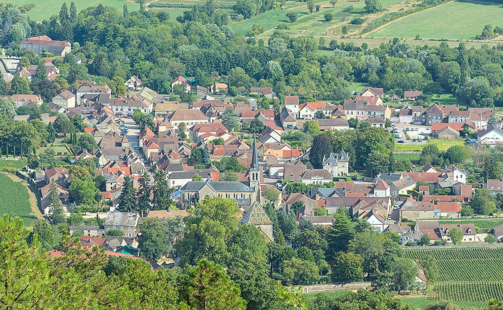

# Santenay

Santenay is the last village of the Côte de Beaune before the vineyards slide south into the Côte Chalonnaise. A windmill stands at the entrance to the village, spa buildings line the older streets, and winegrowers and cure-seekers share the same small centre. Reds are made from [Pinot Noir](ref:pinot-noir), whites from [Chardonnay](ref:chardonnay); bottles are usually 750 mL at 12.5%–13.5% [alcohol by volume](ref:abv).

Figure: Santenay. Image: Benjamin Smith, CC BY-SA 4.0, via Wikimedia Commons ([source page](https://commons.wikimedia.org/wiki/File:Santenay_-_View_from_Mont_de_S%C3%A8ne_-_1.jpg)).

## Where the Côte de Beaune ends

The appellation marks a real geographical boundary. North of Santenay lies Chassagne-Montrachet; south of it, the geology and the administrative framework change. Its vineyards occupy a slope above the Dheule, with parcels ranging from about 210 m to 450 m according to local sources. That range matters: the higher ground is cooler and later, the lower ground warmer and rounder, and the village contains both.

## One appellation, two departments

The Santenay AOC was created on 8 December 1936; BIVB's English introduction also gives 1937, a difference between the decree and its implementation. Santenay is unusual in crossing a departmental border. The AOC covers Santenay in the Côte-d'Or and Remigny in Saône-et-Loire. An administrative line runs through continuous vineyards, yet both sides may be labelled Santenay. For the consumer, the border creates no quality hierarchy: the rules are identical. For growers, land prices and taxation differ while the appellation name is shared. Understanding this prevents the mistake of reading "Remigny" as a separate appellation.

## Iron, limestone and a vertical soil profile

The slope rises from the valley to over 450 m. Grey limestone dominates the high ground; lower down, from roughly the 300 m line, come oolitic limestone, white oolite, marl, kidney-shaped limestone and lower oolite resting on marl. Most vines sit between 250 and 400 m, with exposures from east to south, which gives Santenay a favourable but not extreme ripening profile.

"Iron mixed with limestone" is the usual shorthand, and it needs unpacking. What can be verified is the vertical limestone-marl sequence; iron appears more locally, in patches of reddish-brown clay at boundaries with sandstone, rather than as a uniform red soil across the village. Treating the whole appellation as iron-rich overstates its explanatory power. The steadier variables are altitude and aspect: higher, cooler, more acidic; lower, warmer, rounder.

## How a village without grand cru is ranked

Santenay has no grand cru. Above village level there are only premiers crus, 11 climats according to BIVB's French page; the English sheet lists 12 names, the difference arising from the combined label Les Gravières-Clos de Tavannes. The absence of a grand cru does not make the village a lower tier by default: the premiers crus differ sharply among themselves, and Les Gravières and Clos de Tavannes give two quite different structures.

## Les Gravières and Clos de Tavannes

Les Gravières means "gravelly ground": a stony topsoil drains quickly and typically gives a more aromatic, suppler wine with fine tannin. Clos de Tavannes, a walled parcel in the south of the village, has deeper soil and gives more structure and longer ageing potential. La Comme, Beauregard, Grand Clos Rousseau, Clos Rousseau, Clos Faubard, Clos des Mouches, Beaurepaire, Passetemps and La Maladière add further differences of aspect and depth. On a label, the climat name carries more information than "Premier Cru".

## Yields and alcohol in the cahier

Village maximum yields are 50 hl/ha for red and 57 hl/ha for white; premier cru limits are 48 and 55, with butoir ceilings of 58/64 and 56/62. Minimum natural alcohol is 10.5% for village red and 11% for village white, rising to 11% and 11.5% for premier cru. Minimum sugar ripeness is 180 and 178 g/L at village level, and 189 and 187 g/L for premier cru. Planting density must reach 9,000 vines per hectare, with rows no wider than 1.25 m. The latest cahier des charges and BIVB data remain authoritative.

## Red at nearly eighty per cent

In 2022 Santenay had 258.32 ha of red (101.21 ha premier cru) and 72.40 ha of white (22.23 ha premier cru), producing an average of 10,198 hl red and 2,736 hl white. Red is about 78% of the surface and 79% of the volume. This explains why the village's public image is almost entirely red: white is far from negligible in absolute terms, but the narrative has been dominated by red. Pernand is close to half white, Savigny about 14%; Santenay sits in between, tilted firmly to red.

## Jessiaume and the Gravières benchmark

Domaine Jessiaume has been established in Santenay since 1850, one of the village's oldest family estates, and was taken over by David Murray in 2014 with substantial investment in the winery. Its Les Gravières is a useful reference for the climat: gravelly soil gives perfume and suppleness, and extraction is kept moderate. Larger operators such as Château de Santenay work alongside independent growers, and the same climat can taste very different from one cellar to another.

## Three-way comparison: Chassagne, Mercurey, Meursault

Against Chassagne-Montrachet to the north, Santenay red is firmer and more saline, with less creamy weight; its white is leaner and more mineral, not the broad Chassagne style. Against [Mercurey](ref:mercurey) to the south, Santenay is finer and higher in acidity, while Mercurey is fleshier and more direct. Against [Meursault](ref:meursault), Santenay white is obviously lighter and should not be read as a "little Meursault". The three-way comparison shows Santenay as a style with its own acid and tannin coordinates, not a mere transition zone.

## Prices

Typical European retail in 2026: €20–32 for village red, €35–55 for premier cru red; €25–35 for village white, €40–58 for premier cru white. Named climats such as Les Gravières and Clos de Tavannes can command 20%–30% more. Prices move with vintage, scores, merchant and exchange rate, so these are orders of magnitude only. Santenay usually sits one step below Chassagne and Meursault at the same level, but that reflects market heat rather than absolute quality.

## Braised veal and glazed poultry

The tannin is fine and steady, so braised veal, beef stew, roast chicken and glazed or teriyaki poultry all work; BIVB even suggests a homemade hamburger, because the wine has flesh without heaviness. The white suits fish couscous, mushroom pasta and poultry in cream sauce. For cheese, the red is paired with Brie de Meaux, Pont-l'Évêque, Reblochon and Bleu de Bresse; the white with Comté, Beaufort and goat's cheese.

## Correcting the "cheap Chassagne" myth

The most widespread misunderstanding is that Santenay is a substitute for Chassagne-Montrachet when the budget runs out. In fact it has no grand cru but 11 premiers crus, with Les Gravières and Clos de Tavannes each showing a clear identity; red is nearly 80% of the surface; and the style is firm and saline rather than broad and creamy. Treating it as a stand-in misses its real strength: structured, fairly priced red with an early drinking window.

## Spas, windmills and the wind

Santenay is both a thermal spa and a wine village; BIVB describes it as home to the nymph of water and the god of wine. The Sorine windmill is a local landmark, and the Mont de Sène and Montagne des Trois Croix give views over the whole appellation. None of this is tasting note material, but it explains why tourism and wine feed each other here: people come to take the waters and leave with bottles.

## See also

- [Red wine](ref:red-wine) and [white wine](ref:white-wine): the two categories.
- [Pinot Noir](ref:pinot-noir) and [Chardonnay](ref:chardonnay): the varieties.
- [Grape](ref:grape), [fermentation](ref:fermentation) and [oak ageing](ref:oak-ageing): material and process.
- [France](ref:france) and [Burgundy](ref:burgundy): the regional frame.
- [Alcohol by volume](ref:abv): the label term.
- [Mercurey](ref:mercurey): the Côte Chalonnaise comparison to the south.
- [Meursault](ref:meursault): the white-wine comparison to the north.

Read [Red wine](ref:red-wine) for the style side of Santenay, and [France](ref:france) for the region and vintage side. Together they locate it on a map.

The appellation records include historical data going back to 1829.
