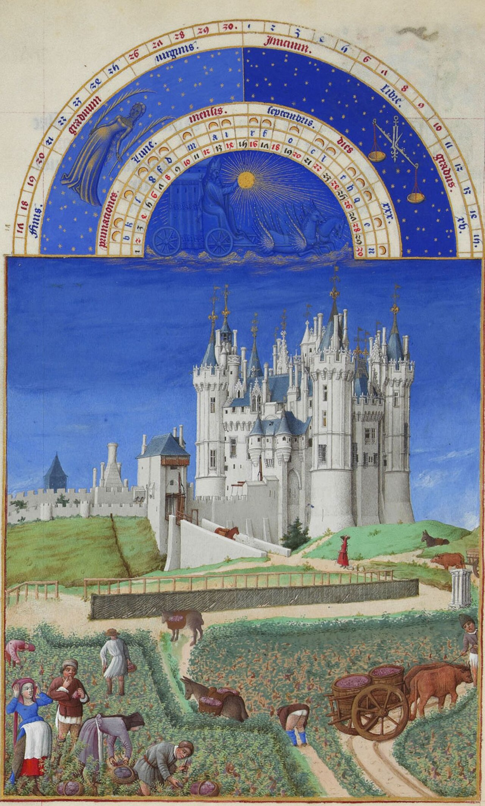

# Saumur-Champigny

Saumur-Champigny is a red wine appellation in the Anjou-Saumur part of the [Loire](ref:loire) Valley in [France](ref:france), on the left bank of the river south-east of Saumur. It is made from [Cabernet Franc](ref:cabernet-franc) and bottled as a still [red wine](ref:red-wine), typically 750 mL at 12%–13.5% [alcohol by volume](ref:abv).

Figure: Saumur-Champigny. Image: Limbourg brothers / Barthélemy d'Eyck / Jean Colombe, Public domain, via Wikimedia Commons ([source page](https://commons.wikimedia.org/wiki/File:Les_Tr%C3%A8s_Riches_Heures_du_duc_de_Berry_septembre.jpg)).

## The short answer: Cabernet Franc with a limestone accent

Start with the layers. Red wine is the category, Cabernet Franc is the grape, Saumur-Champigny is the AOC, and a named estate or cuvée is the product. The appellation name can stand alone on a label, but it is not a brand and it does not describe every Cabernet Franc in the Loire. It shares a grape with [Bourgueil](ref:bourgueil) and [Chinon](ref:chinon) upstream, yet the limestone here pushes the wine in a different direction: finer tannin, earlier accessibility, and a red-fruit profile rather than the tobacco-and-gravel register of Chinon.

## Why the appellation only dates from 31 December 1957

Saumur had a regulatory framework from 1936, but the Champigny red denomination was not recognised in its own right until the decree of 31 December 1957; the current text is decree 2011-649 of 8 June 2011. That gap matters. It is more than two decades after France's first 1936 AOCs, because the area spent the interwar and post-war years supplying bulk wine and cooperative bottlings. Growers only converged on the idea of a red-only, Cabernet Franc-led appellation after the war. The 2011 revision tightened planting density, minimum alcohol and acid-adjustment rules, and it is the version that underpins today's labels.

## Eight communes, seven of them villages around Saumur

The decree lists eight communes: Saumur itself, plus Chacé, Montsoreau, Parnay, Saint-Cyr-en-Bourg, Souzay-Champigny, Turquant and Varrains — in other words, Saumur and seven villages around it. The growers' association often speaks of "nine villages", a difference that comes from counting historic hamlets rather than administrative communes; it does not change the legal boundary. The vineyards are not one continuous block. They sit in islands on the plateaus and slopes of these villages, which is why two neighbouring sites can ripen a week apart in the same vintage.

## Tuffeau: the stone that breathes — and the "field of fire"

The signature parent rock is tuffeau, a soft white marine limestone laid down in the Turonian. Vines root in a thin layer of soil over the tuffeau and sometimes penetrate the rock itself; the plateau tops carry Senonian and Eocene sands, clays and gravels instead. Tuffeau absorbs heat by day and releases it at night, and it drains quickly, so grapes do not swell with water. The name may come from the Latin campus igni, "field of fire", a reference to this unusually warm, sun-facing slope. Growers still age wine in galleries cut into the tuffeau, where the temperature stays near 12 °C.

## Altitude, density and the 57 hl/ha ceiling

The technical rules are precise. Planting is limited to 40–110 m above sea level; minimum density is 4,000 vines per hectare, with minimum row and vine spacing; pruning is mainly single Guyot. The base yield is 57 hl/ha, with a 69 hl/ha "butoir" ceiling that cannot be exceeded. Minimum natural alcohol is 10.5%, fermentable sugar in the finished wine may not exceed 3 g/L, and malolactic conversion is required, with malic acid at or below 0.4 g/L. Irrigation is banned and cover crops are mandatory. Together these rules explain how the appellation can produce both light weekday wines and more structured bottles in good years.

## Ninety-nine percent Cabernet Franc, with a legal escape hatch

The association puts Cabernet Franc at 99% of plantings; in the 2023 harvest it alone covered 1,412 ha. The law, however, does not close the door completely. Cabernet Franc is the principal variety, while Cabernet Sauvignon and Pineau d'Aunis may be used only as accessories, together no more than 15%. In warm years that allowance has a practical role: it can add freshness or aromatic lift without changing the appellation's identity. When a label says Saumur-Champigny, it is safe to assume the glass is dominated by Cabernet Franc.

## How the soil rewrites the aroma: raspberry, violet, pencil lead

The typical register is raspberry, redcurrant and violet, with a touch of green pepper or graphite in youth. Whole-cluster [grapes](ref:grape) are temperature-controlled through [fermentation](ref:fermentation), and part of the blend goes into [oak](ref:oak-ageing), so the final [alcohol](ref:abv) usually lands between 12% and 13.5%. Compared with Bourgueil, the tannins are finer and the wine is usually half a body lighter; compared with Chinon, it has less tobacco and gravel and more creamy roundness. The explanation is physical: thin soils over tuffeau drain fast, berries stay small and thick-skinned, and phenolic ripeness arrives early, while gravelly plateau soils give more alcohol in hot years.

## Three fault lines against Bourgueil and Chinon

The first difference is geology: Bourgueil is largely gravel and limestone, Chinon is clay-flint, and Saumur-Champigny is anchored in tuffeau. The second is climate: this area feels the Atlantic more strongly, with about 550–600 mm of rain, and the rain shadow of the Mauges hills adds a foehn effect; Bourgueil is further inland and cooler in autumn. The third is legal: Saumur-Champigny is an independent AOC, not a second wine of Saumur. Put the three together and you get the same grape with a different skeleton.

## Producers to know, from Clos Rougeard to the co-op

There are 120 growers and a wide range of scales. Clos Rougeard, in Le Bourg, is the top of the pyramid, known for old-vine Cabernet Franc and long oak ageing. Château de Parnay's Clos d'entre les Murs is a single-clos benchmark; Domaine des Roches Neuves, run by Thierry Germain, works with low yields and biodynamics; Domaine Filliatreau's La Grande Vignolle is the more approachable classic; Château du Hureau in Parnay is another long-standing reference. Cooperatives still account for a meaningful share of volume, so the bottler information on the back label is worth reading.

## Price bands: €11 entry, €60 and up is another game

In French retail in 2026, and allowing for vintage, channel and scores, entry-level bottles sit around €11–18, village or single-site wines mostly €20–35, and names such as Clos Rougeard often €120 and above, with older vintages higher still. The gap is not a linear measure of quality. It reflects land, yields and the secondary market together. For everyday drinking there is no need to chase the top: around €15 usually delivers the archetypal raspberry and violet.

## The Champagne confusion, and two other myths

The most common mistake is to see "Champigny" and think of Champagne. The two are unrelated: Champigny is a village name on the Loire, and it has nothing to do with the Champagne town of Châlons either. The second myth is that this is a sweet or white version of Saumur; it is red and dry only. The third is that Cabernet Franc must taste of green pepper. In well-ripened vintages on tuffeau, the green pepper retreats and red berries and flowers take over.

## At the table: charcuterie, duck and Livarot

The trade body's classic matches are dry sausage, duck breast, Livarot cheese and apple tart, served at 16–18 °C. The logic is straightforward: fine tannin and fresh acidity suit rich but not heavy poultry and charcuterie; the washed-rind aroma of Livarot stands up to any green pepper, while the tart's sweetness is cut by the wine's acidity. Oily fish or very spicy dishes make the wine look thin, even bitter. Serve young bottles slightly cool at 15 °C, and bottles aged five years or more closer to 17 °C.

To read Saumur-Champigny, start with the base and the stated strength, then the sweetness or bitterness, then how it is served; no single check settles it.