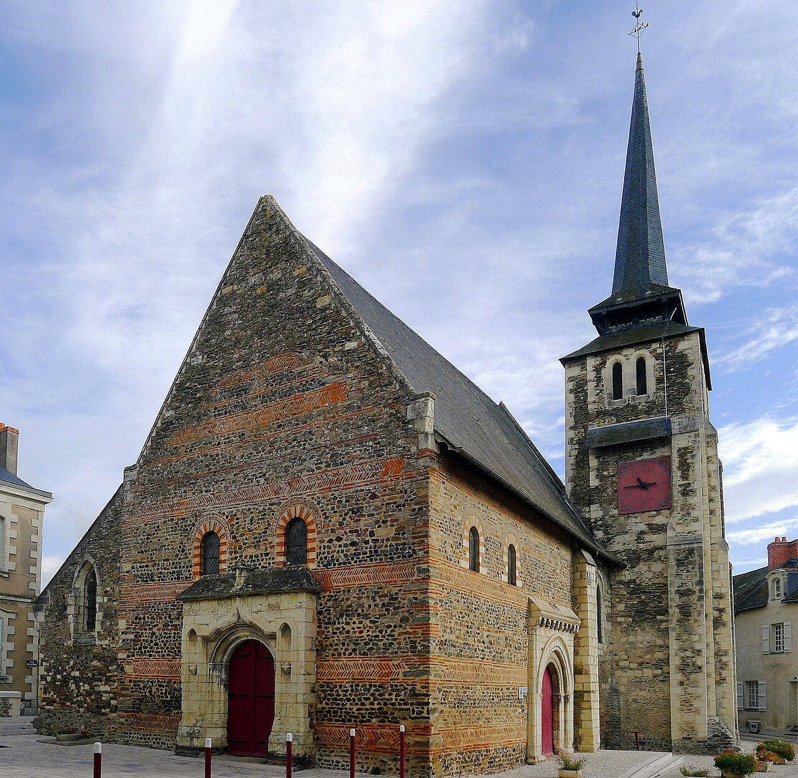

# Savennières

Savennières is a [Chenin Blanc](ref:chenin-blanc) [white wine](ref:white-wine) appellation in the Anjou part of the [Loire](ref:loire) Valley in [France](ref:france), on the right bank about 15 km south-west of Angers. It is mostly dry, with high acidity and strong minerality, developing honey, beeswax and nuts with age; bottles are typically 750 mL at 12%–13.5% [alcohol](ref:abv).

Figure: Savennières. Image: Mbzt, CC BY-SA 4.0, via Wikimedia Commons ([source page](https://commons.wikimedia.org/wiki/File:P1290021_Savenni%C3%A8res_eglise_St-Pierre-St-Romain_rwk2.jpg)).

## 8 December 1952: cut out of the sweet-wine map

The AOC was created by the decree of 8 December 1952. At the time Anjou was a sweet-wine region, and Savennières belonged to the Coteaux de la Loire sweet-wine group. The 1952 decree carved it out and imposed stricter rules than its neighbours: grapes had to reach 212 g/L of natural sugar, a minimum of 12% acquired alcohol, and yields were capped at 25 hl/ha. In other words, it began not as a dry-white appellation but as a more concentrated sweet-wine one. Dry status was won later.

## 140 hectares in production, 37 estates

The appellation covers about 300 ha, of which roughly 140 ha are in production today. The five-year average is 4,033 hl, about 537,000 bottles, from 37 estates, at an average yield of only 35 hl/ha. That makes it small and expensive by Loire standards: parcels are fragmented, slopes are steep and machines are hard to use, so many estates are run by their owners. Thirty years ago only 75 ha remained planted; the recovery came not from expansion but from a generation of growers replanting the slopes.

## Schist, rhyolite and wind-blown sand

Savennières sits at the eastern end of the Armorican massif, in the part of Anjou known as Anjou noir. The soils are mainly schist, with quartz, phtanite and seams of rhyolite and spilite; wind-blown sand covers some hilltops and valley floors. Schist drains fast and roots go deep, while the igneous seams heat up quickly in the sun, giving the wine a hard mineral frame; sand makes it lighter and more aromatic. The combination is rare in the Loire and explains why it diverges from [Vouvray](ref:vouvray), which is mainly on limestone.

## The coulées: small valleys running down to the Loire

The vineyards are not on one continuous slope but along a series of coulées, small valleys perpendicular to the river. Aspects are mostly south or south-west, the slopes are steep and sunny, and the Loire moderates temperature; rainfall is about 650 mm, drier than western Anjou. The windmills are landmarks and evidence of windy, well-ventilated hilltops where botrytis is less of a threat. The coulées create several microclimates, and Coulée de Serrant and Roche aux Moines sit in two of the most famous.

## Dry Chenin: 11.5% and 4 g/L

The current rules divide the styles. Dry and medium-dry wines are capped at 50 hl/ha with a minimum natural alcohol of 11.5%; other styles are capped at 35 hl/ha with 12.5%. Dry wines may not exceed 4 g/L of fermentable sugar, grapes must be picked by hand, density is at least 4,000 vines per hectare, and row spacing is at least 0.90 m, reduced to 0.80 m on slopes above 10%. The [grapes](ref:grape) undergo a slow [fermentation](ref:fermentation) and the wine is usually aged on lees in old [oak](ref:oak-ageing). These numbers explain why Savennières is dry without being thin: low yields concentrate flavour, while the schist and northerly position keep acidity high.

## The seven hectares of Coulée de Serrant

Coulée de Serrant is the most singular site within Savennières: the entire seven-hectare slope is a standalone AOC owned by the Joly family. Cistercian monks planted it in 1130; Nicolas Joly took over in 1977 and converted the estate to biodynamics in 1984. Vines average 35–40 years, with the oldest over 80. The estate makes three wines — Coulée de Serrant, Savennières-Roche aux Moines and Savennières — but only the first comes from the seven-hectare monopole. Yields are extremely low and annual production is usually only a few thousand bottles.

## Roche aux Moines: 30 hl/ha and ten months

Roche aux Moines is the other standalone AOC, on steep schist slopes with quartz and phtanite overlooking the Loire in the commune of Savennières. The five-year average is about 20 ha in production, seven growers, 30 hl/ha, roughly 300 hl and 40,000 bottles. Its charter is stricter than the Savennières mainstream: synthetic herbicides and insecticides are banned, ageing is at least 10 months, harvesting is manual with successive sorting, and the wine must be bottled on the estate. The result is usually broader and saltier than Savennières proper, with longer ageing potential.

## Against Vouvray and Pouilly-Fumé

All three come from the Loire and are often compared. [Vouvray](ref:vouvray) in Touraine makes Chenin in dry, off-dry, sweet and sparkling styles, rounder and more fruity; [Pouilly-Fumé](ref:pouilly-fume) in Centre-Loire makes Sauvignon Blanc, lighter and flintier; Savennières is the minimalist dry-Chenin version, with almost no sparkling, little sweet wine, and an emphasis on saline, bitter, long acidity. At the table, Vouvray suits desserts and pork, Pouilly-Fumé suits seafood, and Savennières suits asparagus, Comté and white meat.

## Estates and bottles: Joly, Closel and Boudignon

Nicolas Joly's Coulée de Serrant is the totem of the appellation; Château de Chamboureau, next to Coulée de Serrant, is broader in style; Domaine du Closel, at Château des Vaults, is run by a woman winemaker and makes finer-boned wines; Domaine aux Moines is a core landowner in Roche aux Moines; Thibaud Boudignon is known for a high-acid, low-yield new style; Château d'Épiré is a historic estate. Most of the 37 estates are small, and the parcel name on the label often matters more than the estate name.

## What Savennières bottles cost

In French retail in 2026, allowing for vintage, channel and scores, Savennières proper sits around €22–32, single-site or older bottles €35–60, Coulée de Serrant mostly €90–140 and Roche aux Moines about €45–80. The reasons are concrete: an average of 35 hl/ha, the labour cost of steep slopes and a ageing potential of ten years or more. Entry bottles are not cheap, but in the wider world of white wine the value is often underestimated.

## The myth that Chenin means sweet

The most common mistake is to see Chenin Blanc and assume sweetness. Savennières is mostly dry, usually below 4 g/L of residual sugar, and can taste drier than many Chardonnays. A second myth is that Coulée de Serrant is a brand of Savennières; it is a separate AOC with equal legal standing. A third is that schist must give a smoky flavour; the minerality here is more saline, bitter and wet-stone than smoky.

## At the table: asparagus, Comté and tarte Tatin

High acidity and salt make Savennières a natural partner for asparagus, especially with hollandaise, white asparagus, baked fish, veal and pork loin. Comté is a classic: the cheese's nuttiness meets the wine's beeswax and wet stone. Tarte Tatin uses the acidity to cut caramel. Avoid very spicy dishes and heavy vinegar, which make the wine look sharp. Serve at 11–13 °C: too cold and the aroma shuts down, too warm and the alcohol stands out.

Savennières is not "the sweet wine of Anjou", nor another Vouvray. It is a low-yield gamble on schist slopes, betting that time will turn acidity into honey.

Setting [White wine](ref:white-wine)'s style beside [Loire Valley](ref:loire)'s region and vintage makes the boundary between them visible.

**In brief:** A dry Chenin Blanc appellation in the Anjou area of the Loire Valley, France, recognised on 8 December 1952 and covering three communes on the right bank with about 140 hectares in production; schist slopes, very low yields and high-acid minerality define the style, and the area contains the separate AOCs of Coulée de Serrant and Roche aux Moines.
