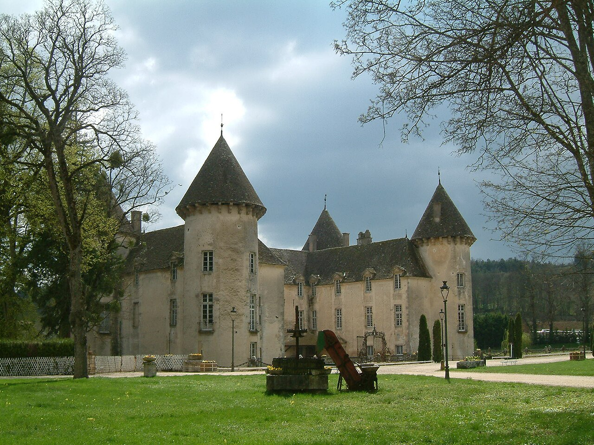

# Savigny-lès-Beaune

Savigny-lès-Beaune runs from the southern foot of the Corton hill to the northern edge of Beaune, cut through by a small river called the Rhoin. Its vineyard area is among the largest in the Côte de Beaune, yet it has no grand cru; it has a long list of 22 premiers crus, yet it is often treated as a village to pass through between Beaune and Corton. That contradiction is the way in: the Savigny-lès-Beaune AOC dates from 31 July 1937 and still has no grand cru. Reds are made from [Pinot Noir](ref:pinot-noir), whites from [Chardonnay](ref:chardonnay) and Pinot Blanc; bottles are normally 750 mL at 12.5%–13.5% [alcohol](ref:abv).

Figure: Savigny-lès-Beaune. Image: Christophe.Finot, CC BY-SA 2.5, via Wikimedia Commons ([source page](https://commons.wikimedia.org/wiki/File:Ch%C3%A2teau-Savigny-l%C3%A8s-Beaune_01.jpg)).

## Two slopes cut by the Rhoin

The Rhoin flows west to east and divides the appellation in two. The northern side, towards Pernand, faces south, with gravelly soil containing iron ooliths; it drains well and warms quickly. The southern side, facing the village, looks east, with sandy-textured limestone that warms more slowly. One river, two ripening curves: the north is rounder and earlier, the south tighter and more linear.

Altitude runs from 250 m to 400 m, and an alluvial cone from the Rhoin mixes river gravel and clay into the foot of the slope. "Savigny" is therefore not one taste but at least two: soft fruit at the base and on the northern slope; firmness and mineral tension in the mid-slope of the south.

## Twenty-two premiers crus in one village

The 22 climats are Aux Clous, Aux Fourneaux, Aux Gravains, Aux Guettes, Aux Serpentières, Basses Vergelesses, Bataillère, Champ Chevrey, La Dominode, Les Charnières, Les Hauts Jarrons, Les Hauts Marconnets, Les Jarrons, Les Lavières, Les Marconnets, Les Narbantons, Les Peuillets, Les Rouvrettes, Les Talmettes, Les Vergelesses, Petits Godeaux and Redrescul. The list is long but fame is uneven: La Dominode, Les Lavières, Les Marconnets, Aux Guettes and Les Narbantons are the names most often cited in the market.

The long list creates a practical problem. A label that says only "Premier Cru" gives very little information. Within the same village, a northern-slope and a southern-slope premier cru, or a parcel at the foot and one mid-slope, can taste completely different. With Savigny, the climat name matters more than the words "premier cru".

## 358 hectares and what that scale means

In 2022 Savigny had 300.08 ha of red (125.31 ha premier cru) and 47.79 ha of white (11.87 ha premier cru), about 358 ha in total, with average annual production of 11,864 hl red and 1,979 hl white. Red is roughly 86% of both surface and volume. Compared with Pernand at nearly half white and Santenay at about 22%, Savigny is a red village by structure, although its white output of nearly 2,000 hl is about 260,000 bottles, hardly a rounding error.

Scale also means internal diversity. Twenty-two premiers crus plus dozens of village lieux-dits cover almost the entire soil and aspect spectrum of the Côte de Beaune. Discussing Savigny as a single style is bound to be inaccurate.

## Iron ooliths versus sandy limestone

BIVB is explicit about the northern slope near Pernand: south-facing, gravelly, with iron ooliths; lower down, the brown-red limestone becomes more clayey and stony. The southern slope facing the village looks east over sandy limestone. At the foot lies the Rhoin's alluvial cone, mixing gravel and clay.

Iron ooliths are the key to the northern reds. They drain faster and warm more visibly by day, so Pinot Noir reaches higher ripeness and the wine feels rounder and fleshier. The southern sandy limestone holds less water and warms slowly, giving tighter, more aromatic wines that need time. These are not good and bad soils but early and late, round and firm.

## The rulebook: yields, alcohol, planting density

Village maximum yields are 50 hl/ha for red and 57 hl/ha for white; premier cru limits are 48 and 55, with butoir ceilings of 58/64 and 56/62. Minimum natural alcohol is 10.5% for village red and 11% for village white, rising to 11% and 11.5% for premier cru. Minimum sugar ripeness is 180 and 178 g/L at village level, 189 and 187 g/L for premier cru. Planting density must reach at least 9,000 vines per hectare.

Among permitted white varieties, Savigny allows Pinot Blanc alongside Chardonnay, a detail that distinguishes it from Aloxe and Pernand. Pinot Blanc rounds the wine and reduces the citrus edge, which helps explain the buttery, brioche-like note often found in Savigny whites.

## Village versus premier cru pricing

Typical European retail in 2026: €20–30 for village red, €32–50 for premier cru red; €25–35 for village white, €35–50 for premier cru white. The gap is usually less than double, far smaller than the gap between a village wine and a Corton grand cru. Three reasons: no grand cru acts as a price anchor; 22 premiers crus dilute any scarcity story; and village-level volume is large.

For buyers this is both opportunity and trap. The opportunity is that a named premier cru such as La Dominode or Les Marconnets still costs less than a comparable Beaune or Pommard. The trap is that a cheap bottle labelled only "Premier Cru" may come from a weaker part of the slope and taste nothing like the famous climats.

## Simon Bize's 0.60-hectare Marconnets

Domaine Simon Bize & Fils farms only 0.60 ha of Les Marconnets, planted in 1973 on the right bank of the Rhoin over deep, sandy soil. The estate describes the wine as showing tension and energy especially in wet years, which points to the character of Marconnets: it wins on acidity and structure rather than sheer weight. At 0.60 ha the production is tiny and rarely seen on the market, but it is a useful sample of the southern/right-bank style.

## Chandon de Briailles, rooted in Savigny

Chandon de Briailles is based in Savigny, with 12 crus spread across Savigny, Pernand and Aloxe, and has been biodynamic since 2005. Its Île des Vergelesses in Pernand is better known, but the Savigny premiers crus are central to the range: whole clusters, light extraction and little sulphur make the wines soft when young and reveal their structure only with age. Set beside Simon Bize's more traditional approach, it shows two winemaking philosophies inside one village.

## Style: a triangle with Aloxe and Pernand

Against [Aloxe-Corton](ref:aloxe-corton), Savigny red has less tannic hardness and more roundness and fruit, with an earlier drinking window; against [Pernand-Vergelesses](ref:pernand-vergelesses), it is fleshier and broader, while Pernand is more floral and linear. Savigny white is butterier and rounder than Pernand white, which keeps a saline, mineral edge.

The triangle is topographic. Aloxe faces due east, ripens early and builds firm tannin; Pernand is higher, later and sharper; Savigny sits in between, with a south-facing north slope and an east-facing south slope, and therefore holds both roundness and firmness.

## The château with aircraft, Abarths and motorcycles

The Château de Savigny, a fourteenth-century building north of the village, was taken over in 1979 by Michel Pont, who filled its courtyards and outbuildings with aircraft, Abarth racing cars, motorcycles, tractors and fire engines. It is now a formal museum complex: around a hundred fighter aircraft and helicopters, 30 Abarth prototypes and more than 200 motorcycles dating from 1903 to 1960, with a €14 entry ticket. It is not a marketing gimmick but a real visitor attraction, and a second identity for a village known otherwise for wine.

## Correcting "no grand cru, therefore cheap"

"Savigny has no grand cru, so it only makes cheap wine" is doubly wrong. First, there are 22 premiers crus, and La Dominode, Les Marconnets and Les Lavières have solid reputations among enthusiasts. Second, the absence of a grand cru is a historical classification outcome, not a verdict on quality. Savigny's strength is precisely that it offers structured red at premier cru prices, not that it is a consolation prize.

Another common error is to call all Savigny red rustic. The iron ooliths of the north and the sandy limestone of the south produce two different textures, round and firm; using "rustic" for both suggests familiarity with only one side.

## Buying, ageing and serving

Village red is usually ready within 4–8 years, premier cru within 8–15; village white within 4–7 years, premier cru within 7–12. When buying, look first at the climat and the slope (north or south), then at vintage and bottler. Store bottles lying down, away from light, at 12–15°C; refrigerate after opening and finish within two or three days. If a "Premier Cru" is unusually cheap, check where the parcel lies before deciding whether it is worth it.

## Related pages

- [Red wine](ref:red-wine) and [white wine](ref:white-wine): the two categories.
- [Pinot Noir](ref:pinot-noir) and [Chardonnay](ref:chardonnay): the main varieties; white also allows Pinot Blanc.
- [Grape](ref:grape), [fermentation](ref:fermentation) and [oak ageing](ref:oak-ageing): material and process.
- [France](ref:france) and [Burgundy](ref:burgundy): the regional frame.
- [Alcohol by volume](ref:abv): the label term.
- [Aloxe-Corton](ref:aloxe-corton): the appellation on the hill to the north.
- [Pernand-Vergelesses](ref:pernand-vergelesses): the valley appellation to the north-west.

For Savigny-lès-Beaune, begin with the base and the stated strength. Then look at the sweetness or bitterness, and finally ask how it is served. The answers point to different choices, not to a single score.