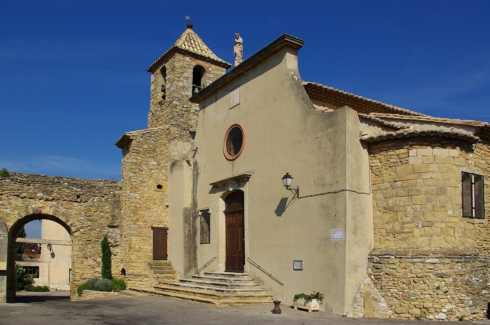

# Vacqueyras

Vacqueyras is an appellation in [France](ref:france)'s Southern [Rhône](ref:rhone), with an AOC covering the two communes of Vacqueyras and Sarrians in the Vaucluse. The vineyards lie on terraces of the Ouvèze, below the Dentelles de Montmirail. The appellation makes [red wine](ref:red-wine), rosé and a small amount of white; the reds are based on [Grenache](ref:grenache), usually with [Syrah](ref:syrah) and Mourvèdre, and the normal bottle is 750 mL at about 13.5%–15% [alcohol](ref:abv).

Figure: Vacqueyras. Image: Pierrenoel, CC BY-SA 3.0, via Wikimedia Commons ([source page](https://commons.wikimedia.org/wiki/File:Eglise_de_Vacqueyras.JPG)).

## "Valley of Stones" and the 60–160 m terraces

The name comes from the Latin *Vallea Quadreria*, "valley of stones", and the description is literal. Most vineyards sit on broad alluvial terraces laid down by the Ouvèze at roughly 60–160 metres, with rolled pebbles (*galets roulés*) on the surface and sandy clay and limestone beneath. The stones absorb heat by day and release it at night, helping Grenache ripen; the sandy clay holds a little water in dry years. Compared with [Gigondas](ref:gigondas), which plants up to 500 metres, Vacqueyras is distinctly lower and flatter. The raw material is [grape](ref:grape); [fermentation](ref:fermentation) and [oak ageing](ref:oak-ageing) vary by estate.

## 1990: a late promotion

The administrative record is longer than Gigondas's. Vacqueyras entered the Côtes du Rhône AOC in 1937, acquired the "Côtes du Rhône Vacqueyras" designation in 1955, and became a village-level appellation in 1967. Only on 9 August 1990 did it obtain an AOC in its own right, nineteen years after Gigondas. The delay does not signal inferior quality. It reflects a larger area, two communes and more growers, all of which took longer to map and to reconcile. Two communes, several hundred parcels and different inheritance structures had to be negotiated one by one; Gigondas had a single commune and far fewer parties at the table.

## Riss terraces versus Gigondas's older Mindel deposits

This is where the two appellations are most often confused. Vacqueyras's terraces were largely formed during the Riss glaciation, while Gigondas has more deposits from the older Mindel glaciation. The age difference has a sensory consequence: younger, sandier soils in Vacqueyras give rounder wines with softer tannin, while the red clay and limestone scree of Gigondas give tighter, saltier wines. Writing both pages as "gravel terraces of the Southern Rhône" erases the distinction that matters most. Against [Châteauneuf-du-Pape](ref:chateauneuf), Vacqueyras has less fat and less oak presence, with more of the valley's open, broad shape.

## Three colours under one AOC

Vacqueyras is not a red-only appellation. Red dominates by a wide margin, while rosé and white each account for low single-digit percentages, with white slightly ahead of rosé. The whites may use Clairette, Grenache Blanc, Bourboulenc, Roussanne, Marsanne and Viognier, with no single variety exceeding 80%. In 2025 the appellation covered 1,421 hectares and produced 38,147 hl, an average of 27 hl/ha, with exports at about 26%. The numbers describe a red-dominated but structurally complete appellation, not a one-colour monoculture.

## The 50/20 rule and what it does to the blend

Start with the base and the stated strength. From there, consider the sweetness or bitterness, then how it is served. That is how a practical judgment about Vacqueyras is built.

## The Garrigues plateau and the Dentelles rain shadow

The appellation is not all river terrace. On the Sarrians side, the Garrigues plateau is covered with clay and gravel, and the Dentelles shelter it from part of the wind. Le Sang des Cailloux describes its 17 hectares as three distinct blocks: Safres (sandy, suited to white), Garrigue argileuse (clay plateau, used for Lopy) and calcareous gravel over brown clay (used for the basic red). This kind of internal mapping is far more useful than a single sentence about "Southern Rhône terroir", and it explains why one estate can produce several very different reds.

## Two estate models: La Monardière and Sang des Cailloux

Domaine de la Monardière was founded in 1987 by Martine and Christian Vache and now farms about 22 hectares; their son Damien joined in the 2000s. Its wines, including Les Calades, Les 2 Monardes and Vieilles Vignes, tend towards clear fruit and round tannin. Le Sang des Cailloux was established in 1975; Serge Férigoule took over in 1990 and his son Frédéri joined in 2003. The estate was certified organic in 2007 and moved to biodynamics in 2010, with an average vine age of 50 years and some plots over 80. Lopy is typically 80% Grenache and 20% Syrah. A third name to watch is Château des Tours, run by Emmanuel Reynaud, the appellation's most cited cult producer, though volumes are tiny and prices far from everyday.

## The Avignon Festival's official cru since 1998

Since 1998, Vacqueyras has been the official cru of the Avignon Festival. The role helps explain the style: the festival audience and its restaurants need a wine more open than Gigondas and lighter than Châteauneuf-du-Pape, one that works after a performance with simple grilled meat and cheese. The appellation accordingly markets itself on consistency and on not needing a long decant, which fits its terraces, lower altitude and higher Syrah share.

## Broader and earlier than Gigondas? Not quite

Put the two wines side by side: Vacqueyras leads with blackberry, dried fig, liquorice and garrigue, its tannins rounder, and it usually enters its drinking window at three to eight years. [Gigondas](ref:gigondas) keeps a straighter acidity and finer tannins, often needing five to ten years. The difference is not rank but altitude, soil age and the proportion of limestone. Next to [Châteauneuf-du-Pape](ref:chateauneuf), Vacqueyras has less fat and less oak presence, with more of the valley's open breadth.

## Prices, pairings and two corrections

Retail samples put Le Sang des Cailloux's basic red at about €20–35, its white at about €29, and leading flagship wines at €35–55; prices move with vintage, channel and exchange rate. For pairing, grilled lamb with olive paste, duck breast with roasted figs and blue cheese all work, and heavier vintages can take braised game. Two misconceptions are worth correcting. First, "Vacqueyras is cheap Gigondas": it is an independent AOC since 1990, larger, lower and governed by different variety minimums, not a downgraded version of its neighbour. Second, "Vacqueyras is red only": it legally makes all three colours, and the white, though only about 2% of output, is one of the region's more interesting minorities.

### Key dates and figures

- Red varieties: at least 50% Grenache; Syrah and Mourvèdre together at least 20%; other permitted varieties no more than 10%; white varieties no more than 5%.
- Minimum natural alcohol: 12.5% for red, 12% for rosé and white.

## Where the figures come from

The figures here come from Inter Rhône's appellation page, the cahier des charges approved on 7 December 2020, the Vacqueyras application published in the Official Journal, and the official material of La Monardière and Le Sang des Cailloux. Prices come only from a Cork & Curve sample and are not presented as an appellation average. All sources were opened and checked on 8 November 2026.

**Short definition:** A Southern Rhône appellation in France spanning the two communes of Vacqueyras and Sarrians, with vineyards on 60–160 metre river terraces of the Ouvèze; reds require at least 50% Grenache and at least 20% Syrah and Mourvèdre combined, with rosé and a little white also made, typically broader and earlier-drinking than Gigondas, commonly 750 mL at about 13.5%–15% vol.

**Key facts.**

| Item | Detail |
| --- | --- |
| In one line | A Southern Rhône appellation in France spanning the two communes of Vacqueyras and Sarrians, with vineyards on 60–160 metre river terraces of the Ouvèze; reds require at least 50% Grenache and at least 20% Syrah and Mour… |
| Style | Red wine |
| Region | France、Rhône Valley |
| ABV | 13.5–15% vol |

**Sources and limits.** The key claims about Vacqueyras are checked against the following sources: Inter Rhône (Used to check the 2025 area, output, AOC date, colour shares and the Avignon Festival detail), Syndicat des Côtes du Rhône / INAO (Used to check variety minimums, minimum natural alcohol and yield ceilings), European Union (Used to check the description of the Ouvèze terraces at 60–160 metres) and 6 sources in total. Prices, batches and status change; the body is project-written and does not reproduce source text.
