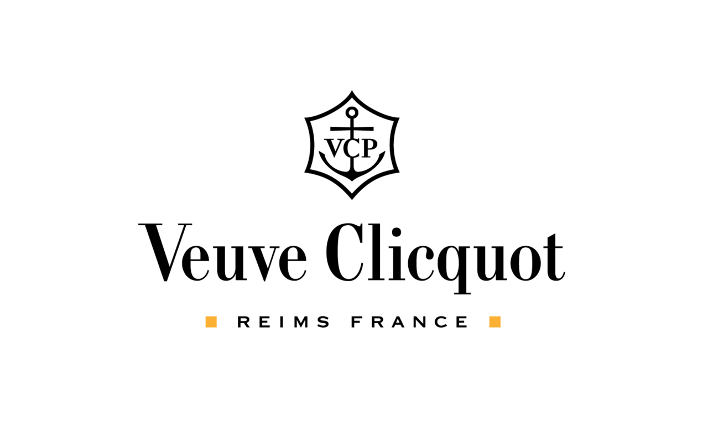

# Veuve Clicquot

Veuve Clicquot is a Champagne house in Reims, founded in 1772 by Philippe Clicquot and taken over in 1805 by his widowed daughter-in-law, Barbe-Nicole Ponsardin. It is now part of [LVMH](ref:lvmh) through Moët Hennessy. “Veuve” is French for widow; the flagship is the non-vintage Yellow Label, usually 750 mL at about 12% [ABV](ref:abv).

Figure: Veuve Clicquot. Image: Julia Jeanselme, CC BY 3.0, via Wikimedia Commons ([source page](https://commons.wikimedia.org/wiki/File:Logo_Veuve_Clicquot.png)).

## 1772: A Wine Merchant's House in Reims

Philippe Clicquot came from a banking and textile family and already owned vineyards when he established a wine merchant's house in Reims in 1772, in the [Champagne](ref:champagne) region of [France](ref:france). In 1805 his son François died, and his twenty-seven-year-old widow, Barbe-Nicole Ponsardin, decided within weeks to take over the business rather than sell it. She ran the accounts, travelled for sales and pushed technical improvements, becoming one of the earliest modern businesswomen.

## 1805: A Widow Takes Control at Twenty-Seven

“Veuve Clicquot” is not a full personal name but the title “widow Clicquot”. When she took over in 1805 the house was still a regional merchant; she drove it into Russia, Britain and European courts. In 1810 she made the first recorded vintage Champagne in the region; 1811 became the “comet vintage”; in 1814 she shipped 10,550 bottles of the 1811 wine to St Petersburg, arriving ahead of the lifting of the blockade on French goods. In 1818 she created the first “rosé d'assemblage” by blending Bouzy red wine with Champagne, replacing the elderberry-based colouring then in use.

## 1816: The Riddling Table and Anton Müller

After ageing on the lees the wine is cloudy, and the sediment must be gathered at the neck before disgorgement. In 1816 Madame Clicquot and her cellar master Anton Müller turned the first riddling table (table de remuage) into a repeatable process: bottles were set at an angle in a punched rack, given a small daily turn and gradually tilted upright so the deposit slid to the neck. The rest of Champagne adopted the method, and it remains the basis of traditional production today. It was not the discovery that sediment sinks; it was the standardisation of a hand movement, with turns shrinking from a quarter to an eighth and then a sixteenth of a rotation.

## Yellow Label: A Fifty-Percent Pinot Noir Frame

Yellow Label is roughly 50% [Pinot Noir](ref:pinot-noir), 20% Meunier and 30% [Chardonnay](ref:chardonnay), drawn from 50–60 crus. Up to 45% can be reserve wine; the house keeps about 400 reserve wines, some aged up to 30 years. The dosage is 9 g/L, a Brut, and the wine rests on the lees for at least 15 months, above the legal minimum. Pinot Noir supplies structure and red-fruit notes, Meunier adds roundness, and Chardonnay brings citrus and florals.

## Fifteen Months Is Only the Legal Floor

France's DGCCRF states that non-vintage Champagne must spend at least 15 months on the lees; vintage Champagne is kept longer. The in-bottle [secondary fermentation](ref:fermentation) itself takes about six to eight weeks. Yellow Label ages beyond the legal floor, although the exact months vary by batch. [Dosage](ref:dosage) sets the sweetness: Brut is normally up to 12 g/L, so 9 g/L is dry; Demi-Sec is noticeably sweeter. The alcohol level, about 12% [ABV](ref:abv), should be read together with bottle size and origin.

## La Grande Dame: The Prestige Vintage Line Since 1972

In 1972, the house's bicentenary, Veuve Clicquot launched La Grande Dame, its prestige vintage Champagne, named after Madame Clicquot's nickname, “the grande dame of Champagne”. The 2018 release is the 25th vintage of the cuvée: 90% Pinot Noir and 10% Chardonnay, with a 6 g/L dosage and an ageing potential the house puts at more than 15 years. It takes the Pinot Noir frame of Yellow Label to its extreme, with more concentration and a saline edge.

## 2011 and 2015: Two Opposite Vintages

In 2011 the harvest was misty and cold, with some of the earliest picking dates on record; the grapes were underripe and diluted. In 2015 conditions were warm and dry, with enough acidity to balance the ripeness, and many critics treat it as a vintage of the decade. Vintage Champagne is made only in years the house considers worthy, so the same label can perform very differently from one declared year to the next.

## 482 Chalk Cellars and UNESCO

In 1909 Veuve Clicquot moved into 482 chalk cellars (crayères) on the outskirts of Reims, former quarries that provide stable temperature and humidity. In July 2015 the Saint-Nicaise hill and the cellars, including those of Veuve Clicquot, were inscribed on the UNESCO World Heritage list as part of “Champagne hillsides, houses and cellars”. The cellars are not a marketing backdrop; they are part of the ageing conditions.

## Why It Has More “Frame” Than Moët

Compared with [Moët](ref:moet) Brut Impérial, Yellow Label uses more Pinot Noir (50% versus about 30%–40%), draws from a smaller blend base (50–60 crus versus more than 200) and carries a higher dosage (9 g/L versus 7 g/L). The result is more structure, more concentrated fruit and a clearer sense of drive. Moët is softer, more neutral and easier to place at a very large banquet.

This is not a claim that one is better. The two houses have different jobs: Yellow Label makes Pinot Noir structure the brand signature, while Moët makes consistency and easy drinking the global standard. The 9 g/L dosage gives Yellow Label a round edge in youth, but Champagne's high acidity keeps the sweetness in check.

## Price Bands: Yellow Label and La Grande Dame

Wine-Searcher put the average retail price of Yellow Label at about US$76 per 750 mL in November 2026. La Grande Dame sits higher, commonly at several times the price of Yellow Label, with the exact figure moving by vintage, channel and exchange rate. Gift boxes, limited editions and magnums push prices further, but packaging should not be read as a grade.

## The Misconception: Yellow Label Is Not Sweet

The yellow label makes some drinkers assume the wine is sweet, but its dosage is 9 g/L, which is a dry Brut. The genuinely sweet styles are Demi-Sec and Doux. A second misunderstanding is to treat “Veuve” as a brand name or a person's name; it means “widow”, referring to Barbe-Nicole Ponsardin, who took over the house in 1805.

## Serving and Pairing

Chill to 8–10°C and use a tulip-shaped or white-wine glass. Yellow Label works as an aperitif and with oysters, fried food, white meat and soft cheese; its acidity cuts through fat and cream. La Grande Dame is better with scallops, lobster and creamy poultry, served a little warmer at 10–12°C. Once opened, the bubbles fade, so plan to finish the bottle.

## Further Reading

- [Sparkling wine](ref:sparkling-wine): the broad category.
- [LVMH](ref:lvmh): the group that owns the house.
- [France](ref:france): the national context.
- [Champagne](ref:champagne): the legal region and process.
- [Pinot Noir](ref:pinot-noir): the backbone of Yellow Label.
- [Chardonnay](ref:chardonnay): the source of citrus and florals.
- [Fermentation](ref:fermentation): the second fermentation in bottle.
- [Blending](ref:blending): how Yellow Label stays consistent.
- [Dosage](ref:dosage): what 9 g/L means for Brut.
- [Alcohol by volume](ref:abv): the roughly 12% figure.
- [Moët](ref:moet): the most direct stylistic reference within the same group.

**In brief:** A Champagne house founded in Reims in 1772, taken over in 1805 by the twenty-seven-year-old widow Barbe-Nicole Ponsardin and known for perfecting the riddling table in 1816; this page explains the Yellow Label blend, La Grande Dame and the house's Pinot Noir frame.

**Key facts.**

| Item | Detail |
| --- | --- |
| In one line | A Champagne house founded in Reims in 1772, taken over in 1805 by the twenty-seven-year-old widow Barbe-Nicole Ponsardin and known for perfecting the riddling table in 1816; this page explains the Yellow Label blend, La … |
| Style | Sparkling wine |
| Region | France、Champagne |
| Producer or brand | LVMH |

**Sources and limits.** The key claims about Veuve Clicquot are checked against the following sources: Veuve Clicquot, The Champagne Academy (2011 was misty and cold with underripe fruit (2/10); 2015 was warm while retaining acidity (9/10)), DGCCRF, Ministère de l'Économie and 6 sources in total. Prices, batches and status change; the body is project-written and does not reproduce source text.
