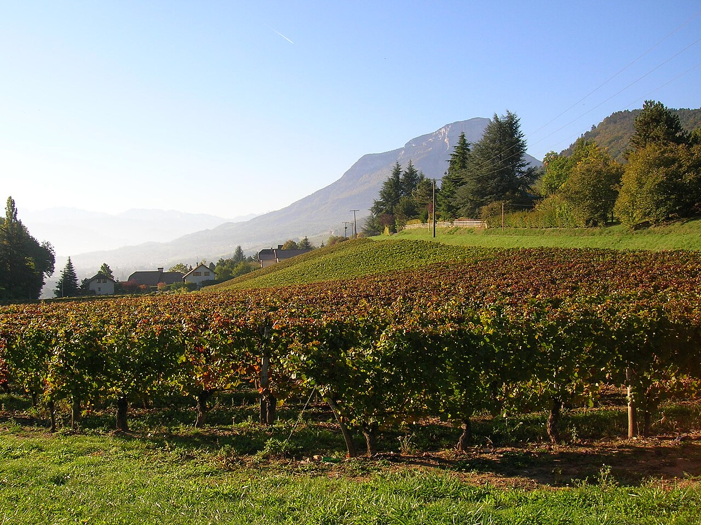

# Vin de Savoie

Vin de Savoie is a regional appellation in the [Savoie](ref:savoie) region of [France](ref:france), covering valley slopes across Savoie and Haute-Savoie. Whites are based on Jacquère, Altesse and [Chardonnay](ref:chardonnay), and reds on Mondeuse. It is commonly 750 mL at about 11.5%–13.5% [alcohol by volume](ref:abv).

Figure: Vin de Savoie. Image: Semnoz, CC BY-SA 3.0, via Wikimedia Commons ([source page](https://commons.wikimedia.org/wiki/File:0509_Saint-Baldoph_Vignes_3.jpg)).

## Definition and position

Start with the levels: [white wine](ref:white-wine) and [red wine](ref:red-wine) are the types, Jacquère, Altesse, Chardonnay and Mondeuse are the varieties, Vin de Savoie is the regional appellation, and specific geographical names and estates are finer levels. The label may give the region as "Vin de Savoie" or "Savoie".

Vin de Savoie is a framework covering several valleys rather than a single style. It includes geographical names such as Apremont, Abymes, Chignin and Montmélian; whites in the same appellation can be lean or fuller, and reds can be light or more structured.

## Producer and brand

Family estates and cooperatives dominate, with merchants also present. Mountain parcels are scattered and small, so many estates also run white, red and sparkling lines while keeping local varieties.

Producer, appellation and product are three levels: the appellation answers for rules and parcel range, the producer answers for who farms, who makes and who bottles, and the product answers for vintage, colour and specification. The same Vin de Savoie differs clearly between valleys and estates.

## Region and ingredients

Vineyards lie in the valleys and slopes before the Alps, from about 250 metres up to more than 600 metres. Soils are mainly limestone, marl and glacial deposits, and aspect and altitude decide ripeness.

The raw material is [grape](ref:grape). White grapes are mainly Jacquère, Altesse and Chardonnay; Jacquère has high acidity and light aroma, Altesse is fuller, and Chardonnay brings citrus and white flowers. The main red grape is Mondeuse, with red fruit, pepper and earth.

## Winemaking

Whites usually ferment at low temperature to preserve aroma and acidity; whether malolactic fermentation runs decides the direction, blocked for freshness and allowed for roundness. Some wines use old barrels or lees stirring to add texture.

Reds are usually whole-cluster fermented, and some estates use semi-carbonic maceration for lighter tannin and direct fruit; maceration time and temperature decide colour and structure. Some wines go into [oak](ref:oak-ageing). See [fermentation](ref:fermentation) for the basic process.

## Specification and label

The common volume is 750 mL, with [alcohol by volume](ref:abv) at about 11.5%–13.5% vol, varying by vintage, colour and estate. The label should be checked for appellation, geographical name, colour, vintage and bottler.

A geographical name usually follows the appellation, for example Apremont or Chignin; a label reading only "Vin de Savoie" or "Savoie" without a geographical name is a standard regional wine. The bottle on hand governs.

## Flavour and tasting

Whites show white flowers, citrus, green apple and mineral notes with high acidity and a light-to-medium body. Reds show red cherry, raspberry, pepper and earth with moderate tannin and clear acidity.

Serve whites at about 8–10 degrees Celsius in a tulip-shaped or Burgundy glass, and reds at about 14–16 degrees Celsius. Note the stylistic differences between Jacquère, Altesse and Chardonnay.

## Drinking and pairing

Whites suit seafood, mountain cheese, poultry and light dishes; reds suit poultry, charcuterie, mushrooms and grilled meat. Avoid dishes that are too hot or too sweet, which mask the fresh mountain character.

Refrigerate whites after opening and finish soon; reds can be kept refrigerated for a few days after opening. Excessive drinking harms health and minors should not drink.

## Buying and storage

Vin de Savoie is best read by starting with the base and the stated strength, moving to the sweetness or bitterness, and ending with how it is served.

For Vin de Savoie, unopened bottles should be kept away from light, lying flat in a cool place at an ideal 12–15 degrees Celsius, avoiding heat and sharp temperature swings. After opening, use a vacuum or inert gas and refrigerate rather than warming and cooling repeatedly.

## Common misconceptions

First, treating Vin de Savoie as a Swiss product. It is a French appellation.
Second, thinking Vin de Savoie makes only white wine. Mondeuse reds matter too.
Third, treating "Savoie" and "Vin de Savoie" as two appellations. They are name forms of the same appellation.
Fourth, assuming mountain wines must be tart. Variety, altitude and ripeness vary widely.
Fifth, judging quality by price alone. Geographical name, vintage and bottler information is more specific.

Vin de Savoie is a regional appellation, not a single style. White wines rely on Jacquère, Altesse and Chardonnay; reds rely on Mondeuse; and named crus such as Apremont, Abymes and Chignin sit inside the appellation. Read the label first for regional or village level, then for variety and sweetness. Mountain origin does not automatically mean a thin, high-acid wine.

**Short definition:** A regional appellation in the French Alps of south-east France, covering valley slopes across Savoie and Haute-Savoie; whites are based on Jacquère, Altesse and Chardonnay and reds on Mondeuse, with named places such as Apremont, Abymes and Chignin, in fresh, high-acid styles, commonly 750 mL at about 11.5%–13.5% vol.

[France](ref:france) and [White wine](ref:white-wine) are the two useful reference points for Vin de Savoie. [France](ref:france) sets out style; [White wine](ref:white-wine) brings in region and vintage. Read them together.

Vin de Savoie is the broad Savoie appellation, covering red, white and sparkling wines from a range of local varieties; Jacquère dominates the whites, while Mondeuse and Gamay make the reds. The appellation includes named subzones such as Apremont, Abymes and Chignin, and the best sites are on limestone and moraine slopes. It is separate from Roussette de Savoie, which is restricted to Altesse. A label may name the subzone instead of Vin de Savoie, so read the full appellation line. The wines are typically light and high-acid, made for alpine food rather than long ageing.

**Key facts.**

| Item | Detail |
| --- | --- |
| In one line | A regional appellation in the French Alps of south-east France, covering valley slopes across Savoie and Haute-Savoie; whites are based on Jacquère, Altesse and Chardonnay and reds on Mondeuse, with named places such as … |
| Style | White wine、Red wine |
| Region | France、Savoie |
| ABV | 11.5–13.5% vol |

**Sources and limits.** The key claims about Vin de Savoie are checked against the following sources: INAO (the area, permitted varieties and geographical names of the Vin de Savoie appellation), European Union (EU wine categories, geographical indications and labelling rules), Oxford University Press (Consulted for entries on Savoie, Jacquère and Mondeuse; Migrated from the former reference list at the end of the article; access date not re-verified). Prices, batches and status change; the body is project-written and does not reproduce source text.

## Further reading

- [Savoie](ref:savoie): the overall framework of the region to which Vin de Savoie belongs.
- [White wine](ref:white-wine) and [red wine](ref:red-wine): the two basic categories of Vin de Savoie.
- [Chardonnay](ref:chardonnay): one of the varieties used for whites.
- [Chignin-Bergeron](ref:chignin-bergeron): a Savoie white geographical name made from Roussanne.
- [Roussette de Savoie](ref:roussette): a Savoie white appellation made from Altesse.
- [Grape](ref:grape): the basic structure of wine grapes and ripeness measures.
- [Fermentation](ref:fermentation) and [oak ageing](ref:oak-ageing): the basic process steps for reds and whites.
- [Alcohol by volume](ref:abv): what 11.5%–13.5% vol means on a label.
