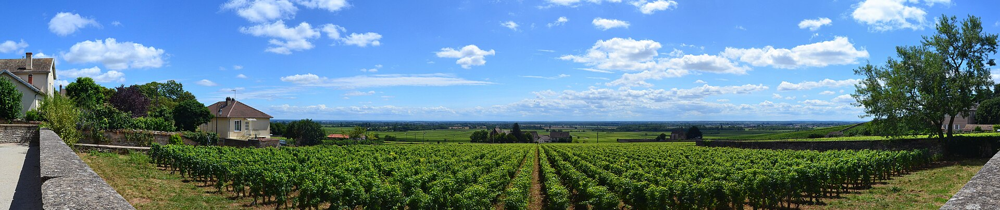

# Volnay

Leave Beaune to the southwest and the slope narrows, with vineyards spreading upward from the foot of the limestone scarp; Volnay grows along that slope. This is a village-level [red wine](ref:red-wine) appellation in the Côte de Beaune, made entirely from [Pinot Noir](ref:pinot-noir), with several premiers crus but no grand cru. The usual bottle is 750 mL at about 12.5%–13.5% vol.

Figure: Related photograph of Volnay. Image: MartinD, CC BY-SA 4.0, via Wikimedia Commons ([source page](https://commons.wikimedia.org/wiki/File:Volnay_vinyards_panorama.jpg)).

## Les Caillerets and Clos des Ducs: the list of premiers crus

Within the [Burgundy](ref:burgundy) hierarchy, Volnay's representative premiers crus include Les Caillerets, Clos des Ducs and Champans. Les Caillerets sits high with thin topsoil, giving a fine, tight wine with clear mineral notes; Clos des Ducs is a monopole, long and narrow with a visible gradient, often taken as the emblem of Volnay's structure; Champans is larger and lower, rounder in body with more outgoing fruit.

The list shows that Volnay's "lightness" has a frame. Higher plots give tighter tannin and clearer acidity, while lower plots give friendlier fruit. Reading the site predicts the style better than reading the village name.

## Slope, limestone and where the "feminine" label comes from

Most Volnay vineyards sit at moderate altitude, facing east or southeast, with thin topsoil over limestone and marl that drains quickly and lets roots go deep. On this [French](ref:france) slope the [grape](ref:grape) ripens slowly, keeping acidity and fine tannin, with aromas leaning towards flowers and red fruit. The difference between the top and the foot of the slope is especially visible in Volnay: higher plots give a leaner, saltier wine, lower plots a rounder, friendlier one, and one estate can show two faces from different sites.

"The most feminine red village of the Côte de Beaune" is a long-standing phrase, meaning fine aroma, soft tannin and a light body. It is an impression, not a grade, and it does not mean a thin wine. Use it as a style hint, not as a verdict on quality.

## A wall away from Pommard: lightness against firmness

Volnay borders [Pommard](ref:pommard), yet the two are often placed at the two opposite ends of the spectrum: Volnay is lighter, more perfumed and finer in tannin, with more red fruit and violet; Pommard is heavier, firmer and earthier, and needs more time when young. The difference is clearest in the same vintage and a similar tier.

The gap comes from slope, soil and extraction traditions, not from different varieties. Both are Pinot Noir; the difference lies in what the wine wants to express: Volnay seeks clear aroma and fine texture, Pommard seeks structure and power.

## Santenots and boundaries: a misread site

Santenots is one of the easiest Volnay premiers crus to misread: most of its plots lie inside the commune of Meursault, yet the red wine may be labelled as Volnay Premier Cru, while the white wine from the same slope belongs to Meursault. Administrative and appellation boundaries do not coincide here.

Such cases remind the drinker that the village name on a label is a legal result and does not always match the commune where the vines grow. When buying a premier cru, read the full site name and the appellation wording rather than relying on the village's location. Meursault is known for whites and Volnay for reds, and this boundary is exactly where the two separate.

## Gentle extraction and the whole-cluster choice

Volnay reds are built on [fermentation](ref:fermentation), and most estates use gentler maceration to keep fruit, flowers and fine tannin; some use a share of whole clusters for spice and frame. [Oak ageing](ref:oak-ageing) follows, and the share of new barrels should not be too high, or it covers the flowers.

Specific parameters belong to estates, so no uniform figures are given here. To judge whether extraction is restrained, look for clear fruit and flowers through the middle rather than barrel flavour and dry tannin alone. Light does not mean thin, and under-extraction can also leave the middle hollow. Picking too early amplifies acidity and green notes, while picking too late makes the flowers ripen and the texture heavier, so the picking window is narrower here than in some other villages.

## Labels and premier cru names

The usual bottle is 750 mL at about 12.5%–13.5% vol, measured as [alcohol by volume](ref:abv). Village wine is labelled Volnay; a premier cru adds Volnay Premier Cru plus the site name; with no grand cru in the village, Grand Cru never appears. Names such as Clos des Ducs and Les Caillerets are printed directly on the label, so spelling and site attribution need checking.

Read the bottler and importer as well. Estate bottling and négociant bottling are two different chains of responsibility; the same site under different bottlers can differ widely. A back label describes distribution, not quality.

## Volnay vintages: balancing perfume and acidity

Warm years usually bring riper fruit, lower acidity and a fuller body; Volnay feels fleshier and the flowers can be covered by cooked fruit. Cool years keep higher acidity and clearer flowers, with more visible tannin, a leaner body and a longer wait. Rainy or hail-hit years cut yields and ripen unevenly, and the wines can be thin and tight.

Within the village, the high plots around Les Caillerets tighten more in cool years, while lower Champans grows fuller in warm years. This is direction only, with no vintage ratings.

## Volnay's tiers and judging bottle condition

Think in relative tiers: village wine is the entry and premier cru the top, since there is no grand cru level here. Among the premiers crus, Les Caillerets, Clos des Ducs and Champans usually lead on reputation, and monopoles carry an extra premium. No specific prices are given here.

A method: confirm whether the label says Volnay or Volnay Premier Cru, then check the site name, bottler, vintage and bottle condition. Village wine can still show typical Volnay perfume, so do not chase premier cru only; equally, a premier cru with a poor vintage or condition can be worse than a well-kept village wine.

## Common misreadings of Volnay

First, assuming that no grand cru means low quality. Volnay's premiers crus can reach great finesse, and tier is not quality.
Second, taking "feminine" to mean "thin". Volnay is light, but the higher plots have a clear frame and ageing capacity.
Third, assuming all of Santenots lies inside the village of Volnay. Most of its plots are in the commune of Meursault, yet may be labelled Volnay Premier Cru for red wine.
Fourth, assuming Clos des Ducs is a grand cru. It is a monopole within the premier cru tier, not a grand cru.
Fifth, believing Volnay is only for early drinking. Village wines suit the medium term, and premiers crus can age, simply at a different rhythm from Pommard.

[Red wine](ref:red-wine) explains style; [Burgundy](ref:burgundy) adds region and vintage. Put Volnay between them before deciding what it is.

**At a glance:** A village-level Pinot Noir red wine appellation in the Côte de Beaune village of Volnay, Burgundy, France, southwest of Beaune; the village has several Premier Cru sites but no Grand Cru, and the style is known for fine aroma, red fruit and flowers, usually lighter than Pommard, commonly 750 mL at about 12.5%–13.5% vol.
