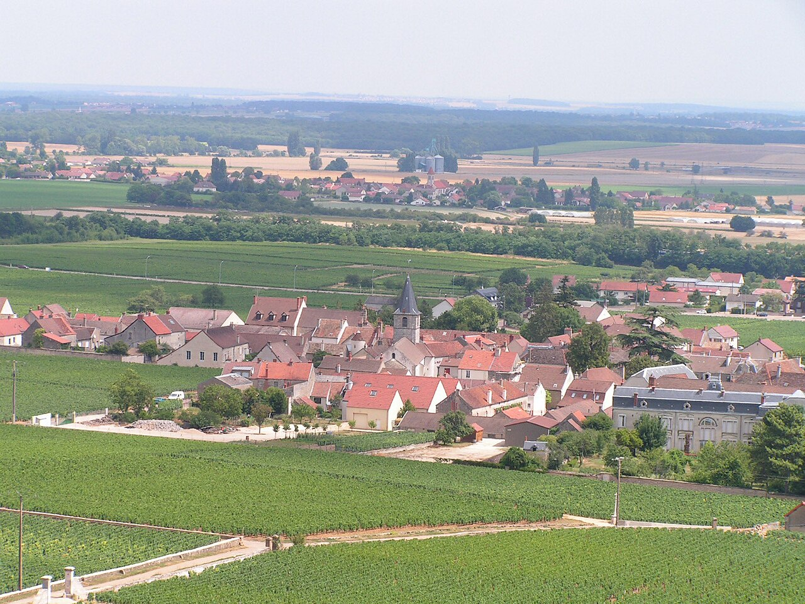

# Vosne-Romanée

Mention Vosne-Romanée and many people think first of the auction hammer and the price, and only then of the soil. That order deserves correcting: this is a village-level [red wine](ref:red-wine) appellation in the Côte de Nuits of Burgundy, made entirely from [Pinot Noir](ref:pinot-noir), and what truly separates it from other villages is the density of grands crus and the structure of the slope. The village and its appellation hold 8 grands crus. The usual bottle is 750 mL at about 12.5%–13.5% vol.

Figure: Vosne-Romanée. Image: Olivier Vanpé, CC BY-SA 2.5, via Wikimedia Commons ([source page](https://commons.wikimedia.org/wiki/File:Vosne-Romanee.jpg)).

## Eight grands crus on the map

Those eight grands crus are Romanée-Conti, La Romanée, La Tâche, Richebourg, Romanée-Saint-Vivant, Échezeaux, Grands-Échezeaux and La Grande Rue. They do not all lie inside the village boundary: Échezeaux and Grands-Échezeaux are in the commune of Flagey-Échezeaux but fall within the legal area of the Vosne-Romanée appellation, and La Grande Rue was promoted to grand cru only in 1992. When reading the site maps of [Burgundy](ref:burgundy), keep administrative boundaries and appellation boundaries apart.

## Romanée-Conti and "about 1.81 hectares"

Romanée-Conti is a monopole of about 1.81 hectares and is also the name of an estate and a wine, not an appellation. Its appellation is still written as Vosne-Romanée. Those three factors - small area, low yields and concentrated demand - combine to give it a near-symbolic status in the market. La Romanée offers a similar case at about 0.85 hectares, also held by a single owner.

Treating [Romanée-Conti](ref:romaneeconti) as an "appellation" is a common mistake. The label names the estate and the site, while the appellation framework sits behind them. For a drinker, understanding this layer matters more than memorising prices: it is first a Pinot Noir, and only then a symbol.

## Spice, red fruit and a velvety texture

Young wines are led by red cherry, raspberry, violet and spice, where cinnamon, clove and liquorice often appear; acidity is medium-plus, tannin is fine and the body medium, and texture is the signature - soft on entry but supported on the finish. With age the wine develops dried flowers, leather, truffle and woodland notes; grands crus usually have deeper layers and a longer finish.

That texture does not mean lightness. The structure sits behind the front, which is supple while the middle and finish show the strength. To judge whether a Vosne is well made, look for clear spice and red fruit and tannin that is fine without being thin, rather than only the smoothness of the first sip.

## Against Nuits-Saint-Georges and Chambolle-Musigny

Compared with [Nuits-Saint-Georges](ref:nuits), Vosne-Romanée is finer and more perfumed, with tighter tannin and less dark fruit and earth; Nuits-Saint-Georges is firmer and more overt, with a stronger chew. Compared with Chambolle-Musigny, Vosne adds spice and weight and gives up some of the pure floral, weightless quality. Set the three side by side and Vosne sits in the middle, leaning towards "perfume and silk".

This coordinate helps buying: for a firmer frame, look north to Nuits-Saint-Georges; for a more soaring floral quality, look south to Chambolle; for spice, velvet and ageing potential together, that is the reason to choose Vosne.

## Vosne's slope, marl and drainage

The vineyards mostly sit in the middle of east- and southeast-facing slopes, where the gradient gives drainage and sunlight. Topsoil is thin over limestone and marl, and some plots carry more clay. The depth of soil and the speed of drainage directly create the style differences within one village. Among the premiers crus, Cros Parantoux became widely known through the work of Henri Jayer, and its position and thin soil are a good symbol of that difference.

On this [French](ref:france) slope, the [grape](ref:grape) can still ripen in cooler years, while in hotter years yields and picking dates have to be controlled. Soil is not a backdrop; it decides whether the body is fine or broad.

## Winemaking and bottling: who sets the style

Reds are built on [fermentation](ref:fermentation), where maceration temperature, length and extraction set colour, tannin and aroma. Some estates use a high share of whole clusters to add spice and a cool note; [oak ageing](ref:oak-ageing) follows, with the share of new barrels varying by estate and tier. Grand cru and village wine differ more through site and yield than through any fixed process.

The ownership structure also shapes style. A monopole grand cru is controlled entirely by one estate, while a grand cru divided among many owners is bottled separately by each of them, and the differences between those wines can be wider than those between village and premier cru. Specific parameters belong to estates, so no uniform figures are given here.

## Vosne vintages: weight against detail

Warm years usually bring riper fruit, lower acidity and a fuller body; the spice leans towards sweeter tones, the velvet is more obvious, but detail can be buried by weight. Cool years keep higher acidity and clearer flowers, with more visible tannin, and the wine needs longer to open. Rainy or hail-hit years cut yields and ripen unevenly, and the wines can be tighter and thinner.

Within one village, slope and soil amplify or buffer the year: thin, fast-draining plots tighten more in cool years, while deeper soils grow heavier in warm years. This is direction only, with no vintage ratings.

## Vosne's tiers and how to judge the channel

The usual bottle is 750 mL at about 12.5%–13.5% vol, measured as [alcohol by volume](ref:abv). Think in relative tiers: village wine is the entry, premier cru sits in the middle and grand cru at the top. Even within grands crus, generalisations fail: Romanée-Conti and La Tâche see the most concentrated demand, while La Grande Rue, Échezeaux and Grands-Échezeaux are relatively more accessible among grands crus but still in a high price band. No specific prices are given here.

A method: first confirm whether the label says village, premier cru or grand cru among those three tiers, then check the site name, estate and bottler, and finally bottle condition and provenance. Cheap bottles from the secondary market or auction need a storage history; the spread between two bottles of the same wine mostly comes from channel, vintage and condition, not from the wine itself.

## A few things most often misread in Vosne

First, treating Romanée-Conti as an appellation name. It is an estate and wine name, while the appellation is Vosne-Romanée.
Second, assuming all eight grands crus lie inside the village boundary. Échezeaux and Grands-Échezeaux are in the commune of Flagey-Échezeaux but belong to the Vosne-Romanée appellation.
Third, assuming La Grande Rue was always a grand cru. It was promoted only in 1992.
Fourth, assuming every Vosne wine is absurdly expensive. Village wines and some premiers crus remain relatively accessible.
Fifth, believing spice must come from oak barrels. Spice can also come from whole clusters and grape skins, so aroma alone cannot tell you the method.

**In brief:** A village appellation in the Côte de Nuits of Burgundy, France, making red wine from Pinot Noir; the village and its appellation hold eight grands crus, including the 1.81-hectare Romanée-Conti monopole, and the style is known for spice, red fruit, velvety texture and long ageing potential, commonly 750 mL at about 12.5%–13.5% vol.
