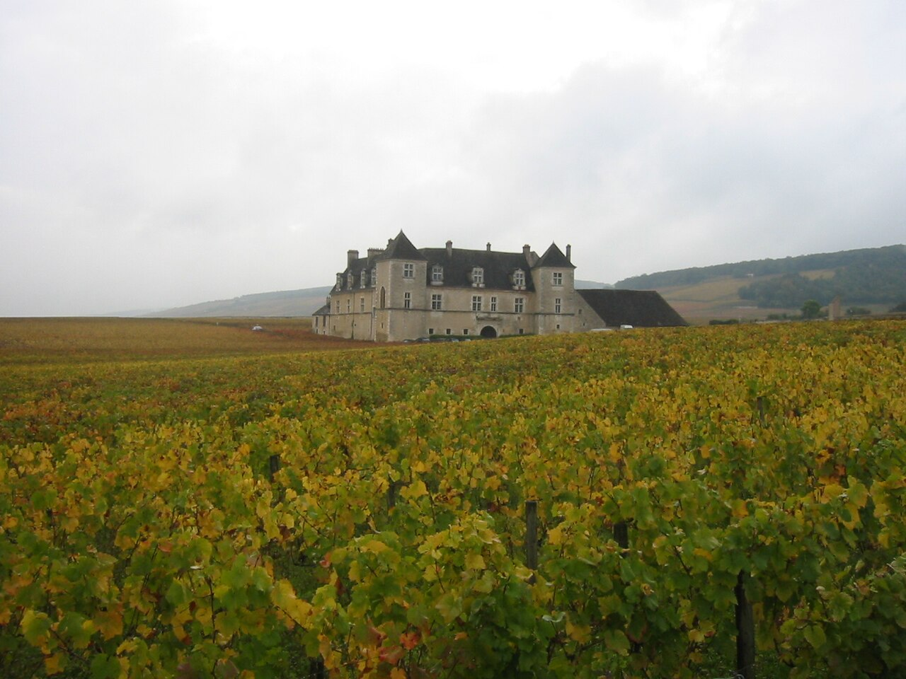

# Vougeot

On the map, Vougeot is a small village with few inhabitants in the middle of the Côte de Nuits, yet its name is almost synonymous with one walled vineyard. The commune contains a single grand cru, Clos de Vougeot, about 50 hectares enclosed by a stone wall, and has no premier cru; village-level wines come from scattered parcels outside the wall. The label therefore has an unusual structure: the village name and the vineyard name point to the same slope but belong to two different legal tiers. Bottles are commonly 750 mL at about 12.5%–13.5% [alcohol by volume](ref:abv); [red wine](ref:red-wine) is made from [Pinot Noir](ref:pinot-noir), and [white wine](ref:white-wine) from [Chardonnay](ref:chardonnay) in very small quantities.

Figure: Vougeot. Image: Wikimedia Commons contributor, CC BY-SA 3.0, via Wikimedia Commons ([source page](https://commons.wikimedia.org/wiki/File:Chateau_du_clos_de_Vougeot_2.JPG)).

> **Quick verdict**
> **In one line:** This entry helps you decide whether Vougeot suits you, and how to serve and pair it.
>
> - **Best for:** Anyone trying to understand what Vougeot is, how it is served and when it fits.
> - **Not for:** If you want only want the cheapest buying link and do not care about flavour or context.
> - **Check first:**
>   - Village-level Vougeot is scarce and usually priced close to a neighbouring village's premier cru.
>   - It helps to separate three levels: red wine and white wine are the categories, Pinot Noir and Chardonnay are the varieties, Vougeot is the appellation (AOC).

## A stone wall and a village out of step

It helps to separate three levels: [red wine](ref:red-wine) and [white wine](ref:white-wine) are the categories, Pinot Noir and Chardonnay are the varieties, Vougeot is the appellation (AOC), and individual estates and bottles belong to the producer level. Vougeot is both a village name and a village-level appellation name that may stand alone on a label. Inside the wall, Clos de Vougeot is a grand cru; outside it, scattered parcels may only be labelled village level. The two share a village name but are not the same thing.

This mismatch is unusual in Burgundy. Most villages first built a village-level reputation and later carved grands crus out of it; Vougeot runs almost the other way round, with the grand cru's fame covering the whole commune. Buyers therefore tend to read "Vougeot" as the walled vineyard and forget that village-level wine exists. Checking the tier first, then the site name and the bottler, prevents the two identities from being confused.

## Slope, soil and aspect inside Clos de Vougeot

Vougeot lies in the narrowest part of the middle Côte de Nuits in [Burgundy](ref:burgundy), [France](ref:france), with its vineyards concentrated south of the houses on slopes that face roughly east and south-east. The base is limestone and marl; upslope the soil is thin, stony and fast-draining, while clay increases towards the foot. Within about 50 hectares, Clos de Vougeot runs from the top of the slope to the bottom. The change in altitude is not dramatic, but the difference in soil depth and drainage is enough to split one grand cru name into clearly different wines: parcels near the top and the château are usually lighter and more floral, while parcels near the foot and the main road are fuller with more obvious structure. Aspect, row spacing and parcel shape also affect ripening. The official delimitation governs the boundaries.

This also explains why the same Clos de Vougeot can taste like two different villages in the hands of two producers. The site is large, owners are numerous and parcels are fragmented, so any generalisation about "the Clos de Vougeot style" can only describe the middle of the range. What actually decides a bottle is the position of that small parcel and the state of the fruit in that harvest.

## Cistercian monks, the wall and today's boundaries

Clos de Vougeot was established by the Cistercian monks of Cîteaux in the 12th century, and the main body of the wall and château is usually traced to the 16th century. The wall began as a boundary for work and management and later became the symbol of the site. After the French Revolution the church property was divided and sold, and the vineyard passed into many hands; today dozens of estates hold parcels inside the wall, and single ownership accounts for only a small part. The wall therefore tells us about history, not about the quality of any one bottle.

The raw material is [grape](ref:grape), and both colours sit within the same varietal framework. The point of this history is that the boundary of Clos de Vougeot was drawn by people, and there is no uniform "grand cru soil" inside the wall. Treating the wall, the château or the site name as a guarantee of quality often leads to disappointment once the bottle is open.

## A grand cru shared by dozens of owners

Under the single name Clos de Vougeot, the bottler is the key information. Large merchants, family estates and small growers may all hold parcels; some estates own only one or two rows, others own several adjoining blocks. Slope position, vine age, farming and winemaking choices combine to give the same name a wide stylistic range. Village-level Vougeot is produced in tiny quantities, often as an estate's entry wine, and is rarely seen on the market; the white version is even rarer.

Producer, appellation and product are three levels: the appellation answers for rules and parcel range, the producer answers for who farms, who makes and who bottles, and the product answers for vintage, tier and colour. When you see Clos de Vougeot, identifying the bottler and parcel information before discussing style is far more reliable than judging by the site name. The bottler, importer and back-label information are the first clues to identity.

## Winemaking: whole-cluster share and restrained new oak

Red fruit is usually sorted after harvest, and some producers keep a proportion of whole clusters to add aromatic layers and structure. [Fermentation](ref:fermentation) runs in temperature-controlled vessels, where maceration time and temperature shape colour, tannin and aroma. The wine then ages in [oak](ref:oak-ageing); grands crus usually see a higher proportion of new barrels than village wines, but more is not always better, because Vougeot's fruit is relatively fine and heavy new oak can bury the floral and mineral notes. Whites are pressed before fermentation, and some are stirred on their lees to add texture. Clarification and filtration before bottling depend on the producer.

Because Clos de Vougeot is large, ripening dates differ widely between owners, which gives the whole-cluster and new-oak shares a very broad range under one name. Rather than memorising a fixed recipe, it is more useful to read these choices as clues to the bottler's intent.

## Against Chambolle-Musigny and Vosne-Romanée

Typical Vougeot reds show red cherry, black cherry, violet and damp earth, with mushrooms, fallen leaves and a little spice with age; the palate has clear acidity, medium-plus tannin and a medium body. Compared with [Chambolle-Musigny](ref:chambolle) to the north, Vougeot is thicker and earthier, while Chambolle is finer, more floral and silkier in texture. Compared with [Vosne-Romanée](ref:vosne) to the south, Vougeot is more restrained in spice and richness, while Vosne is usually more opulent and sweeter. Put simply: Chambolle is more scented, Vosne is denser, and Vougeot is firmer and more earthy.

The whites show citrus, white flowers and flinty minerality, but output is small and the style is less representative than the reds. Serve reds at about 15–17 degrees Celsius and whites at about 10–12 degrees Celsius. Too warm a serving makes Vougeot's tannin feel coarse, while too cold a serving suppresses the floral notes.

## Warm years and cool years in the Clos

Warm years usually bring deeper colour, riper black fruit and a fuller body, with lower acidity and tannin that feels rounder; cool years keep higher acidity, push red fruit and flowers forward, and give a leaner body with a firmer tannin line. The clay at the foot of Clos de Vougeot holds more water in wet years, so ripening can be uneven there, while the fast-draining upper slope may keep fruit in better condition in a damp season. Rain at harvest affects dilution, which makes sorting and parcel selection especially important.

Start with the base and the stated strength. From there, consider the sweetness or bitterness, then how it is served. That is how a practical judgment about Vougeot is built.

## Reading price from the bottler and the slope

Village-level Vougeot is scarce and usually priced close to a neighbouring village's premier cru. Clos de Vougeot spans a very wide price band: famous estates and well-placed parcels sit high, while lesser-known owners may sit relatively low. Comparing vintages from one estate, or bottlers within the same village, is more meaningful than comparing across villages. Judge by bottler, parcel position, vintage and back-label information rather than by the words "Clos de Vougeot" alone.

Price is not a direct scale of quality: one site name can cover products from entry level to high price. On a limited budget, a village wine or a Clos de Vougeot from a lesser-known owner often shows the site more honestly than chasing a famous name. No specific figures are given here.

## Five misconceptions about walls, village names and site names

First, treating the wall or the château as a guarantee of quality. The wall is a historical boundary and does not vouch for every parcel.
Second, treating the village name and Clos de Vougeot as synonyms. Village and grand cru are two legal tiers.
Third, assuming Vougeot has premiers crus. The village has only village and grand cru tiers.
Fourth, assuming Clos de Vougeot belongs to one estate. It is held in parcels by dozens of owners, and the bottler is the key.
Fifth, assuming Vougeot makes only red wine. The village appellation also makes a little white, though it is rarely seen on the market.

## Further reading

- [Red wine](ref:red-wine): the wider category to which the reds belong.
- [White wine](ref:white-wine): the wider category to which the whites belong.
- [Pinot Noir](ref:pinot-noir): the variety used for the reds.
- [Chardonnay](ref:chardonnay): the variety used for the whites.
- [France](ref:france): French wine law and appellations.
- [Burgundy](ref:burgundy): the grading framework of the region.
- [Grape](ref:grape): the basic structure of wine grapes and ripeness measures.
- [Fermentation](ref:fermentation): the logic of maceration and fermentation.
- [Oak ageing](ref:oak-ageing): the stage that integrates aroma and softens structure.
- [Alcohol by volume](ref:abv): what 12.5%–13.5% vol means on a label.
- [Chambolle-Musigny](ref:chambolle): the village appellation to the north.
- [Vosne-Romanée](ref:vosne): the village appellation to the south.
