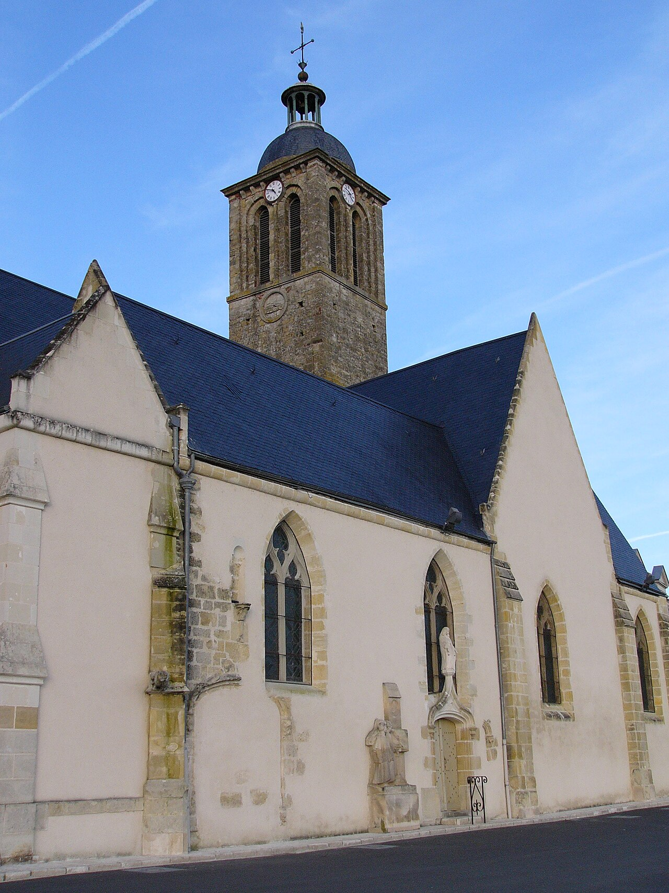

# Vouvray

Vouvray is a Chenin Blanc appellation in the Touraine area of France's [Loire Valley](ref:france), on the right bank of the Loire east of Tours. One appellation produces dry, off-dry, sweet and sparkling wines across a wide stylistic range, but the only variety is [Chenin Blanc](ref:chenin-blanc). The wines are known for quince, apple, honey and flinty minerality, commonly 750 mL at about 11%–13.5% [alcohol by volume](ref:abv).

Figure: Vouvray. Image: Croquant, CC BY-SA 4.0, via Wikimedia Commons ([source page](https://commons.wikimedia.org/wiki/File:Vouvray_%C3%A9glise.jpg)).

## Definition and position

Start with the levels: [white wine](ref:white-wine) is the category, Chenin Blanc is the variety, Vouvray is the appellation (AOC), and individual estates and wines are the producer level. Vouvray is both a place name and an appellation name that may appear on a label, and it should not be confused with a brand.

What makes Vouvray unusual is that one appellation name covers several sweetness levels and forms: dry, off-dry, sweet, and traditional-method sparkling. On seeing "Vouvray", check both the sweetness label and whether it is sparkling, since the appellation name alone does not fix the style.

## Producer and brand

The appellation is dominated by family estates, alongside négociants and cooperatives. Sizes vary greatly: some estates own parcels and bottle themselves, while others buy grapes or wine and blend. The bottler information on the label is the key to telling estate wine from merchant wine.

Producer, appellation and product are three levels: the appellation answers for rules and geography, the producer answers for who farms, who makes and who bottles, and the product answers for vintage, sweetness and specification. Styles differ markedly between estates, and one wine cannot stand for the whole appellation.

## Region and ingredients

Vouvray lies in the Touraine area of the Loire Valley in [France](ref:france), on the right bank of the Loire. The climate mixes maritime and continental influence, and a relatively stable autumn favours late picking and noble rot. Soils are mainly tuffeau limestone and clay, with flint in some parcels, and drainage and heat retention shape ripening.

Tuffeau is the local building and cellar material, and many estates carve cellars into the rock, where constant temperature and humidity help ageing. The raw material is [grape](ref:grape), of the [Chenin Blanc](ref:chenin-blanc) variety, and the appellation rules require Chenin Blanc for the white wines.

## Winemaking

Dry Vouvray usually completes [fermentation](ref:fermentation) in stainless steel or old oak to keep acidity and fruit; some estates use [oak ageing](ref:oak-ageing) for texture and nutty notes. Off-dry and sweet styles keep residual sugar, either by stopping fermentation or by picking riper fruit, and the level depends on ripeness and where fermentation stops.

Sparkling Vouvray is made by the traditional method, with a second fermentation in bottle, giving fine bubbles and high acidity, in styles from crisp to full. Specific parameters are estate information, and this entry gives no universal figures; the estate's own material and the label govern.

## Specification and label

The common volume is 750 mL, with [alcohol by volume](ref:abv) at about 11%–13.5% vol, and sweet or late-harvest wines may be higher. The label should be checked for appellation name, vintage, sweetness label (sec, demi-sec, moelleux and so on), whether it is sparkling, bottler and importer.

Label languages differ by market, so the bottle on hand governs. Sweetness terms are regulated, but actual perception still differs between estates, and alcohol and vintage are useful alongside the term when buying.

## Flavour and tasting

Dry Vouvray is dominated by quince, apple, pear, chamomile and flinty minerality, with high acidity and a medium body; off-dry and sweet styles add honey, apricot and orange peel and a denser texture. With age it develops honey, dried fruit and toasted bread, and good sweet wines keep for a long time.

For tasting, serve at about 10–12 degrees Celsius, cooler for sweet wines. Watch the clarity of fruit and minerality, as excessive oak or over-ripe fruit makes the wine heavy. For sweet wines, check that acidity balances the residual sugar.

## Drinking and pairing

Dry Vouvray suits goat cheese, seafood, white meat and light sauces; off-dry and sweet styles suit fruit tarts, blue cheese and foie gras. Sparkling Vouvray works as an aperitif with salty snacks and fried food.

Most dry wines are for drinking within 3–8 years, while good sweet and sparkling wines last longer; the window depends on vintage and estate. After opening, refrigerate and drink soon. Excessive drinking harms health and minors should not drink.

## Buying and storage

Buy from reputable channels and check appellation name, sweetness label, vintage and bottler information. Prices vary widely with sweetness, vintage and estate reputation, so no figure is given here. A sweetness label is not a quality tier, and style fit matters more.

For Vouvray, unopened bottles should be kept away from light, lying flat in a cool place at an ideal 10–13 degrees Celsius, avoiding heat and sharp temperature swings. Cork-sealed bottles need humidity and can be stored lying down. After opening, refrigerate and drink soon; sweet wines oxidise slowly, but aroma still fades.

## Common misconceptions

First, treating Vouvray as a sweet-wine appellation. Dry and sparkling wines matter just as much.
Second, believing Vouvray may blend other varieties. The white wines are made from Chenin Blanc.
Third, treating the sweetness label as a quality tier. It describes residual sugar, not rank.
Fourth, thinking only red wines age. Good dry and sweet Vouvray both age well.
Fifth, judging authenticity by price or packaging. Channel, back label and bottler information are more reliable.

**At a glance:** A Chenin Blanc appellation in the Touraine area of France's Loire Valley, on the right bank of the Loire east of Tours. One appellation produces dry, off-dry, sweet and sparkling wines, known for quince, apple, honey and flinty minerality; commonly 750 mL at about 11%–13.5% vol.

For Vouvray, begin with the base and the stated strength, then the sweetness or bitterness, and finish with how it is served; that order keeps the account grounded.

**Key facts.**

| Item | Detail |
| --- | --- |
| In one line | A Chenin Blanc appellation in the Touraine area of France's Loire Valley, on the right bank of the Loire east of Tours. One appellation produces dry, off-dry, sweet and sparkling wines, known for quince, apple, honey and… |
| Style | White wine |
| Region | France |
| ABV | 11–13.5% vol |

**Sources and limits.** The key claims about Vouvray are checked against the following sources: INAO (the appellation area, varieties and sweetness labelling rules), InterLoire (the soils, style range and sparkling tradition), Oxford University Press (Consulted for entries on Vouvray and Chenin Blanc). Prices, batches and status change; the body is project-written and does not reproduce source text.

## Further reading

- [White wine](ref:white-wine): the wider category to which Vouvray belongs.
- [Chenin Blanc](ref:chenin-blanc): the only variety in Vouvray white wine.
- [France](ref:france): French wine law and appellations.
- [Loire Valley](ref:loire): the region band and sub-region framework around Vouvray.
- [Grape](ref:grape): the basic structure of wine grapes and ripeness measures.
- [Fermentation](ref:fermentation): the logic of residual sugar and sweetness.
- [Oak ageing](ref:oak-ageing): one source of texture and nutty notes.
- [Alcohol by volume](ref:abv): what 11%–13.5% vol means on a label.
