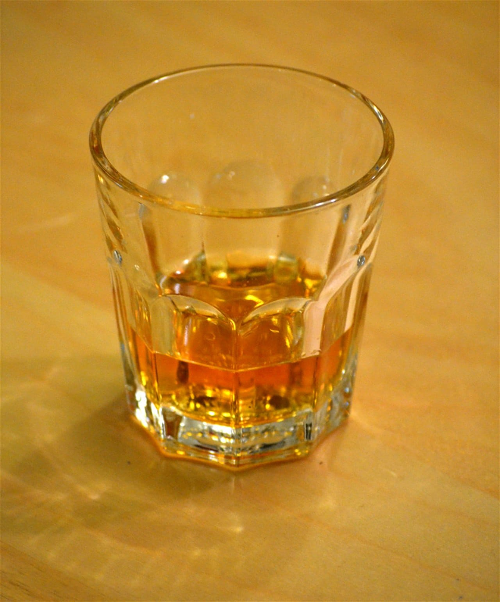

# Glenfiddich 18 Year Old

Glenfiddich 18 Year Old is a Speyside single malt Scotch whisky, matured for at least 18 years in Oloroso sherry and bourbon casks and then married in small batches. It is commonly 40% ABV, labelled 43% ABV in the US market, and sold in 700 mL or 750 mL bottles.

Figure: Glenfiddich 18 Year Old. Project-generated or category illustration used for whisky category context; not a photograph of the subject.

## Definition and position

Glenfiddich 18 Year Old is the product, Glenfiddich is the brand, William Grant & Sons is the owner, [whisky](ref:whisky) is the drink, and single malt is the type. Keeping these four levels apart separates distillery history, brand position and the age of the liquid.

"18 years" is an age statement meaning the youngest whisky in the bottle is at least 18 years old; it is not an average age, and it is not 18 years of extra maturation after blending. The product sits in the regular premium range, above the 12-year-old and below the 21-year-old and older expressions.

## Origin and distillery

The distillery is in Dufftown, in the Speyside region of [Scotland](ref:scotland). In 1886 William Grant began building the distillery there, and the first distillation took place at Christmas in 1887. The site uses local spring water, and the valley microclimate is part of its production setting.

Speyside is known for a softer profile with fruit, flowers and malt, but a regional style is only a statistical tendency and cannot replace the specific distillery's process and cask choices. Origin explains geography and regulation, while the distillery explains equipment and method.

## Ingredients and mashing

Single malt Scotch whisky is made from malted barley through mashing, fermentation and pot still distillation. Glenfiddich uses its own malt and spring water; the wort goes into fermentation vessels, where yeast converts sugar into alcohol and aroma precursors.

Raw materials and water shape the new-make backbone, but the final style is driven more by distillation cuts and oak casks. Barley variety, peat use and fermentation time are company process details that public sources may not fully disclose; this entry does not treat one raw-material factor as the whole explanation.

## Ageing and marrying

The 18-year-old matures in Oloroso sherry and bourbon casks. Sherry casks bring dried fruit, peel and spice, while bourbon casks bring vanilla, honey and woody sweetness. [Oak ageing](ref:oak-ageing) sets the aroma direction and integration; cask material, size, new or used status and warehouse conditions all affect the result.

After maturation the whiskies are married in small batches of no more than 150 casks, resting in wooden tuns for a period so that the different casks integrate before bottling. Each batch is individually numbered, so batch variation exists. Marrying is not simple mixing; it lets flavour settle into a more coherent whole.

## Specification and label

The common [alcohol by volume](ref:abv) is 40%, while the official US brand shop states 43%; bottles are commonly 700 mL or 750 mL. Labels vary by market and batch, so the bottle on hand governs.

The label should be checked for brand, distillery, age, type, strength, net volume, bottler and batch number. Single malt, blended malt and blended whisky are different categories; "18 years" is a regulated age statement, not "matured for 18 years and then blended".

## Flavour and tasting

Typical aromas are ripe apple, dried fruit, peel, honey and oak; the palate shows dried fruit, confectionery and date notes, a medium-to-full body and a warm finish. The 43% ABV version has more heat, while 40% ABV is softer; water opens aroma but also changes balance.

For tasting, start neat at room temperature, then add a few drops of water to compare. Ice lowers temperature and dilutes aroma. Dark chocolate, cheese, roast meat and nuts pair well; the sweetness of sherry casks contrasts with savoury food. Avoid very spicy dishes at the same time.

## History and naming

William Grant began building Glenfiddich in 1886 and production started in 1887. The name comes from the Gaelic "Glen of the Deer". The distillery has long been held by a family company, and that ownership structure is part of its public story.

The 18-year-old belongs to the regular age-statement range, and the name directly states the minimum maturation; it is not a commemorative edition or a single-vintage release. Brand history and product age are two dimensions, and the distillery's founding year cannot replace the 18-year statement on the bottle.

## Buying and drinking

When buying, check the official channel, label language, strength and batch number, and look for anti-counterfeit and importer information. Prices vary by market and batch, so no figure is given here; older does not automatically mean more enjoyable, and personal preference still needs actual tasting.

After opening, store away from light, upright and cool to reduce aroma loss; long storage does not need refrigeration, but high heat and sharp temperature swings should be avoided. Neat, with a little water or with ice are all acceptable. Excessive drinking harms health and minors should not drink.

## Common misconceptions

First, treating 18 years as an average age. It is the minimum age in the bottle.
Second, assuming older always tastes better. Age affects style and price, not personal preference.
Third, treating Speyside as one uniform style. The region is a tendency; distilleries differ greatly.
Fourth, treating marrying as simple mixing. Marrying needs resting and creates batch variation.
Fifth, using distillery history instead of product information. The bottle label is the specific basis.

**Short definition:** A Speyside single malt Scotch whisky matured for 18 years in Oloroso sherry and bourbon casks and then married in small batches. Commonly 40% ABV, with 43% ABV in some markets.

To read Glenfiddich 18 Year Old, start with the base and the stated strength, then the sweetness or bitterness, then how it is served; no single check settles it.

**Key facts.**

| Item | Detail |
| --- | --- |
| In one line | A Speyside single malt Scotch whisky matured for 18 years in Oloroso sherry and bourbon casks and then married in small batches. Commonly 40% ABV, with 43% ABV in some markets. |
| Style | Whisky |
| Region | Scotland |
| ABV | 40–43% vol |

**Sources and limits.** The key claims about Glenfiddich 18 Year Old are checked against the following sources: Glenfiddich (the 18-year maturation, sherry and bourbon cask combination, small-batch marrying and 43% ABV in the US market), William Grant & Sons (the distillery's founding and Speyside origin), Scotch Whisky Association (the legal definition of Scotch whisky and age-statement rules) and 4 sources in total. Prices, batches and status change; the body is project-written and does not reproduce source text.

**Read alongside.** Put Glenfiddich 18 Year Old next to Whisky, Scotland, Oak ageing: the first fixes identity and boundary, the others provide a region, process or peer comparison. Read this entry first, then return to those entries; the links become coordinates, not decoration.

For Glenfiddich 18 Year Old, this entry was last checked in 2026; prices, batches and availability change, so confirm them against the sources below.

## Further reading

- [Whisky](ref:whisky): whisky categories and basic production.
- [Scotland](ref:scotland): the regions and rules behind Scotch whisky.
- [Oak ageing](ref:oak-ageing): how sherry and bourbon casks shape flavour.
- [Alcohol by volume](ref:abv): reading 40% and 43% ABV labels.
