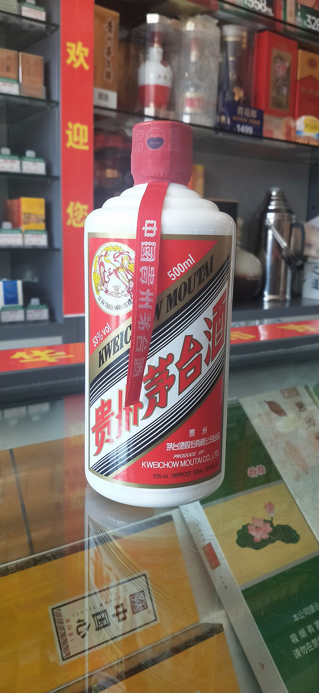

# Moutai

Moutai is produced in Maotai, Renhuai, Guizhou, and is a leading example of sauce-aroma baijiu. It uses sorghum and a high-temperature wheat qu, with repeated cooking, fermentation and distillation; the base spirit is aged and blended. The common Feitian Moutai is 53% ABV.

Figure: Moutai. Image: 毕明明, CC BY-SA 4.0, via Wikimedia Commons ([source page](https://commons.wikimedia.org/wiki/File:Kweichow_Moutai_2023_Part_1.jpg)).

## Definition and position

Moutai is a brand product within [baijiu](ref:baijiu) and the flagship of the sauce-aroma style. Brand, origin and style are three different layers: Maotai is a geographical producing area, Moutai is a specific brand, and sauce aroma is a process and flavour category. Mixing the three is the most common source of error in buying and discussing the product.

Moutai is a distilled spirit, with strength stated as [alcohol by volume](ref:abv). The common product is 53% ABV, and lower-strength versions such as 43% ABV also exist. Different strengths have different body design, blending ratios and taste aims, so "higher strength is better" is not a valid rule.

## Origin and environment

Maotai sits in the Chishui river valley, where the terrain brings relatively stable temperature and humidity, hot summers and mild winters, favouring open qu making and the microbial activity of stacked fermentation. Local water, soil and the microbial environment built up by long-term brewing are treated as conditions for the sauce-aroma style.

"You cannot make Moutai outside Maotai" is an industry saying that stresses the integration of origin environment and traditional process. It should not be read as a strict scientific conclusion, nor does it mean other regions cannot make good sauce-aroma baijiu. Origin value comes from the combined effect of climate, raw materials, process and accumulated practice.

## Raw materials and qu

The main materials are local glutinous sorghum and wheat. Glutinous sorghum is high in branched starch, survives repeated steaming and keeps supplying sugar through repeated fermentation. Wheat is used for high-temperature qu: the bricks are stacked and turned, building a complex community of bacteria, moulds and yeasts.

[Qu making](ref:qu-making) is the foundation of sauce aroma. Aroma precursors from high-temperature qu convert during later fermentation and distillation into the composite structure of soy-like, toasted and baked notes. Qu quality depends on season, temperature and handling experience, so base spirits from the same distillery also vary between batches.

## Production

The public process is often summarised as one annual production cycle, two grain additions, nine steamings, eight fermentations and seven distillations. Grain and qu are mixed and go through repeated cycles: after each steaming the grain is cooled, qu is added, it is stacked, then fermented in a pit, and spirit is drawn. Base spirits from different rounds differ clearly and must be stored separately.

After distillation comes maturation and blending. Base spirits are stored in clay jars for several years so that harsh compounds dissipate and aromas integrate, and then the blender combines rounds, ages and styles. Blending is not simple mixing but the use of different base spirits to complete a structure. Before bottling, water is usually not added to reduce strength, or it is adjusted to the product design.

## Flavour and tasting

Moutai's aroma is often described as a prominent sauce note with toasted, floral-fruit, baked and qu notes, and a long-lasting empty-cup fragrance. The entry is full, with sweetness and acidity together, bitterness and umami appearing mid-palate, and a long finish. Vintage and round bring detail differences, so the word "sauce aroma" alone is not a judgment.

Taste in a small cup: let it rest and smell, then sip so the liquid covers the tongue. Check whether the alcohol is carried by the body and whether the finish is clean. Water changes the aroma structure; if you try it, add drop by drop and compare. Too warm a serving temperature amplifies alcohol, and room temperature shows the layers better.

## Product lines and labels

Moutai has Feitian, Five Star, vintage and series products, with different price, positioning and body design. Products of other distilleries in Maotai town are not the same thing as Moutai: the former may use the origin description, while the latter is protected by trademark and geographical indication. Check the producer, trademark, standard and anti-counterfeit information when buying.

The vintage, batch and strength on the label are key to identifying the product. The detailed rules for vintage products are set by company standards and label statements, and packaging colour or the word "aged" is not enough to infer them. Price movements are market behaviour, and this entry gives no collecting or investment advice.

## Drinking and pairing

The traditional serve is neat in a small cup at room temperature. At the table it suits savoury Chinese dishes with rich sauce flavours, such as braised beef, roast goose, braised dishes and mushrooms; strong chilli and heavy acidity amplify the alcohol and cover the finer aroma. A small amount before a meal is enough, and large toasts are not the point.

Moutai can be used in mixed drinks, but its high strength significantly changes the balance. Ice or a large amount of water is not traditional and dilutes the aroma and structure. In cooking, a small amount adds aroma, while too much brings bitterness.

## Common misconceptions

First, equating "Maotai town" with "Moutai". Origin and brand are not the same concept.
Second, that higher strength is better. Strength serves body design, and lower-strength versions also have complete style aims.
Third, that a yellow tint means old liquor. Colour may come from storage, the vessel or additives and cannot date the bottle on its own.
Fourth, judging quality by legs or bubbles. These relate to strength and surface tension, not quality.
Fifth, equating bottle age with jar maturation. Change after bottling is far slower than in clay jars, and storage conditions are harder to control.

**Short definition:** A sauce-aroma baijiu from Maotai, Guizhou, made from sorghum and wheat qu and commonly bottled at 53% ABV. 

Start with the base and the stated strength. From there, consider the sweetness or bitterness, then how it is served. That is how a practical judgment about Moutai is built.

**Key facts.**

| Item | Detail |
| --- | --- |
| In one line | A sauce-aroma baijiu from Maotai, Guizhou, made from sorghum and wheat qu and commonly bottled at 53% ABV. |
| Style | Baijiu |
| ABV | 53–53% vol |

**Sources and limits.** The key claims about Moutai are checked against the following sources: Industry body (product lines, origin and public company information; sauce-aroma baijiu, high-temperature qu and related process terms), Oxford University Press (Consulted for entries on Chinese baijiu, sauce aroma and drinking culture). Prices, batches and status change; the body is project-written and does not reproduce source text.

## Further reading

- [Baijiu](ref:baijiu): the broad category and process background for Moutai.
- [Qu making](ref:qu-making): how high-temperature qu shapes sauce aroma.
- [Distillation](ref:distillation): the basic step of drawing and grading baijiu.
- [Alcohol by volume](ref:abv): the measure for understanding 53% ABV and lower-strength versions.
