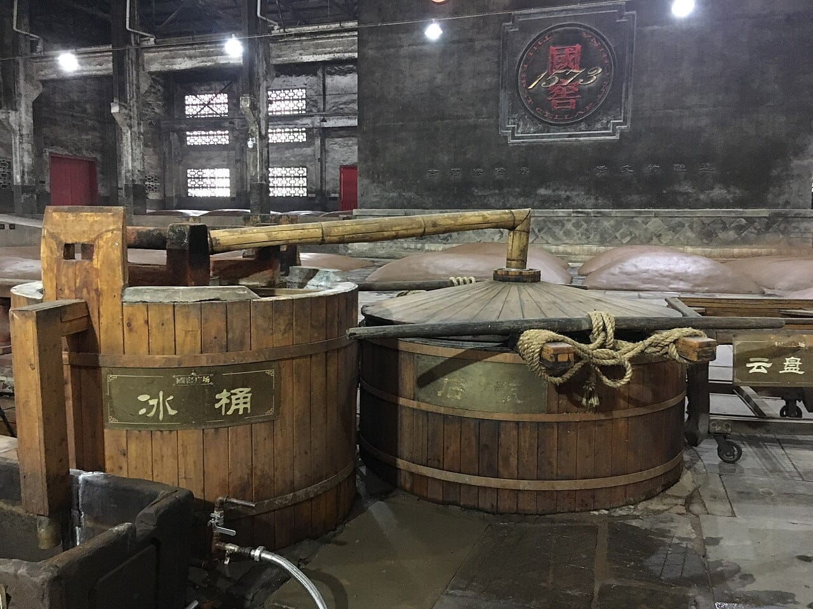

# Guojiao 1573

Guojiao 1573 is a high-end [strong-aroma baijiu](ref:strong-aroma) product from [Luzhou Laojiao](ref:brand), named directly after the pit group begun in 1573. It is commonly 52% ABV in 500 mL and comes from Luzhou, Sichuan. Name, brand, pit and company are four concepts and must not be conflated.

Figure: Guojiao 1573. Image: Xiaomage de, CC BY-SA 4.0, via Wikimedia Commons ([source page](https://commons.wikimedia.org/wiki/File:Traditioneller_chinesischer_Destillationsapparat_in_der_Brennerei_Luzhou_Laojiao.jpg)).

## Definition and position

Guojiao 1573 is a product name, not a company name. "1573" refers to the founding year of the pit group, not the age of every bottle. It belongs to the strong-aroma route of [baijiu](ref:baijiu) and is positioned as the brand's high-end core product, separated from Tequ, Touqu and other series by price and body design.

Borrowing the historical symbol of the pits is common in the baijiu industry. But the history of a symbol is not the history of the liquid; age statements should follow the label and public company information.

## Producer and brand

The product is made within the [group](ref:producer) system, the brand is carried by [Luzhou Laojiao](ref:brand), and the listed company handles production and disclosure. Group, joint-stock company, brand and product are four layers with different data scopes.

For Guojiao 1573, begin with the base and the stated strength. Then look at the sweetness or bitterness, and finally ask how it is served. The answers point to different choices, not to a single score.

## Origin and raw materials

Luzhou lies in southeastern Sichuan, where the Yangtze and Tuo rivers meet, with a warm humid climate suited to solid-state mud-pit fermentation. Within the map of [China](ref:china)'s baijiu regions, Luzhou is an important strong-aroma node.

The main raw material is [sorghum](ref:sorghum) with wheat qu, and some products use multi-grain ratios. Sorghum starch and grain structure affect fermentation start-up, while qu microbial composition affects pit and grain aroma. The ingredient list and standard are directly checkable.

## Brewing process

Strong aroma uses solid-state mud-pit fermentation, continued mash recycling and mixed steaming and boiling. [Qu making](ref:qu-making) and pit maintenance together decide aroma depth and cleanliness; the longer a pit is used continuously, the more stable the microbial ecology in the pit mud.

After removal, the mash is [distilled](ref:distillation) with fractional cutting; new spirit is stored by grade and round before blending. Storage vessel and time affect how quickly harshness fades, while blending balances aroma, body and finish.

## Specification and label

The common specification is 52% ABV in 500 mL; other strengths, volumes and gift editions exist. The product standard for strong-aroma baijiu is commonly GB/T 10781.1, and the bottle label governs.

The producer, product name, aroma type, strength, volume, standard and anti-counterfeit information on the label are the basics for identity. Buy through official channels and check anti-counterfeit marks and batches rather than judging from the number "1573" or packaging style.

## Flavour and tasting

The aroma is led by pit and grain notes, often with sweetness; the entry is mellow and sweet, the body relatively full, the mid-palate opens and the finish is clean. Different pits, ages and blends create clear differences, and one description cannot cover every batch.

For Guojiao 1573, taste from a small cup: smell at rest, then gently swirl and smell again. Let the liquid stay in the mouth and note the order of sweet, sour, bitter and savoury and the body thickness. Water lowers heat and opens aroma but changes balance, so add drop by drop and compare.

## History and market

For Guojiao 1573, public information shows that the pit group begun in 1573 was listed as a Major Historical and Cultural Site Protected at the National Level in 1996; the listed company was listed in 1994, and the group was founded in 2000. These milestones have heritage and public registration support and can be checked.

Guojiao 1573 represents the brand's move upmarket and has long sat in the high-end price band. Prices change with year, channel and supply and demand, and this entry gives no figures. Treating "1573" as age is the most common misreading of this product.

## Buying and storage

Prefer official channels and check anti-counterfeit marks, producer and batch. Gift boxes and channel editions should be checked against the label, and packaging differences should not be mistaken for body differences. For full cases, check seals and storage conditions.

For Guojiao 1573, unopened baijiu should be stored upright, away from light, in a cool place without strong odours. Once opened, drink it soon; prolonged exposure loses aroma. Home storage cannot reproduce distillery conditions, so purchase year should not be equated with quality gain.

## Common misconceptions

First, treating "1573" as the age of the liquid. It is first of all a pit and product name.
Second, treating Guojiao 1573 as a company name. It is a product name.
Third, assuming higher strength is more authentic. Strength serves product design.
Fourth, treating a packaging edition as a body upgrade. Edition differences need official explanation.
Fifth, judging authenticity from price or packaging. Anti-counterfeit checks, channels and labels are more reliable.

[Luzhou Laojiao](ref:brand)'s style and [Baijiu](ref:baijiu)'s region and vintage form a useful pair: the contrast shows where one ends and the other begins.

**At a glance:** A high-end strong-aroma product from Luzhou Laojiao, named after the pit group begun in 1573, commonly 52% ABV in 500 mL. The name is not the age of the liquid.

Guojiao 1573 is the flagship of Luzhou Laojiao, a strong-aroma baijiu from Luzhou, Sichuan; the name refers to the pit age claimed for the continuous fermentation cellars, not to the age of the liquid in the bottle. It is distilled from sorghum and other grains with wheat qu, and the style is sweet, aromatic and full-bodied. The brand sits in the premium baijiu tier, with packaging and price varying by release. A bottle should be checked for the producer, the grade and the batch; the 1573 is a brand and heritage claim, not a statutory age statement. Compared with Wuliangye, Guojiao 1573 is softer and more aromatic, while both are strong-aroma.

**Key facts.**

| Item | Detail |
| --- | --- |
| In one line | A high-end strong-aroma product from Luzhou Laojiao, named after the pit group begun in 1573, commonly 52% ABV in 500 mL. The name is not the age of the liquid. |
| Style | Baijiu、Strong-aroma baijiu |
| Region | China |
| ABV | 52–52% vol |
| Producer or brand | Luzhou Laojiao Group Co., Ltd.、Luzhou Laojiao |

**Sources and limits.** The key claims about Guojiao 1573 are checked against the following sources: Industry body (brand, product series and public information; the product-standard basis for strong-aroma baijiu), Oxford University Press (Consulted for entries on Chinese baijiu). Prices, batches and status change; the body is project-written and does not reproduce source text.

## Further reading

- [Luzhou Laojiao](ref:brand): brand structure and product system.
- [Luzhou Laojiao Group Co., Ltd.](ref:producer): group and listed company layers.
- [Baijiu](ref:baijiu): the category and aroma-type system.
- [Strong-aroma baijiu](ref:strong-aroma): mud pits and continued mash.
- [Sorghum](ref:sorghum): one of the main strong-aroma materials.
- [Qu making](ref:qu-making): how qu shapes aroma.
- [Distillation](ref:distillation): cutting and strength basics.
- [China](ref:china): the broad context of baijiu regions.
