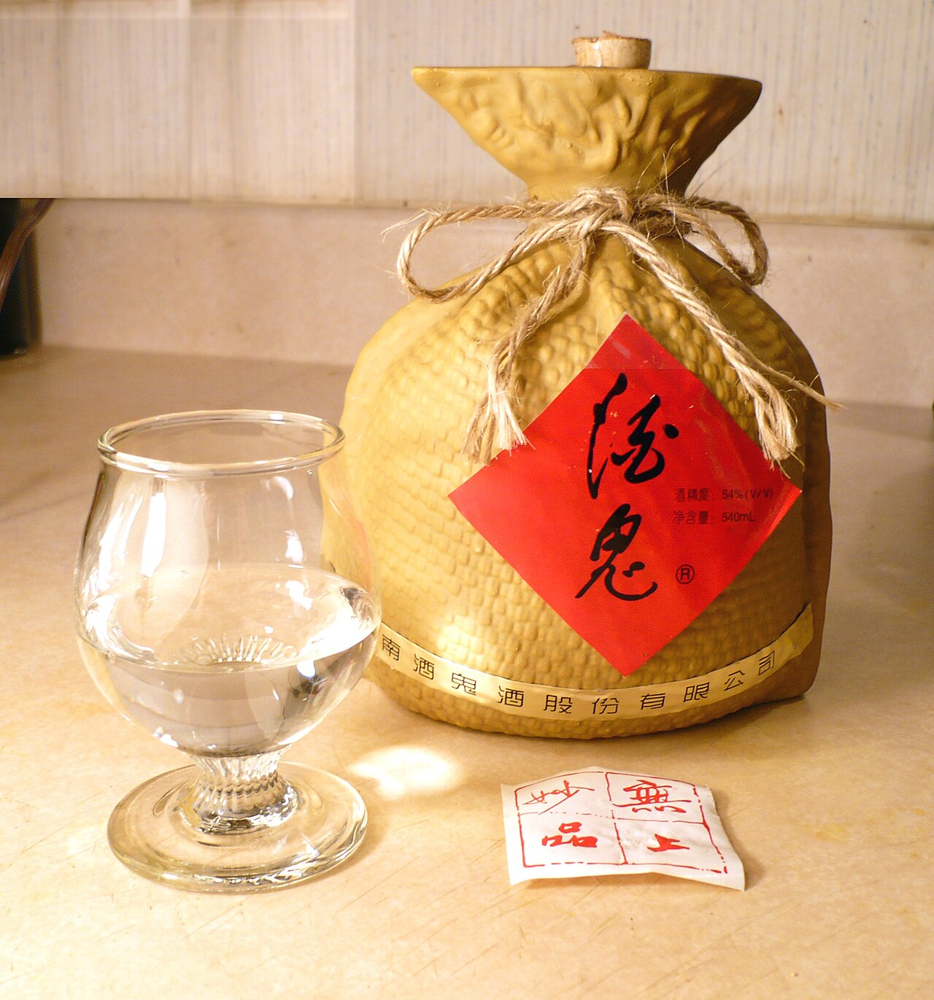

# Jiugui

Jiugui is produced in Jishou, Hunan, and belongs to the fuyu-aroma category. The style combines features of strong-, light- and sauce-aroma production, using sorghum, rice, glutinous rice, wheat and corn. A common strength is 52% ABV.

Figure: Jiugui. Image: Badagnani, CC BY 3.0, via Wikimedia Commons ([source page](https://commons.wikimedia.org/wiki/File:Jiugui.jpg)).

## Definition and position

Jiugui is a brand within [baijiu](ref:baijiu) and the main representative of fuyu aroma. Fuyu aroma is not "three aroma types mixed together": it is a separate process spanning qu making, fermentation, distillation and storage, so that the finished spirit combines the sweetness of strong aroma, the cleanliness of light aroma and the aftertaste of sauce aroma.

The product is distilled, with strength stated as [alcohol by volume](ref:abv), commonly 52% ABV. Aroma type is a category and style is a product concept; within the same aroma type, different series still differ in aromatic centre and body weight.

## Origin and environment

Jishou lies in western Hunan in a subtropical monsoon climate, with high humidity and four distinct seasons, and the mountainous terrain makes local microclimates more varied. Warm, humid conditions favour qu making and open fermentation and also place higher demands on workshop hygiene. Local water and grain are basic conditions for the style.

Western Hunan's brewing tradition is tied to its multi-ethnic food culture. Jiugui's origin story often stresses valleys, springs and caves; these elements can be read as clues to storage and the microbial environment, but they cannot replace checking the specific process and label.

## Raw materials and qu

The five grains supply starch, protein and structure: sorghum is the frame, rice and glutinous rice add sweetness and roundness, wheat helps qu making and fermentation, and corn brings weight. A multi-grain recipe makes the aroma more composite and raises the difficulty of raw-material management and proportion control.

Fuyu aroma usually combines small qu and large qu: small qu has strong saccharifying power, while large qu provides more complex aroma precursors. [Qu making](ref:qu-making) temperature and the ratio of qu types affect how quickly fermentation starts and where the aroma goes. Too much qu aroma covers grain notes; too little leaves the body thin.

## Production

The public flow is: prepare the raw materials, cook, cool, add qu, ferment in the pit, distil, grade and store, blend and bottle. The fermentation vessel and pit management decide the microbial environment; cutting the distillate by segment decides the cleanliness and aromatic depth of the base spirit.

New spirit is stored separately by round and grade, then blended. The difficulty of fuyu aroma is to be composite without being muddled: the strong, light and sauce characteristics must work together in one body rather than conflict. Storage and blending are the stages that solve this.

Fermentation cycles and round schedules are adjusted with the seasons: summer needs temperature control to prevent excessive acidity, while winter needs insulation to ensure fermentation starts. Workshop hygiene and qu-room humidity matter too, and any lapse makes the composite aroma muddled.

## Flavour and tasting

The usual description is "strong aroma at the start, light aroma in the middle, sauce aroma in the finish": a sweet, mellow entry, a cleaner mid-palate and a toasted, savoury aftertaste. Fuyu aroma is a defined category, not a marketing adjective, but products and vintages still vary.

Taste in a small cup: smell the resting aroma and check whether one aroma type overwhelms the others; then sip and follow the shift from entry to aftertaste. The evaluation focuses on harmony rather than the strength of any one note. Water changes the layers, so add it drop by drop if you try.

## Product lines and labels

Jiugui has Neican and Jiugui series with different positioning and body design. The packaging and naming carry strong western Hunan cultural symbols, which is brand narrative; discussing quality should still return to raw materials, process and body. The producer, aroma type, strength, standard and volume on the label are the basics for identity. Counterfeits and similar names exist, so buy through official channels and check anti-counterfeit marks.

Terms such as "vintage" and "cave storage" need to be read with company standards and labels. Cave storage describes a storage environment, not the exact age of the liquid; the specific age and blending ratio should come from official information.

## Drinking and pairing

Serve neat in a small cup with the bold flavours of Hunan cuisine. The chilli and cured flavours of Hunan food amplify the alcohol and change the perception of sweetness; for a first taste, take a small sip, look for the aromatic layers, then decide whether to pair it with heavy dishes.

Jiugui can be used in mixed drinks, but high strength significantly changes the balance. Ice or a large amount of water is not traditional and dilutes the composite aroma. After opening, store away from light in a cool place and finish within a reasonable time. Drink in moderation and avoid rapid drinking on an empty stomach.

## Common misconceptions

First, reading fuyu aroma as "three spirits blended". It is an aroma type formed by a complete process, not a simple mix.
Second, that a more composite aroma is always better. Composite needs harmony; muddled is not complex.
Third, judging it solely by strong- or sauce-aroma standards. The evaluation framework should match the aroma type.
Fourth, equating cave storage with a guarantee of age. Cave storage is a storage condition, not a specific age.
Fifth, judging authenticity by packaging or price. Anti-counterfeit checks, channels and labels are reliable.

**Short definition:** A fuyu-aroma baijiu from Jishou, Hunan, combining strong-, light- and sauce-aroma production features.

Jiugui is best read by starting with the base and the stated strength, moving to the sweetness or bitterness, and ending with how it is served.

[Baijiu](ref:baijiu) and [Qu making](ref:qu-making) are the two useful reference points for Jiugui. [Baijiu](ref:baijiu) sets out style; [Qu making](ref:qu-making) brings in region and vintage. Read them together.

**Key facts.**

| Item | Detail |
| --- | --- |
| In one line | A fuyu-aroma baijiu from Jishou, Hunan, combining strong-, light- and sauce-aroma production features. |
| Style | Baijiu |
| ABV | 52–52% vol |

**Sources and limits.** The key claims about Jiugui are checked against the following sources: Industry body (origin, aroma type and product lines; fuyu-aroma baijiu and related process terms), Oxford University Press (Consulted for entries on Chinese baijiu aroma types and drinking culture). Prices, batches and status change; the body is project-written and does not reproduce source text.

## Further reading

- [Baijiu](ref:baijiu): the broad category and aroma-type system behind Jiugui.
- [Strong-aroma baijiu](ref:strong-aroma): a reference for understanding the "strong at the start" feature.
- [Qu making](ref:qu-making): how small and large qu shape a composite aroma.
- [Alcohol by volume](ref:abv): the measure for comparing product strengths.
