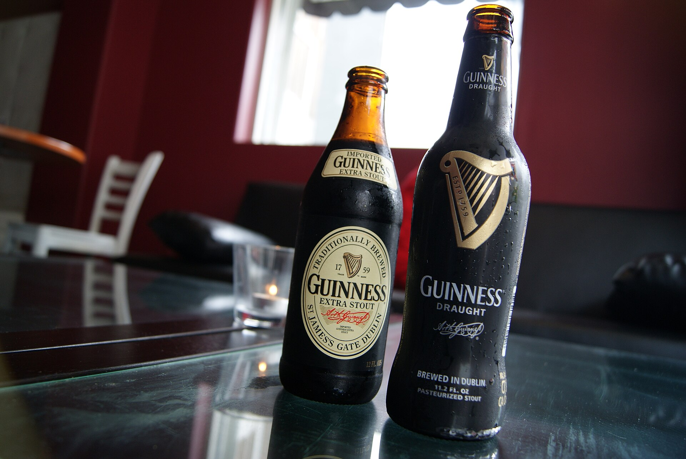

# Guinness Draught

Guinness is a dry stout from the St James's Gate brewery in Dublin, Ireland. Its flagship Guinness Draught is about 4.2% ABV, with roasted barley giving coffee and cocoa-like colour and bitterness, and a nitrogen version adding a creamier texture.

Figure: Related photograph of Guinness Draught. Image: Aneil Lutchman, CC BY-SA 2.0, via Wikimedia Commons ([source page](https://commons.wikimedia.org/wiki/File:Guinness_Extra_Stout_and_Guinness_Draught.jpg)).

## Definition and position

Guinness is a brand; stout is a [beer](ref:beer) style. Stout grew out of the British porter tradition and later developed a dry route in Ireland. Dry stout stresses roasted flavour and a clean finish rather than syrupy sweetness, and is not the same as the loose term "black beer".

Package and product need separating: Guinness Draught is a specific product, and cans, bottles and draught differ in nitrogen handling and texture. The brand also has other stouts and special products with different strengths and goals.

## Origin and history

Guinness traces its history to 1759, when Arthur Guinness took the brewery lease at St James's Gate in Dublin and began brewing. In the 18th and 19th centuries, porter and stout spread in London and Ireland, and Guinness gradually became the most representative Irish stout brand.

Dublin's soft water and raw-material supply shaped the early style. The brand later expanded production to several countries, but St James's Gate remains the symbolic site. Origin and brand history are background; the origin of a specific product should come from the label.

Porter and stout diverged in the London beer market of the 18th and 19th centuries. Stout originally meant a "strong" beer and later became a style name; Guinness industrialised the style in Ireland and extended it overseas through rail and shipping. This history explains why stout and porter are related yet distinct.

## Raw materials

The main materials are barley malt, roasted barley, water, hops and yeast. Roasted barley is the main source of dark colour and coffee-cocoa flavour and also contributes bitterness; unmalted roasted barley adds a dry finish. Hop levels are usually modest, providing balancing bitterness.

Water quality matters for stout. Dublin's soft water suited mashing and fermenting dark malt, and modern plants adjust water chemistry for consistency. Ingredient proportions and roast level set colour, bitterness and body, and the specific recipe is producer information.

## Production

The typical flow is: milling, mashing, lautering, boiling, cooling, pitching yeast, primary fermentation, secondary fermentation and maturation. Some products use nitrogen or a nitrogen mix to create fine foam and a smooth texture; nitrogen itself does not dissolve in the beer and mainly changes foam and mouthfeel.

Cans often contain a nitrogen device that releases gas when opened to form the foam layer, while draught beer is dispensed through a nitrogen tap. These package differences are an important feature of the Guinness range and are easily overlooked.

Roasted barley gives colour and flavour in the mash, but too much brings acrid bitterness; hop levels must balance malt sweetness. Fermentation temperature and yeast strain shape ester aroma, and dry stout is usually kept clean to highlight roast rather than fruit.

## Flavour and tasting

Guinness Draught is usually medium-light in body, with coffee, cocoa, toast and a little hop bitterness, finishing dry. A dark colour does not mean a heavy body; its bitterness comes largely from roasted barley rather than heavy hopping, so it differs from IPA bitterness.

Look at foam fineness and persistence, smell the roast, then taste the balance of bitterness and sweetness and the smooth nitrogen texture. Too cold suppresses aroma, too warm makes it loose. When comparing with other stouts, separate dry from sweet types.

Nitrogenated beer has finer foam and a smoother texture but slower aroma release. Judge foam texture and aroma separately: good foam does not mean strong aroma, and vice versa.

## Product lines and labels

Guinness products include Draught, Extra Stout and special series with different strengths and original gravities. The product name, strength, volume and origin on the label are the basics for identity. [Beverage-alcohol classification](ref:gbt-17204) places beer among fermented drinks, which helps avoid confusing it with distilled spirits.

"Nitrogenated", "draught" and "imported original" need to be read with the package and label. Recipes may be adjusted for different markets, changing strength and flavour, so check the label rather than judging by brand alone.

## Drinking and pairing

Serve at about 6–8°C in a straight pint glass; the nitrogen version shows a visible foam settle, so wait for it to stabilise. The settle takes a little patience, and rushing to fill the glass spoils the texture. Oysters, braised meat, Irish bread and hard cheese suit it; light salads make the beer seem heavy.

Finish an opened bottle or can soon, avoiding repeated warming and oxidation. Drink beer in moderation and avoid rapid drinking on an empty stomach. Do not shake a nitrogen version hard, or the foam will run away.

## Common misconceptions

First, equating stout with "black beer". Dark colour does not mean a heavy body, and stout includes dry and sweet types.
Second, that all bitterness comes from hops. Much of Guinness bitterness comes from roasted barley.
Third, that nitrogen changes strength. Nitrogen mainly affects foam and texture.
Fourth, treating cans and draught as the same experience. Package and dispensing differ, and so does texture.
Fifth, that darker means more nutritious. Colour comes from roasting, not nutrition.

[Beer](ref:beer) and [Alcohol by volume (ABV)](ref:abv) answer different questions about Guinness Draught: style and region and vintage. Read them as a pair, not as alternatives.

**In brief:** A dry stout from the St James's Gate brewery in Dublin, Ireland; the flagship is about 4.2% ABV and known for its roasted barley depth and nitrogen-conditioned texture.

A frequent error is to treat Guinness Draught as a drink style or a brand. Establish which style it belongs to, then who makes it and which vintage or batch. Neither answer settles the question alone.

### Key dates and figures

- 2021: GB/T 17204-2021, the Chinese terminology and classification standard for alcoholic drinks, covers the category.

**Key facts.**

| Item | Detail |
| --- | --- |
| In one line | A dry stout from the St James's Gate brewery in Dublin, Ireland; the flagship is about 4.2% ABV and known for its roasted barley depth and nitrogen-conditioned texture. |
| Style | Beer |
| ABV | 4.2–4.2% vol |

**Sources and limits.** The key claims about Guinness Draught are checked against the following sources: Guinness (brand history, products and strength), Beer Judge Certification Program (the style description of stout), Oxford University Press (Consulted for entries on stout, Irish beer and nitrogenated beer). Prices, batches and status change; the body is project-written and does not reproduce source text.

## Further reading

- [Beer](ref:beer): the broad category, raw materials and basic process.
- [Beverage-alcohol classification](ref:gbt-17204): where beer sits in the drinks system.
- [Alcohol by volume](ref:abv): the 4.2% ABV label and low-strength fermented drinks.
