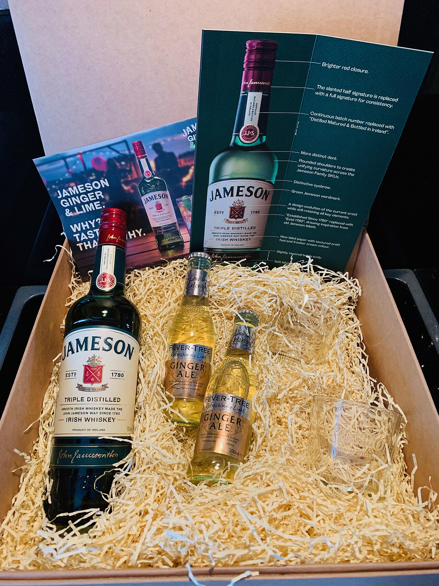

# Jameson Irish Whiskey

Jameson is an Irish blended [whiskey](ref:whisky) brand founded in Dublin in 1780 by John Jameson and now produced at the Midleton distillery in County Cork. It is triple [distilled](ref:distillation) and blends pot still whiskey with grain whiskey, usually at 40% ABV. Its flavour profile is built on grain sweetness, green apple, vanilla and soft spice.

Figure: Jameson Irish Whiskey. Image: That's Dram Good, CC BY-SA 4.0, via Wikimedia Commons ([source page](https://commons.wikimedia.org/wiki/File:Jameson_Original.jpg)).

## Definition and identity

Irish whiskey is a geographical indication that must be produced and matured in Ireland, including Northern Ireland, from cereal grain and aged in oak for at least 3 years. Apart from water and caramel colouring, additives are generally not permitted, and bottling strength must be at least 40% ABV. Jameson is a blended whiskey within that category, not a single malt and not a single pot still.

"Blended" here means combining different whiskey types: pot still whiskey contributes spice, texture and body, while grain whiskey contributes sweetness and a lighter body. The brand does not publish the exact proportions, so flavour cannot be used to calculate how much of each component is present. Understanding the blend explains the smooth style better than memorising "triple distilled".

## History

In 1780 John Jameson established his distilling business in Dublin and later set up a distillery on Bow Street, which grew into an important Irish whiskey brand. Irish whiskey held a significant global position in the nineteenth century; the twentieth century brought war, Prohibition, trade barriers and industry contraction, and many distilleries closed or merged.

In 1975 production was concentrated at the Midleton distillery in County Cork, and the brand continued from there. Its modern image stresses smoothness, easy drinking and mixability, which reflects both triple distillation and blending and a long-standing market position. Historical dates and the actual age of a bottle are different things; the standard bottling usually carries no age statement. A stable blend reduces batch variation and keeps the flavour consistent across markets.

## Region and ingredients

Ireland's mild, damp climate suits barley, and whiskey may use barley as well as maize or other grains. Pot still whiskey typically combines malted and unmalted barley, while grain whiskey relies on maize and other starch sources. The proportions and the mashing and fermentation conditions shape sweetness, grain character and texture.

Water, yeast and still design also matter. The shape of a copper pot still affects reflux and aroma retention; triple distillation usually gives a lighter, cleaner spirit but can reduce some heavier flavours. "More distillations is better" is too simple, because styles differ: Scotch single malts often use two distillations to retain oils and complexity, while Irish blends may aim for smoothness.

## Process and ageing

Legal maturation must take place in oak, commonly bourbon and sherry casks. [Oak ageing](ref:oak-ageing) adds vanilla, coconut, dried fruit and spice and slowly softens pungency through controlled oxidation. Jameson does not publish its exact cask mix; the standard bottling is generally bourbon-cask led, giving vanilla and grain sweetness.

Blending happens after maturation or before bottling: different casks, ages and whiskey types are combined to stabilise the style. Bottling may involve the addition of water to lower strength and a small amount of caramel colouring. "Triple distilled" describes a process, not longer ageing or higher quality; judgement still depends on the specific bottling and batch.

## Flavour and tasting

Jameson typically shows grain sweetness, green apple, pear, vanilla and light floral notes. The palate is soft and sweet, with spice and wood in the middle and a medium finish. It usually has no pronounced peat smoke, which contrasts with some Scotch whiskies. Special versions, such as cask-strength or unusual casks, can be much more aromatic and stronger.

Taste neat at room temperature; a little room-temperature water opens the aroma and reduces pungency; ice cools and dilutes, which suits hot weather or higher-strength versions. Do not drown it in soda, or the grain sweetness and spice layers will disappear.

## Drinking and pairing

Neat, on the rocks and with soda are all common, and Jameson is widely used in Irish coffee and whiskey cocktails. As a blended whiskey it is approachable, but that does not make it characterless. With food it suits roast chicken, pork, creamy dishes and medium-strength cheese; very spicy or very acidic dishes can clash with the alcohol and sweetness.

Store away from direct sunlight and heat, with a sealed bottle and as little headspace as possible. Aroma fades slowly after opening, usually more slowly than wine; taste a small amount before drinking a long-opened bottle.

## Common misconceptions

First, treating all Irish whiskey as single malt. Ireland also produces blends, single malts and single pot still whiskey.
Second, assuming triple distillation is unique to Jameson. Several Irish distilleries use it, and not every Irish whiskey does.
Third, reading "smooth" as "low quality". Smoothness comes from distillation and blending choices; it is a style, not a defect.
Fourth, treating Jameson as Scotch. It is an Irish geographical indication with different rules.
Fifth, assuming the standard bottling has a stated age. A blend without an age statement is not unaged; it simply carries no minimum age claim.

**In brief:** An Irish blended whiskey brand founded in Dublin in 1780 and now made at Midleton in Cork; triple distilled, usually 40% ABV. 

For Jameson Irish Whiskey, begin with the base and the stated strength. Then look at the sweetness or bitterness, and finally ask how it is served. The answers point to different choices, not to a single score.

[Whisky](ref:whisky) explains style; [Oak ageing](ref:oak-ageing) adds region and vintage. Put Jameson Irish Whiskey between them before deciding what it is.

Do not reduce Jameson Irish Whiskey to a drink style or a brand.

Jameson is a blended Irish whiskey, triple-distilled and typically 40% ABV; the blend combines pot-still whiskey with grain whiskey, which gives it a lighter, smoother profile than a single pot still.

**Key facts.**

| Item | Detail |
| --- | --- |
| In one line | An Irish blended whiskey brand founded in Dublin in 1780 and now made at Midleton in Cork; triple distilled, usually 40% ABV. |
| Style | Whisky |
| ABV | 40–40% vol |

**Sources and limits.** The key claims about Jameson Irish Whiskey are checked against the following sources: Jameson (brand history, triple distillation and product information), Irish Whiskey Association (the Irish whiskey geographical indication, minimum ageing and labelling rules), Oxford University Press (Consulted for entries on Irish whiskey, triple distillation and blending) and 4 sources in total. Prices, batches and status change; the body is project-written and does not reproduce source text.

## Further reading

- [Whisky](ref:whisky): the wider distilled category to which Jameson belongs.
- [Distillation](ref:distillation): triple distillation and its effect on body.
- [Oak ageing](ref:oak-ageing): the main stage for vanilla, dried fruit and structure.
