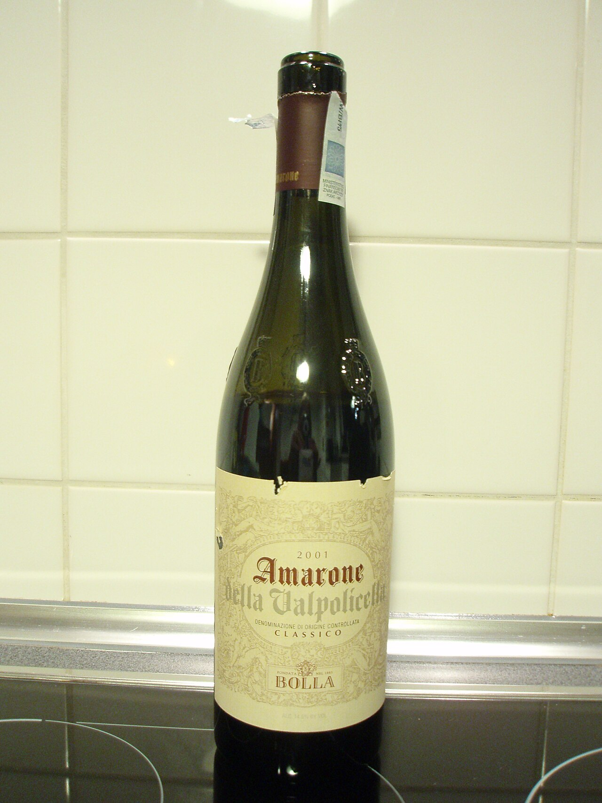

# Amarone della Valpolicella

Amarone della Valpolicella is a red wine from the Valpolicella area of Veneto, Italy, made from Corvina, Corvinone and Rondinella grapes dried before fermentation, giving a full body, high alcohol and notes of dried fruit and cherry. It is commonly 750 mL at about 15%–16% vol, and the area's rules require the grapes to be dried first, then fermented and aged for an extended period.

Figure: Amarone della Valpolicella. Photograph: A bottle of Amarone della Valpolicella. Credit: Jerzy Kociatkiewicz, CC BY-SA 2.0, via Wikimedia Commons ([source](https://commons.wikimedia.org/w/index.php?curid=8844471)).

## Definition and position

Start by separating the levels: [red wine](ref:red-wine) is the category, Corvina and related grapes are the varieties, Valpolicella is the place, Amarone is the appellation (DOCG), and individual estates and wines are the producer level. Keeping these four apart is what stops "Amarone" from being read as a brand or as a grape.

Amarone is a place name and an appellation marker, not a trademark. It is a dried-grape red wine, distinct from Valpolicella, Valpolicella Superiore and the sweet Recioto of the same area; only wine made under the Amarone production rules and meeting the ageing requirements may use the name.

## Producer and brand

The Valpolicella area has family estates, cooperatives and merchants, from domaines of a few hectares to larger cooperatives. The bottler information on the label is the basis for identity, and one estate often makes Valpolicella, Ripasso and Amarone together, so the range has to be read in layers.

Estate, brand and product are three levels: the estate answers for sites, equipment and method, the brand answers for positioning and range, and the product answers for vintage, volume and alcohol. Regional history and company narrative cannot replace the appellation, vintage and ageing information on the bottle.

## Region and ingredients

The appellation lies in the province of Verona in the Veneto region of [Italy](ref:italy), covering the classic Valpolicella zone and an extended zone, with hills and valleys and a climate moderated by Lake Garda and the Alps; autumn is relatively dry, which favours drying the grapes.

The raw material is [grape](ref:grape), mainly Corvina and Corvinone with Rondinella and other permitted varieties. Healthy, ripe clusters with intact skins are selected at harvest, because drying concentrates sugar and flavour and also magnifies any mould or damage.

## Winemaking

After harvest the grapes are not pressed at once but laid out to dry in well-ventilated rooms, usually for about 100 to 120 days, so the berries lose water and sugar and flavour concentrate. The dried grapes are then destemmed and pressed and slowly [fermented](ref:fermentation); low temperature and high sugar lengthen the fermentation.

After fermentation the wine goes into [oak ageing](ref:oak-ageing) and then continues in bottle. The production rules set requirements for drying time, minimum alcohol and ageing period, and the wine may be released only when these are met; barrel type, age and duration are the estate's choice. Ripasso is a different product made by fermenting Valpolicella wine on the lees of Amarone.

## Specification and label

The common volume is 750 mL, with [alcohol by volume](ref:abv) at about 15%–16% vol, varying with vintage and estate. The label should be checked for the appellation name Amarone della Valpolicella, the DOCG mark, vintage, bottler, net volume and importer information, and should be distinguished from Ripasso and Recioto.

The Chinese back label, importer and anti-counterfeit information are the basis for checking identity; label languages differ by market, so the bottle on hand governs. On seeing the word "Amarone", also confirm that it is the full appellation name.

## Flavour and tasting

Typical aromas are dried fruit, black cherry, dried plum, fig, cinnamon and cocoa, with leather, tobacco and nuts emerging with age. The palate is full-bodied with high alcohol, medium-high acidity and thick tannin, and a long finish; the sweetness brought by drying and the high alcohol need acidity to support them, or the wine can feel heavy.

For tasting, serve at about 16–18 degrees Celsius in a large glass and avoid too warm a temperature, which amplifies alcohol. Younger vintages can be decanted, while older bottles should be decanted for less time; the aroma changes with temperature and air, so the wine suits slow drinking.

## Drinking and pairing

It pairs well with braised and roasted meat, game, hard cheese and rich sauces; high alcohol and a full body suit food rich in fat and protein and echo the savoury depth of aged cheese. It does not suit steamed seafood, light vegetables or very sweet food, where the alcohol can stand out.

After opening, refrigerate and finish within a few days, as prolonged air contact speeds oxidation. Amarone is usually high in alcohol with a firm structure, suited to small servings when young or to medium-term keeping; the drinking window depends on vintage and estate. Excessive drinking harms health and minors should not drink.

## Buying and storage

Buy from reputable channels and check the appellation name, vintage, bottler and importer information. Prices move with vintage, zone and channel, so no figure is given here; Valpolicella, Ripasso and Amarone are different products, and one wine cannot stand for the whole area.

For Amarone della Valpolicella, unopened bottles should be kept away from light, lying flat, in a cool place at an ideal 12–15 degrees Celsius, avoiding heat and sharp temperature swings. Cork-sealed bottles need humidity and can be stored lying down; after opening, refrigerate and drink soon, as a high-alcohol wine changes quickly once open.

## Common misconceptions

First, treating Amarone as a grape variety. It is an appellation name, built mainly on Corvina.
Second, confusing Amarone with Ripasso. Ripasso is a different product with different methods and positioning.
Third, assuming Amarone is sweet. The sweet wine is Recioto; Amarone is usually dry or near dry.
Fourth, treating high alcohol as a guarantee of quality. Balance, acidity and aroma concentration matter just as much.
Fifth, judging authenticity by price or packaging. Channel, label and anti-counterfeit information are more reliable.

Setting [Red wine](ref:red-wine)'s style beside [Grape](ref:grape)'s region and vintage makes the boundary between them visible.

**Short definition:** A red wine from the Valpolicella area of Veneto, Italy, made from Corvina, Corvinone and Rondinella grapes dried before fermentation, giving a full body, high alcohol and notes of dried fruit and cherry. The DOCG rules require drying and extended ageing; commonly 750 mL at about 15%–16% vol.

## Further reading

- [Red wine](ref:red-wine): red wine categories and basic winemaking.
- [Italy](ref:italy): where Veneto sits in the Italian wine map.
- [Grape](ref:grape): the basic structure of wine grapes and ripeness measures.
- [Fermentation](ref:fermentation): the slow fermentation of a high-sugar must.
- [Oak ageing](ref:oak-ageing): how barrel type and age shape a dried-grape red.
- [Alcohol by volume](ref:abv): what 15%–16% vol means on a label.
