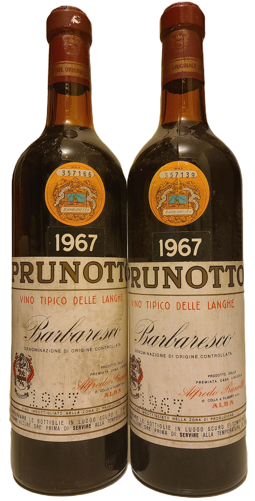

# Barbaresco

Barbaresco is a red wine from the Barbaresco DOCG in Piedmont, Italy, made only from Nebbiolo. It belongs to the same Nebbiolo family as Barolo, but its area is smaller, its climate slightly warmer and its style softer, and it usually reaches its drinking window earlier. It is commonly 750 mL at about 13.5%–14.5% vol, and the appellation rules require at least 26 months of total ageing, with at least 9 months in wood.

Figure: Barbaresco. Image: Geographer, CC BY-SA 4.0, via Wikimedia Commons ([source page](https://commons.wikimedia.org/wiki/File:Prunotto_Barbaresco_1967.jpg)).

## Definition and position

Start by separating the levels: [red wine](ref:red-wine) is the category, Nebbiolo is the variety, Piedmont is the region, Barbaresco is the appellation (DOCG), and estates and individual wines are the producer level. Barbaresco is not a brand, and it is not a grape name.

Compared with [Barolo](ref:barolo), Barbaresco covers a far smaller delimited area, only three communes in the province of Cuneo plus a small part of the city of Alba. Both are made from 100% Nebbiolo, with different rules and stylistic aims; Barolo has long been better known and more expensive, but that does not make Barbaresco a second-tier Barolo.

## Producer and brand

The producers are mainly family estates, alongside cooperatives and merchants. Historically some estates have held both Barolo and Barbaresco parcels and run parallel ranges; the bottler, site name and commune on the label are the basis for identity.

The delimited area covers the communes of Barbaresco, Neive and Treiso, plus the San Rocco Seno d'Elvio district of Alba. Commune and site names are often printed in small type, and different slopes within one commune can give noticeably different styles.

## Region and ingredients

The appellation lies in the hills on the right bank of the Tanaro in Piedmont, north-west [Italy](ref:italy), at generally lower altitude than Barolo; aspect and slope bring ripening slightly earlier. The climate is continental, with autumn fog and day-night temperature swings that favour aroma and acidity.

Soils are mainly marl with sand and clay, retaining water and nutrients more evenly than some Barolo sites, so the wines are usually softer and less tightly tannic. The raw material is [grape](ref:grape), of the [Nebbiolo](ref:nebbiolo) variety, which ripens late, has thick skins, pale colour and high tannin and acidity.

## Winemaking

Harvest usually runs from early to mid October; after destemming and pressing, maceration lasts several weeks to extract colour, tannin and aroma. Fermentation is followed by malolactic conversion to soften acidity. Nebbiolo is low in pigment, so over-extraction quickly turns bitter; restraint matters more than simply extending maceration.

The wine then goes into [oak ageing](ref:oak-ageing). Large casks emphasise slow oxidation and integration, while small barrels add sweet spice; both paths are used in the appellation. The rules require at least 26 months of total ageing, with at least 9 months in wood; wines labelled Riserva require at least 50 months of total ageing.

## Specification and label

The common volume is 750 mL, with [alcohol by volume](ref:abv) at about 13.5%–14.5% vol, varying with vintage and estate. The label should be checked for the name Barbaresco, the DOCG mark, vintage, the word Riserva, the commune or site name, bottler, net volume and importer information.

The Chinese back label and importer information are the entry point for checking identity; label languages differ by market, so the bottle on hand governs. Products described as "Barbaresco style" outside the delimited area are not appellation wine.

## Flavour and tasting

Typical aromas are rose, violet, red cherry, raspberry, liquorice and spice, developing dried flowers, leather and earth with age. The palate has high acidity and firm but finer tannin than Barolo, medium to full body and a long finish.

Serve at about 16–18 degrees Celsius in a large tulip-shaped glass. Younger vintages can be decanted for one to two hours, while older bottles should be decanted for less time. Watch the colour shift from garnet towards brick red; pale colour does not mean weak structure.

## Drinking and pairing

It pairs well with braised meat, poultry, mushroom dishes, medium-strength cheese and pasta; high acidity cuts fat, and tannin softens against meat protein. It does not suit steamed seafood, heavily spicy dishes or very sweet desserts.

After opening, refrigerate and finish within a few days; prolonged air contact speeds oxidation. Compared with Barolo, most Barbaresco reaches its drinking window earlier, though the window still depends on vintage, commune and estate method. Excessive drinking harms health and minors should not drink.

## Buying and storage

Buy from reputable channels and check vintage, the DOCG mark, commune or site name, bottler and importer information. Prices move with vintage, site and channel, so no figure is given here; a famous site and an ordinary parcel within the same appellation belong to different levels.

For Barbaresco, unopened bottles should be kept away from light, lying flat, in a cool place at an ideal 12–15 degrees Celsius, avoiding heat and sharp temperature swings. Cork-sealed bottles need humidity; after opening, refrigerate and drink soon.

## Common misconceptions

First, treating Barbaresco as a cheap substitute for Barolo. The delimited areas, ageing rules and stylistic aims all differ.
Second, treating the place name as a variety name. The variety is Nebbiolo.
Third, equating pale colour with a thin wine. Nebbiolo is naturally low in pigment, yet tannin and acidity can be high.
Fourth, assuming Barbaresco must be cellared for a long time. Most wines reach their window earlier than Barolo.
Fifth, looking only at estate fame and ignoring commune, site and vintage.

**In brief:** A red wine from the Barbaresco DOCG in Piedmont, Italy, made only from Nebbiolo and softer and earlier to drink than Barolo, known for aromas of rose, red cherry and spice. The rules require at least 26 months of total ageing with at least 9 months in wood; commonly 750 mL at about 13.5%–14.5% vol. 

For Barbaresco, begin with the base and the stated strength, then the sweetness or bitterness, and finish with how it is served; that order keeps the account grounded.

Start with [Red wine](ref:red-wine) for style, then read [Italy](ref:italy) for region and vintage. Seeing both keeps Barbaresco from being confused with a neighbouring idea.

**Key facts.**

| Item | Detail |
| --- | --- |
| In one line | A red wine from the Barbaresco DOCG in Piedmont, Italy, made only from Nebbiolo and softer and earlier to drink than Barolo, known for aromas of rose, red cherry and spice. The rules require at least 26 months of total a… |
| Style | Red wine |
| Region | Italy |
| ABV | 13.5–14.5% vol |

## Further reading

- [Red wine](ref:red-wine): red wine categories and basic winemaking.
- [Barolo](ref:barolo): the other appellation from the same variety, for comparison of ageing rules and style.
- [Italy](ref:italy): the Italian wine map and the appellation system.
- [Nebbiolo](ref:nebbiolo): the botany and aromas of the core variety.
- [Grape](ref:grape): the basic structure of wine grapes and ripeness measures.
- [Fermentation](ref:fermentation): the role of maceration and malolactic conversion.
- [Oak ageing](ref:oak-ageing): how large and small barrels shape style.
- [Alcohol by volume](ref:abv): what 13.5%–14.5% vol means on a label.
