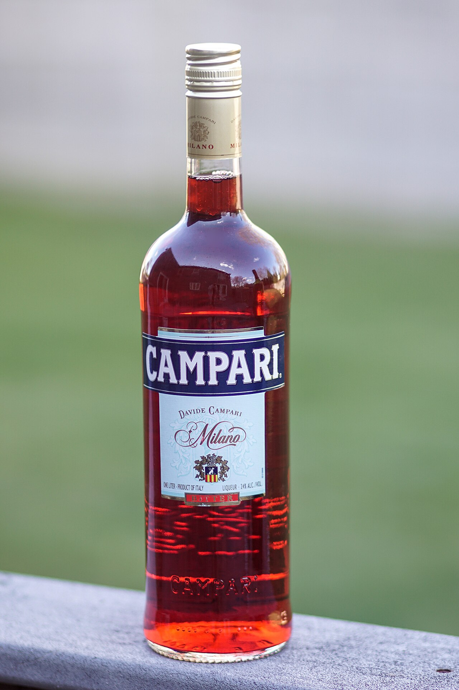

# Campari

Campari is an Italian bitter aperitif created in Milan in 1860 by Gaspare Campari. It is flavoured with herbs, roots and citrus peel, usually at 20.5%–25% ABV, and balances bitterness with sweetness. It belongs both to the [aperitif](ref:aperitif) and [liqueur](ref:liqueur) categories and is the core ingredient of the [Negroni](ref:negroni).

Figure: Campari. Image: Kenneth C. Zirkel, CC BY-SA 4.0, via Wikimedia Commons ([source page](https://commons.wikimedia.org/wiki/File:Bottle_of_Campari_(United_States).jpg)).

## Definition and identity

Campari is a "bitter": an alcohol base is flavoured with bitter plants and citrus peel through maceration or distillation, then balanced with syrup and water. It is not gin and not wine; bitterness is the design goal, not a defect. As an aperitif it is normally drunk before a meal, using bitterness and bubbles to stimulate appetite rather than to accompany food.

Campari is both a brand and a shorthand for a style. Other producers make bitter liqueurs, but only Campari-brand products may use the trademark. ABV and recipe differ between countries and versions, so buyers should follow the bottle label and official information rather than treating one market's specification as the global standard.

## History

In 1860, Gaspare Campari opened a bar in Milan and launched his bitter. The full recipe has never been published; official material says only that it contains herbs, aromatic plants, roots and citrus peel. In the late nineteenth and twentieth centuries the Campari family took the product from Milan to other parts of Italy and overseas, gradually building an international brand.

In the later twentieth century Campari expanded its reach through advertising, art patronage and cocktail culture, and the red liquid and simple label became recognisable symbols. Ownership and production have changed several times, but the narrative of bitterness, red colour and Milan origins has remained. Brand history and verifiable specification are different: dates and people are history, while ABV, volume and ingredients are label information.

## Region and ingredients

Campari is produced in Italy and the brand's headquarters are there; Milan is its historical starting point. Ingredients include herbs, roots, bark, citrus peel, water, sugar and alcohol. The exact plant list and proportions are trade secrets and cannot be checked item by item from outside. Public information confirms the structure of "several botanicals plus citrus", not a single mystery herb that determines the whole flavour.

Bitterness comes from alkaloids, terpenes, polyphenols and bitter peptides, among other compounds; sugar provides balance and roundness. High sugar alongside bitterness is typical of a bitter aperitif: sweetness arrives first, bitterness rises in the middle, and citrus and herbal notes linger. At lower alcohol, bitterness is easier to perceive; at higher alcohol, aroma is stronger but pungency increases.

## Recipe and production

The public process is straightforward: botanicals are macerated in alcohol or an alcohol-water mixture so that aroma and bitter compounds dissolve; the liquid may be [distilled](ref:distillation) or filtered to obtain a clear extract; it is then blended with syrup, water and colour to reach the target ABV and sweetness. Red is part of the identity, but colour carries no flavour information and cannot be used to judge bitterness.

Industrial production uses batch control to keep colour, sweetness and bitterness stable. Recipes may be adjusted for local rules, taxes and consumer preferences, so the Italian version and an export version can differ in ABV or sweetness. Compare products only after confirming the version and specification.

## Flavour and tasting

Campari typically shows orange peel, bitter orange, herbs, roots and a light floral note. It enters sweet, bitterness rises in the middle, and the finish is clean with citrus peel and spice. The bitterness is structural rather than "medicinal": it pulls sweetness and aroma back into balance. Too cold a temperature closes the aroma; too warm increases alcohol pungency.

Taste a small amount neat first, then add a few drops of water to see whether the aroma opens, and finally add soda to compare how bubbles change bitterness and sweetness. Do not judge a bitter with large mouthfuls: bitterness develops at the back of the mouth, and fast swallowing misses the layers.

## Drinking and pairing

The classic aperitif serve is Campari with soda and ice, or a Campari Soda, optionally with a slice of orange. In mixing, the International Bartenders Association's Negroni uses equal parts Campari, gin and sweet vermouth, finished with orange peel; the Americano uses Campari, sweet vermouth and soda. Campari also works in highballs or with grapefruit, though the sweet-sour balance changes markedly.

Before a meal it pairs with olives, nuts, savoury snacks and hard cheese. Very sweet desserts are less suitable, because layered sweetness makes the bitterness feel abrupt. As an after-dinner drink its bitterness can cut richness, but high-sugar versions are not for large consumption.

## Common misconceptions

First, treating Campari as gin. It lacks a juniper-led aromatic structure and is a bitter liqueur.
Second, assuming "more bitter is more authentic". Bitterness is the result of recipe and sweetness balance, and versions differ.
Third, reading red as a flavour clue. Colour comes from recipe and colour management, not from bitterness or sweetness.
Fourth, treating one country's ABV as the global standard. 20.5%–25% is a common range; the label is authoritative.
Fifth, treating the equal-parts Negroni as the only version. The IBA publishes an official ratio, but bars often adjust it.

Start with the base and the stated strength. From there, consider the sweetness or bitterness, then how it is served. That is how a practical judgment about Campari is built.

[Aperitif](ref:aperitif) and [Negroni](ref:negroni) answer different questions about Campari: style and region and vintage. Read them as a pair, not as alternatives.

**At a glance:** An Italian bitter aperitif created in Milan in 1860 by Gaspare Campari; usually 20.5%–25% ABV, with a bitter-sweet balance, and the core ingredient of the Negroni.

**Key facts.**

| Item | Detail |
| --- | --- |
| In one line | An Italian bitter aperitif created in Milan in 1860 by Gaspare Campari; usually 20.5%–25% ABV, with a bitter-sweet balance, and the core ingredient of the Negroni. |
| Style | Aperitif、Liqueur |
| ABV | 20.5–25% vol |

**Sources and limits.** The key claims about Campari are checked against the following sources: Campari (brand history, products and ABV information), IBA (Campari's role in the Negroni and the official ratio), Oxford University Press (Consulted for entries on bitter liqueurs, aperitifs and Campari) and 4 sources in total. Prices, batches and status change; the body is project-written and does not reproduce source text.

**Read alongside.** Put Campari next to Aperitif, Liqueur, Negroni: the first fixes identity and boundary, the others provide a region, process or peer comparison. Read this page first, then return to those entries; the links become coordinates, not decoration.

## Further reading

- [Aperitif](ref:aperitif): the category framework for pre-meal drinking and bitter stimulation.
- [Liqueur](ref:liqueur): the wider prepared-spirit category to which Campari belongs.
- [Negroni](ref:negroni): one of Campari's best-known cocktail applications.
