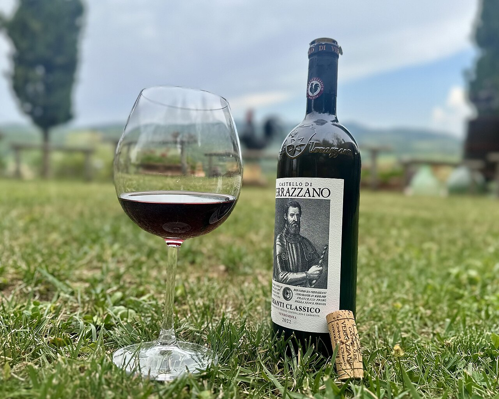

# Chianti Classico

Chianti Classico is a red wine from the Chianti Classico DOCG in the Chianti hills of Tuscany, Italy, based on Sangiovese with high acidity and clear tannin, known for aromas of sour cherry, violet and leather. It is commonly 750 mL at about 13%–14.5% vol; the rules require at least 80% Sangiovese, with at least 12 months of ageing for the standard wine and 24 months for Riserva.

Figure: Chianti Classico. Photograph: Chianti Classico example bottle - Annata type. Credit: FranzKafka2000, CC BY-SA 4.0, via Wikimedia Commons ([source](https://commons.wikimedia.org/w/index.php?curid=168690826)).

## Definition and position

Start by separating the levels: [red wine](ref:red-wine) is the category, Sangiovese is the variety, Tuscany is the region, Chianti Classico is the appellation (DOCG), and estates and individual wines are the producer level. Chianti Classico is not a brand, and it is not a synonym for the wider Chianti area.

"Classico" refers to the oldest core zone between Florence and Siena. It once shared a system with the much larger Chianti area and was gradually separated around 1984, when each gained its own rules; today the boundaries, marks and ageing requirements differ, and the two cannot stand in for each other.

## Producer and brand

Producers include family estates, cooperatives and merchants of very different scale. In 1924 a group of estates founded the consortium that protects the historic mark, using the black rooster (Gallo Nero) as the appellation symbol; the mark belongs to the consortium and is not a generic device open to any producer.

The delimited core covers the communes of Greve, Castellina, Radda and Gaiole, plus parts of a few neighbouring municipalities. Labels commonly show the commune, a site name and the black rooster mark; bottler and importer information are the entry point for checking identity.

## Region and ingredients

The appellation lies in the Chianti hills of central [Italy](ref:italy), between Florence and Siena, with rolling terrain mostly at 200–600 metres. The climate is Mediterranean, with warm dry summers; day-night temperature swings and aspect set the ripening pace, while autumn rain affects harvest planning.

Soils are mainly galestro schist and alberese limestone, free-draining and low in nutrients, which helps control yields and build acidity. The raw material is [grape](ref:grape), with [Sangiovese](ref:sangiovese) as the main variety; the rules allow up to 20% of other permitted red varieties, and the wine may also be made entirely from Sangiovese.

## Winemaking

Harvest usually runs from late September to October. After destemming, maceration lasts from about ten days to several weeks to extract colour, tannin and aroma. Sangiovese is high in acidity and moderate in pigment, so extraction and temperature control shape the body; malolactic conversion follows to soften acidity.

The wine then goes into [oak ageing](ref:oak-ageing). Traditional large casks emphasise slow oxidation and a fresh structure, while modern small barrels add sweet spice and vanilla. The standard wine ages at least 12 months; Riserva at least 24 months, including at least 3 months in bottle; Gran Selezione requires at least 30 months and additional rules on the origin of the fruit.

## Specification and label

The common volume is 750 mL, with [alcohol by volume](ref:abv) at about 13%–14.5% vol, varying with vintage, commune and estate. The label should be checked for the name Chianti Classico, the DOCG mark, vintage, the words Riserva or Gran Selezione, the black rooster mark, bottler, net volume and importer information.

The black rooster is the historic mark of the appellation consortium, used to identify members' wines; the absence of the mark does not by itself mean a wine is faulty, and its presence does not automatically place a wine in a given tier. Tier and vintage still have to be checked against the label and the rules.

## Flavour and tasting

Typical aromas are sour cherry, red plum, violet, tomato leaf, dried hay and leather, developing tobacco, spice and earth with age. The palate has high acidity and clear tannin, medium body and a dry finish; compared with [Brunello](ref:brunello), Chianti Classico is usually lighter and earlier to drink.

Serve at about 16–18 degrees Celsius in a medium-sized glass; younger wines can be decanted briefly, while Riserva and Gran Selezione can take a little longer. High acidity is a variety trait, not a fault, and it feels more balanced with food.

## Drinking and pairing

It pairs well with tomato-based pasta, roasted meat, poultry, mushrooms and medium-strength cheese; high acidity works especially well with tomato and olive oil. It does not suit very sweet desserts, steamed seafood or heavily spicy dishes, which can make the wine taste sharp.

After opening, refrigerate and finish within a few days. The standard wine suits everyday drinking, while Riserva and Gran Selezione can be kept a while before drinking, though not every wine needs long cellaring. Excessive drinking harms health and minors should not drink.

## Buying and storage

Buy from reputable channels and check vintage, the DOCG mark, the tier wording, the black rooster mark, bottler and importer information. Prices move with vintage, commune, tier and channel, so no figure is given here; the standard wine and Gran Selezione belong to different levels.

For Chianti Classico, unopened bottles should be kept away from light, lying flat, in a cool place at 12–15 degrees Celsius, avoiding heat and sharp temperature swings. Cork-sealed bottles need humidity; after opening, refrigerate and drink soon rather than warming and cooling repeatedly.

## Common misconceptions

First, confusing Chianti Classico with the whole Chianti area. Their boundaries and rules differ.
Second, treating the black rooster mark as proof of a tier. It identifies consortium membership, not vintage or tier.
Third, assuming Sangiovese must be blended. The rules allow an all-Sangiovese wine.
Fourth, treating high acidity as a defect. It is part of the variety and appellation style.
Fifth, assuming Riserva is always better. It denotes a longer ageing requirement, not a personal preference.

**At a glance:** A red wine from the Chianti Classico DOCG in the Chianti hills of Tuscany, Italy, based on Sangiovese with high acidity and clear tannin, known for aromas of sour cherry, violet and leather. The rules require at least 80% Sangiovese, with at least 12 months of ageing for the standard wine and 24 months for Riserva; commonly 750 mL at about 13%–14.5% vol.

**Key facts.**

| Item | Detail |
| --- | --- |
| In one line | A red wine from the Chianti Classico DOCG in the Chianti hills of Tuscany, Italy, based on Sangiovese with high acidity and clear tannin, known for aromas of sour cherry, violet and leather. The rules require at least 80… |
| Style | Red wine |
| Region | Italy |
| ABV | 13–14.5% vol |

## Further reading

- [Red wine](ref:red-wine): red wine categories and basic winemaking.
- [Italy](ref:italy): the Italian wine map and the appellation system.
- [Sangiovese](ref:sangiovese): the botany and aromas of the core Tuscan variety.
- [Brunello](ref:brunello): another appellation in the Sangiovese family.
- [Grape](ref:grape): the basic structure of wine grapes and ripeness measures.
- [Fermentation](ref:fermentation): the role of maceration and malolactic conversion.
- [Oak ageing](ref:oak-ageing): how large and small barrels shape style.
- [Alcohol by volume](ref:abv): what 13%–14.5% vol means on a label.
