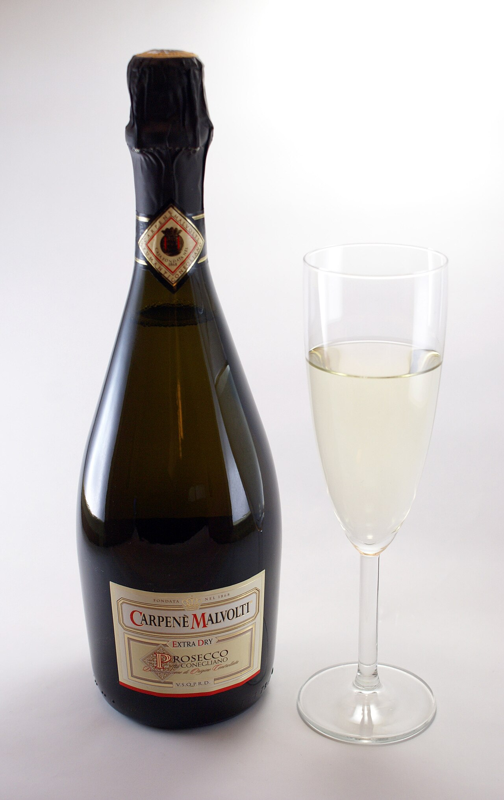

# Prosecco

Prosecco is a sparkling wine from Veneto and Friuli in Italy, made from Glera and mostly given a second fermentation in tank, known for green apple, pear and white flower aromas and a light body. It is commonly 750 mL at about 11%–12% vol, and the area is divided into the broad Prosecco DOC plus the two DOCG areas of Conegliano Valdobbiadene and Asolo.

Figure: Prosecco. Image: Sandstein, CC BY 3.0, via Wikimedia Commons ([source page](https://commons.wikimedia.org/wiki/File:Prosecco_di_Conegliano_bottle_and_glass.jpg)).

## Definition and position

Start by separating the levels: [sparkling wine](ref:sparkling) is the category, Glera is the variety, Veneto and Friuli are the regions, Prosecco is the appellation name, and individual estates and wines are the producer level. Keeping these four apart is what stops "Prosecco" from being read as a brand or as a grape.

Prosecco is a place name and an appellation marker, not a trademark. Only wine made from Glera grown and vinified inside the delimited area under the rules, with the required pressure and alcohol, may be labelled Prosecco; other sparkling wines described as "Prosecco style" are not appellation wine.

## Producer and brand

The Prosecco area has many estates, cooperatives and merchants, from small family domaines to large cooperatives. The bottler information on the label is the basis for identity; cooperatives and small estates differ greatly in range, price and style, so the word "Prosecco" alone cannot tell you the scale of production.

Estate, brand and product are three levels: the estate answers for sites, equipment and method, the brand answers for positioning and range, and the product answers for tier, sweetness and volume. DOC and DOCG within the area are different tiers, and the full name on the label should be read word by word.

## Region and ingredients

The area lies in the Veneto and Friuli Venezia Giulia regions of north-east [Italy](ref:italy), with its core in the hills between Conegliano and Valdobbiadene and around Asolo; the Prosecco DOC area is larger and covers several provinces across the two regions.

The raw material is [grape](ref:grape), of the Glera variety, and the rules require Glera to be the main component. Slope, altitude and day-night temperature swings in the hills affect acidity and aroma; soils and microclimates create differences, but parcels within the area still need to be judged individually.

## Winemaking

After harvest the grapes are pressed and the juice undergoes a first [fermentation](ref:fermentation) to make base wine; a second fermentation then takes place in a sealed tank, creating the bubbles while retaining fruit, a method often called the tank method or Martinotti method. Tank fermentation runs cooler and shorter, which suits the fresh green apple and white flower aromas.

Some producers use a second fermentation in bottle for a more complex, more costly style, but tank fermentation is the mainstream for Prosecco. After fermentation a sweetening liquor sets the sweetness level, from Brut through Dry; the sweetness term and the alcohol figure are the key label information.

## Specification and label

The common volume is 750 mL, with [alcohol by volume](ref:abv) at about 11%–12% vol, varying with tier and sweetness. The label should be checked for the full appellation name (Prosecco DOC, or Conegliano Valdobbiadene Prosecco Superiore DOCG and so on), the sweetness term (Brut, Extra Dry, Dry), vintage or non-vintage, bottler, net volume and importer information.

The sweetness terms do not match everyday intuition: Brut is usually the driest, Extra Dry is sweeter, and Dry is sweeter still. The Chinese back label, importer and anti-counterfeit information are the basis for checking identity; label languages differ by market, so the bottle on hand governs.

## Flavour and tasting

Typical aromas are green apple, pear, white peach, white flowers and citrus, with bread and cream notes in some wines; the bubbles are fine, the acidity clear and the body light, with a clean finish. Compared with Champagne, Prosecco usually emphasises fruit and easy drinking, with less complexity from yeast and extended ageing.

For tasting, chill well to about 6–8 degrees Celsius and use a tulip-shaped or flute glass; too warm a temperature makes the bubbles fade quickly and pushes sweetness forward. When smelling, watch for clear oxidation or a wet-cardboard note, the latter possibly linked to the cork or storage conditions.

## Drinking and pairing

It works as an aperitif and pairs with seafood, salads, fried food, white meat and light cheese; bubbles and acidity cleanse the palate and cut fat. It does not suit heavy red-meat sauces or very sweet desserts, where the wine can seem thin or the sweetness piles up.

After opening, refrigerate with a stopper; the bubbles fade with time, so finish within a day or two. Most Prosecco is for drinking young, while some DOCG wines can be kept short term; the drinking window depends on tier and vintage. Excessive drinking harms health and minors should not drink.

## Buying and storage

Buy from reputable channels and check the full appellation name, sweetness term, bottler and importer information. Prices move with tier, sweetness and channel, so no figure is given here; Prosecco DOC and the two DOCG areas are different tiers, and one wine cannot stand for the whole area.

For Prosecco, unopened bottles should be kept away from light, standing upright, in a cool place, avoiding heat and sharp temperature swings; sparkling wine is not best stored lying down for long periods, as the cork can suffer. After opening, refrigerate and drink soon rather than warming and cooling repeatedly, which loses bubbles.

## Common misconceptions

First, treating Prosecco as a grape variety. The variety is Glera; Prosecco is an appellation name.
Second, equating Prosecco with Champagne. The areas, varieties and mainstream methods differ.
Third, assuming Extra Dry is drier than Brut. The sweetness terms do not match their literal reading.
Fourth, assuming all Prosecco is a cheap wine. DOCG wines and specific sites can be more complex.
Fifth, judging authenticity by price or packaging. Channel, label and anti-counterfeit information are more reliable.

For Prosecco, begin with the base and the stated strength. Then look at the sweetness or bitterness, and finally ask how it is served. The answers point to different choices, not to a single score.

Read [Sparkling wine](ref:sparkling) for the style side of Prosecco, and [Grape](ref:grape) for the region and vintage side. Together they locate it.

**Key facts.**

| Item | Detail |
| --- | --- |
| In one line | A sparkling wine from Veneto and Friuli in Italy, made from Glera and mostly fermented a second time in tank, known for green apple, pear and white flower aromas and a light body. Commonly 750 mL at about 11%–12% vol, wi… |
| Style | Sparkling wine |
| Region | Italy |
| ABV | 11–12% vol |

## Further reading

- [Sparkling wine](ref:sparkling): sparkling wine categories and the main methods.
- [Italy](ref:italy): where Veneto and Friuli sit in the Italian wine map.
- [Grape](ref:grape): the basic structure of wine grapes and ripeness measures.
- [Fermentation](ref:fermentation): how tank fermentation retains fruit.
- [Alcohol by volume](ref:abv): what 11%–12% vol means on a label.
