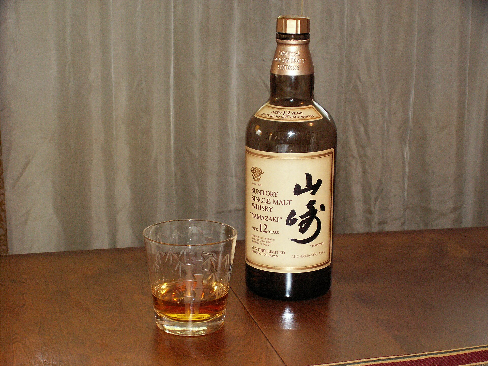

# Yamazaki Single Malt

Yamazaki is Suntory's malt whisky distillery in Shimamoto, Osaka Prefecture, opened in 1923 and one of the starting points of the Japanese whisky industry. Yamazaki single malt often uses mizunara and sherry casks, commonly at 43% ABV.

Figure: Related photograph of Yamazaki Single Malt. Image: Gentgeen, CC BY-SA 3.0, via Wikimedia Commons ([source page](https://commons.wikimedia.org/wiki/File:Yamazake_single_malt.jpg)).

## Definition and position

Yamazaki is the distillery name and also the brand and product-line name. It belongs to single malt within [whisky](ref:whisky): one distillery, malted barley, pot-still distillation and maturation under defined conditions. Single malt is not single cask, and most products are still multi-cask blends.

"Japanese whisky" has specific labelling requirements covering raw materials, distillation, maturation location and bottling. Not every whisky sold in Japan meets them, so check the label and industry standard rather than relying on brand or origin impressions. Yamazaki also has products without an age statement, and the presence or absence of a number does not settle quality.

## Origin and environment

Yamazaki sits in the hills near the border of Osaka and Kyoto, close to the confluence of the Katsura, Uji and Kizu rivers, with a humid climate and four distinct seasons. Humidity and temperature swings affect maturation speed and flavour direction in oak, which is an important siting consideration.

Water and airborne microbes around a distillery are part of the Japanese whisky story but should not be overstated as the only determinant. Raw materials, still shape, cask type and warehouse conditions also decide the final flavour. Regional stories need to be read alongside process facts.

Japanese whisky industrialised in the 1920s, with Yamazaki Distillery promoted by Shinjiro Torii and Masataka Taketsuru involved in early technical work. Japanese whisky then developed its own style and gained international attention, and this history helps separate brand narrative from product fact.

## Raw materials

The main material is malted barley. Yamazaki uses different varieties and kilning levels, and some peated malt brings a light smoke. Yeast and fermentation time shape aroma precursors, and the distillery keeps several fermentation conditions to increase base-spirit diversity.

Water is used in mashing, dilution and reduction, and its quality affects the palate. Specific ratios are company information; the ingredient list and strength on the label are what consumers can check directly.

## Production

The typical flow is: malting, kilning, mashing, fermentation, [distillation](ref:distillation), maturation, blending, reduction and bottling. Yamazaki uses pot stills of different shapes to produce different base styles, and the cut points after distillation shape aroma and body.

[Oak ageing](ref:oak-ageing) is central to the style. Mizunara brings incense, coconut and spice, sherry casks bring dried fruit, chocolate and spice, and bourbon casks bring vanilla and sweetness. The mix and proportion are set by the blender for each product.

## Flavour and tasting

Yamazaki is usually fine and balanced, with floral and fruit notes, honey and sandalwood-like wood. Mizunara's incense and coconut are relatively recognisable features; vintages, cask types and product lines differ widely, and one description cannot cover them all.

A blended single malt stresses balance, with different casks complementing one another: mizunara for spice and wood, sherry for dried fruit and weight, bourbon for vanilla and sweetness. Judge overall harmony rather than chasing one cask note.

Taste from a tulip glass to gather aroma: smell at rest, then add a little water and watch it change. Water lowers heat and opens aroma but changes structure; ice suppresses aroma further. The highball is a common everyday Japanese serve but dilutes detail and is not the main tasting method.

## Product lines and labels

Yamazaki's range includes single malts with and without age statements, with different strengths and cask mixes. The product name, strength, volume, origin and age designation on the label are the basics for identity.

Japanese whisky labelling rules have tightened in recent years, and the relationship between a stated age and actual liquid age needs careful reading. Non-age products may be multi-cask blends and are not necessarily lower quality; the age structure and proportions should come from official information.

## Drinking and pairing

Serve neat or with a little water in a small tulip glass. Japanese grilled food, sushi, teriyaki and mild cheese suit it; very spicy or very acidic dishes disturb the delicate aroma. The highball suits casual drinking, but accept that the aroma is diluted.

Store opened bottles away from light in a cool place and finish within a reasonable time. Whisky does not oxidise as fast as wine, but long exposure to air and light still costs aroma. Drink in moderation.

## Common misconceptions

First, equating single malt with single cask. Most single malts are multi-cask.
Second, that all Japanese whisky meets Japanese labelling standards. Check the label and industry standard.
Third, treating mizunara as the only source of style. Cask, distillation and raw materials matter equally.
Fourth, that older is always better. Drinking window and cask differences matter more.
Fifth, using a highball experience in place of tasting. Soda masks detail.

[Whisky](ref:whisky) and [Oak ageing](ref:oak-ageing) are the two useful reference points for Yamazaki Single Malt. [Whisky](ref:whisky) sets out style; [Oak ageing](ref:oak-ageing) brings in region and vintage. Read them together.

**Short definition:** Suntory's malt whisky distillery in Shimamoto, Osaka Prefecture, opened in 1923; commonly 43% ABV, known for mizunara and sherry-cask styles.

For Yamazaki Single Malt, begin with the base and the stated strength. Then look at the sweetness or bitterness, and finally ask how it is served. The answers point to different choices, not to a single score.

Yamazaki is Japan's first commercial malt distillery, opened by Suntory in 1923; its single malts use multiple pot stills and a mix of American, Spanish and Japanese oak, giving a range from light and fruity to sherry-rich.

**Key facts.**

| Item | Detail |
| --- | --- |
| In one line | Suntory's malt whisky distillery in Shimamoto, Osaka Prefecture, opened in 1923; commonly 43% ABV, known for mizunara and sherry-cask styles. |
| Style | Whisky |
| ABV | 43–43% vol |

**Sources and limits.** The key claims about Yamazaki Single Malt are checked against the following sources: Suntory (distillery history, origin and product information), Industry body (labelling requirements for Japanese whisky), Oxford University Press (Consulted for entries on Japanese whisky and Yamazaki). Prices, batches and status change; the body is project-written and does not reproduce source text.

**Read alongside.** Put Yamazaki Single Malt next to Whisky, Distillation, Oak ageing: the first fixes identity and boundary, the others provide a region, process or peer comparison. Read this page first, then return to those entries; the links become coordinates, not decoration.

## Further reading

- [Whisky](ref:whisky): the broad category, raw materials and main types.
- [Distillation](ref:distillation): how pot stills and cut points shape flavour.
- [Oak ageing](ref:oak-ageing): the differences among mizunara, sherry and bourbon casks.
- [Alcohol by volume](ref:abv): the 43% ABV label and the reduction process.
