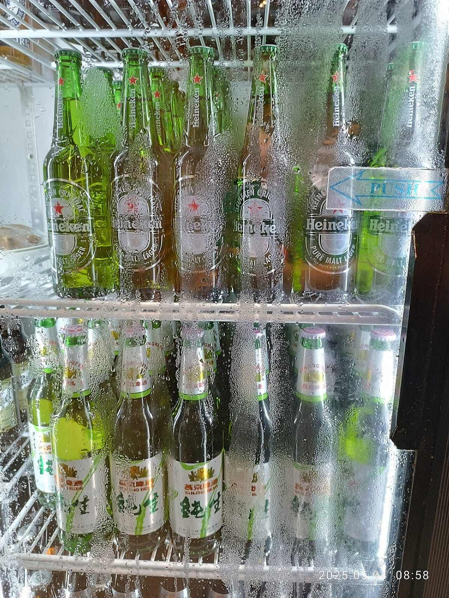

# Heineken

Look only at the shelf and Heineken is mostly a colour: green glass, green label, green light box. The visual signature is so successful that many drinkers forget it is also a technical choice, and that green glass is not always kind to beer. The best way into Heineken is through that contradiction: an industrial lager whose core promise is stability and cleanliness, packaged in the format most vulnerable to light.

Figure: Heineken. Photograph: HK KTD 觀塘 Kwun Tong 鱷魚恤中心 Crocodile Center shop 稻香茶居 Tao Heung Tea House Restaurant cold bottled beer Heineken bottles brand May 2025 R12S. Credit: Lee Zhun Waesm Stephen AussieA, CC0, via Wikimedia Commons ([source](https://commons.wikimedia.org/w/index.php?curid=164691047)).

## The green bottle and the bitterness: two sides of one sign

Heineken is a pale [lager](ref:lager) brewed by Heineken of Amsterdam since 1873, usually 5.0% vol in 330 mL. Its flavour sits between American lager and German pilsner: more backbone and bitterness than Budweiser, lighter and more carbonated than a traditional pilsner. It is not craft beer or a small-batch product, but a standard lager designed for global distribution.

"International lager" is a commercial category, not a legal style. It describes a product with a neutral flavour, moderate bitterness and the capacity to avoid offence beside almost any cuisine or climate. Heineken is one of its model examples.

## Amsterdam 1864: starting from De Hooiberg

In 1864 the twenty-two-year-old Gerard Adriaan Heineken bought the De Hooiberg brewery in Amsterdam. The Dutch market was then dominated by cloudy top-fermented beer; he moved towards German and Czech bottom fermentation and set his sights on export. In 1873 the company was registered as Heineken's Bierbrouwerij Maatschappij, the year brand history usually treats as the start of modern Heineken.

The late-nineteenth-century European beer industry was dividing along technical lines: pasteurisation, mechanical refrigeration and rail transport allowed pale lager to travel and made stability a more valuable commercial skill than personality. Heineken's early success rested on that infrastructure rather than on a legendary recipe.

## A-yeast: turning flavour into a reproducible asset

In 1886 Heineken obtained a yeast strain from Hartog Elion, a yeast specialist then working in Amsterdam; it became known as "A-yeast". The strain became the core of brand consistency: different plants, different water and different years could still produce a similar aroma profile so long as the fermentation curve and yeast condition remained controlled.

The company still maintains its own yeast library and uses A-yeast as part of its brand story. Technically this is not mysterious, since large brewing groups routinely keep proprietary strains; commercially it turns "flavour" from an abstract description into an asset that can be stored, copied and verified. That is one of the essential differences between industrial lager and small brewing: the former pursues repeatability, the latter single-batch expression.

## Raw materials and mashing: why it has more backbone than American lager

The published materials are [barley](ref:barley) malt, [water](ref:water) and hops, with no rice or maize adjunct. An all-malt grist gives fuller malt sweetness and a biscuit note, and the body feels more solid; hops supply a light herbal and spicy character, with bitterness above American lager but far below IPA.

Plants use local water treated to approach a common style target. Mineral content affects mashing efficiency, the presentation of hop bitterness and fermentation behaviour, so water treatment is one of the most important stability tools in a large lager plant. Proportions and process parameters are company information and only partly public, so this entry does not guess at numbers.

## Cool fermentation and conditioning

Brewing uses cool [fermentation](ref:fermentation): mashing, boiling, hopping, cooling, pitching yeast, a main fermentation at low temperature, then cold conditioning and filtration. Conditioning settles yeast and coarse flavours, while filtration further guarantees clarity and shelf stability.

The goal is "clean": no obvious ester, no yeastiness, a linear and short bitterness. The price is limited complexity, since the beer will not unfold with temperature and time like an unfiltered lager or a wheat beer. Drinking Heineken is about consistency and refreshment rather than change.

## Lightstruck flavour: the chemical cost of green glass

Iso-alpha acids from hops break down in light, and the reactive fragments combine with sulphur compounds from yeast to form 3-methyl-2-butene-1-thiol, usually shortened to 3-MBT. The compound is perceptible at extremely low concentration and smells of skunk or burnt rubber; the industry calls the fault "lightstruck". Brown glass blocks most ultraviolet, green glass blocks far less, and clear glass least of all.

The green bottle is therefore a trade-off between brand recognition and flavour stability. Heineken reduces the risk with dark printing, light-protected logistics and shorter shelf life, but a drinker can still meet a bottle that has seen too much light. The test is simple: if the aroma is plainly skunky rather than hoppy, it is probably not a "style" but a storage and transport failure.

## Specifications, origin and global licensing

The Dutch original is commonly 5.0% vol in 330 mL bottles; other markets are brewed by licensed local plants, often at 4.5%–5.0% vol, in packs such as 330 mL bottles and 500 mL cans. Licensed production means products under one brand are not fully identical, a normal condition for international beer brands.

In 2017 Heineken launched a 0.0 no-alcohol version, produced by vacuum distillation to remove alcohol followed by flavour adjustment. It widens the brand's occasions, but also reminds drinkers that no-alcohol does not mean no calories and does not mean unlimited drinking. Read the producer, origin, strength and net volume on the back label.

## Price band and drinking occasions

Heineken sits at a mid-market price in most countries, above local mainstream lager and below craft and imported specialty beer. Its main occasions are restaurants, bars and parties, where the need is a familiar, inoffensive, well-chilled beer.

In China it is often positioned as an imported lager, competing with Budweiser, Carlsberg and domestic premium lagers. The price difference comes more from brand positioning, channel and duty than from raw-material cost. It works with barbecue, seafood, salads and light food; with very hot or heavily sauced dishes its bitterness is amplified and its freshness falls away.

## Common misconceptions

First, that Heineken is a small Dutch craft brewery. It is an industrial lager from a multinational, and the Netherlands is only the brand's origin.
Second, that the green bottle preserves the beer better. Green glass blocks less ultraviolet than brown and makes lightstruck notes more likely.
Third, that Heineken tastes identical everywhere. Licensed plants, water and regulation create differences.
Fourth, that "international lager" is a legal style. It is a commercial category with no appellation rules.
Fifth, judging complexity by brand recognition. Recognition comes from distribution and consistency, not from layers.
Sixth, that A-yeast is pure marketing fiction. It is a real long-used strain, even if brand storytelling magnifies its role.

**In brief:** A pale lager brewed by Heineken of Amsterdam since 1873, usually 5.0% vol in 330 mL; known for its proprietary A-yeast, the signature green bottle and a crisp, lightly bitter style, and one of the most widely distributed beer brands in the world. 

## Further reading

- [Lager](ref:lager): the beer category and bottom-fermentation logic behind Heineken.
- [Netherlands](ref:netherlands): the brand's origin and main producing country.
- [Barley](ref:barley) and [water](ref:water): the main materials of an all-malt recipe.
- [Fermentation](ref:fermentation): how cool fermentation and conditioning shape a clean finish.
