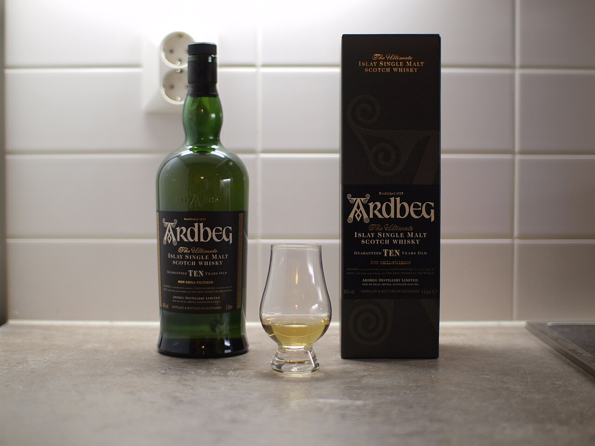

# Ardbeg 10 Year Old

Ardbeg 10 is a heavily peated single malt Scotch whisky from Islay, matured for at least 10 years in bourbon casks and bottled without chill filtration, commonly at 46% ABV in 700 mL bottles. It is known for tar, smoke, coffee and dark chocolate flavours and is a benchmark of the heavily peated style.

Figure: Ardbeg 10 Year Old. Photograph: File:Ardbeg 10 years old whisky.jpg. Credit: JIP, CC BY-SA 3.0, via Wikimedia Commons ([source](https://commons.wikimedia.org/w/index.php?curid=40682836)).

## Definition and position

Separate the levels first: whisky is the broad category, single malt Scotch is a legal type, Islay is a region, Ardbeg is the distillery and brand, and the 10-year expression is a specific product. Keeping the four apart clarifies island style, distillery craft and the age of the liquid.

The 10-year figure is the minimum maturation time of every component in the bottle. It is the distillery's core regular expression, above which sit Uigeadail, Corryvreckan and other no-age or special-cask versions. A regular expression is not a stripped-down product; it is the most direct entry to the house style.

## Producer and brand

The distillery stands on the south coast of Islay, was formally established in 1815, went through closure and revival late in the 20th century, and now belongs to the Glenmorangie Company under the [LVMH](ref:lvmh) group. Heavy peat, non-chill filtration and a relatively high ABV are its publicly stated craft positions.

Distillery, brand and product are three levels: the distillery answers equipment and craft, the brand answers positioning and range, and the product answers age, cask type and ABV. Group ownership and distillery history are background and cannot replace the specific specification on the label.

## Region and ingredients

Islay lies off the west coast of Scotland in a maritime climate with strong winds, high humidity and small temperature swings, and it has abundant peat. Local peat releases phenolic compounds when burned, which attach to the malt during kilning and create the base of smoke and medicinal notes; Ardbeg's peat intensity is high by industry norms.

The raw materials are [barley](ref:barley) and [water](ref:water). Barley is steeped and germinated, kilned over a peat fire, mashed, fermented and distilled. The precise phenol level, malt suppliers and water details belong to distillery craft information that is not always public, so this page does not treat a single figure as the whole explanation of style.

## Production

The wort is fermented and then [distilled](ref:distillation) in pot stills, and the heart of the run is filled into bourbon casks for [ageing](ref:oak-ageing). Ardbeg 10 is bottled without chill filtration, keeping more lipids and flavour compounds, so a slight haze can appear after water is added; that is a result of the process, not spoilage.

Bourbon casks bring vanilla, coconut and woody sweetness that layer against the heavy peat smoke. Cask sources, cask age and warehouse conditions shape the final style, and the exact proportions are undisclosed; small batch variation is normal for single malt.

## Specification and label

The common [alcohol by volume](ref:abv) is 46% ABV, usually in 700 mL bottles. The label should be checked for distillery name, age statement, single malt type, ABV, net content, bottler and batch details; non-chill filtration is usually mentioned on the packaging or back label.

The 10-year figure must be read with the type: single malt means pot-distilled malt whisky from one distillery, and the age is the minimum maturation time. The local-language back label, importer and anti-counterfeit information support identity checks, and labels can differ between markets.

## Flavour and tasting

Typical aromas are tar, campfire smoke, coffee grounds, dark chocolate and aniseed, with sea salt and lemon peel. The palate is heavily smoky with bittersweet dark flavours, a medium-to-full body and a long finish of sweetness and ash. At 46% ABV the aroma is more concentrated and the alcohol more noticeable.

Taste it neat at room temperature first, then add a few drops of water; water opens fruit and sweetness and softens the smoke, and a non-chill-filtered version may turn hazy. Those new to heavy peat can sip slowly from a small glass rather than facing the smoke all at once.

## Drinking and pairing

Neat, with a little water or with ice all work. Dark chocolate, smoked meat, blue cheese and roasted meat pair well; bittersweet and smoky notes contrast with fat and salt. Avoid pairing with delicate seafood, whose freshness is easily masked.

It can also be used in mixing, but the heavy peat will dominate the drink and the recipe must be adjusted. After opening, store upright in a dark, cool place; the liquid oxidises slowly and is best finished within a few months. Excessive drinking is harmful to health, and minors should not drink.

## Buying and storage

Buy through regular channels and check anti-counterfeit marks, the local back label, importer and batch number. Prices move with market and batch, so this page gives no figures; differences in volume and packaging between markets should be checked on the actual bottle.

An unopened bottle can be kept for years in a dark, cool place, standing upright to limit contact between liquid and cork. Heat and strong light accelerate decline, and odour-heavy environments such as kitchens are unsuitable for long storage; once opened, finish it within a few months.

## Common misconceptions

First, treating the haze of non-chill-filtered whisky as spoilage. It is a result of the process after water is added.
Second, treating 46% ABV as stronger and therefore better. ABV affects aroma and texture, not quality.
Third, assuming heavy peat means smoke only. Beneath the smoke lie fruit sweetness, sea salt and bitterness.
Fourth, treating 10 years as an average age. It is the minimum maturation time of every component.
Fifth, judging authenticity by packaging or gift boxes. Channel, anti-counterfeit marks and label information are more reliable.

Read Ardbeg 10 Year Old through the base and the stated strength, then the sweetness or bitterness, and finally how it is served. The sequence matters.

[Whisky](ref:whisky) explains style; [LVMH](ref:lvmh) adds region and vintage. Put Ardbeg 10 Year Old between them before deciding what it is.

**Key facts.**

| Item | Detail |
| --- | --- |
| In one line | A heavily peated single malt Scotch whisky from Islay, matured for at least 10 years in bourbon casks, non-chill filtered and commonly 46% ABV in 700 mL bottles; known for tar, smoke and coffee notes. |
| Style | Whisky |
| Region | Scotland |
| ABV | 46–46% vol |
| Producer or brand | LVMH |

**Sources and limits.** The key claims about Ardbeg 10 Year Old are checked against the following sources: Ardbeg Distillery (the 10-year maturation, non-chill filtration and 46% ABV), LVMH (the owning group and brand structure), Scotch Whisky Association (the legal definition of Scotch whisky and age-statement rules) and 4 sources in total. Prices, batches and status change; the body is project-written and does not reproduce source text.

## Further reading

- [Whisky](ref:whisky): categories and basic production.
- [Scotland](ref:scotland): regions and the legal background for Scotch whisky.
- [LVMH](ref:lvmh): the owning group and brand structure.
- [Barley](ref:barley): the role of malted barley in single malt.
- [Water](ref:water): the basis of mashing, fermentation and dilution.
- [Fermentation](ref:fermentation): the basic logic of wort fermentation.
- [Distillation](ref:distillation): pot distillation and the cut.
- [Oak ageing](ref:oak-ageing): how bourbon casks shape aroma and body.
- [Peat](ref:peat): the source of phenolic compounds and smoke.
- [Alcohol by volume](ref:abv): what 46% ABV means on the label.
- [Laphroaig 10](ref:laphroaig): a comparative read on another heavily peated Islay malt.
