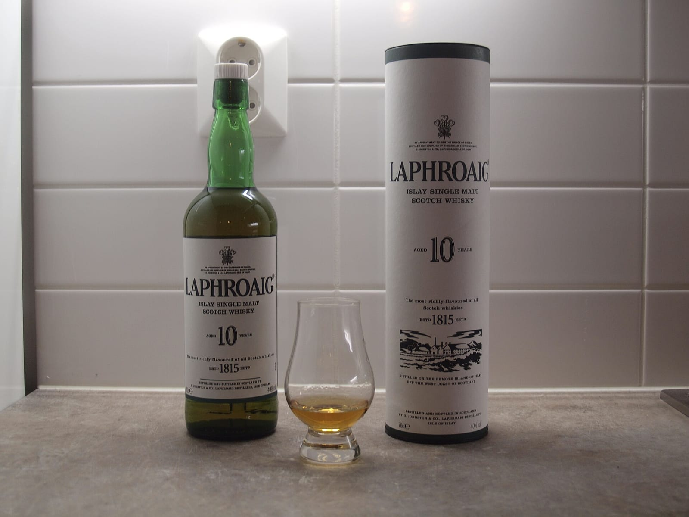

# Laphroaig 10 Year Old

Laphroaig 10 is a single malt Scotch whisky from the south coast of Islay, known for the smoke, iodine and maritime notes produced by peat-smoked malt. It is matured in bourbon casks for at least 10 years, commonly 40% ABV in 700 mL bottles, with 43% ABV in some markets.

Figure: Related photograph of Laphroaig 10 Year Old. Image: JIP, CC BY-SA 3.0, via Wikimedia Commons ([source page](https://commons.wikimedia.org/wiki/File:Laphroaig_10_year_old_whisky.jpg)).

## Definition and position

Separate the levels first: whisky is the broad category, single malt Scotch is a legal type, Islay is a region, Laphroaig is the distillery and brand, and the 10-year expression is a specific product. Keeping the four apart prevents confusion between island style, distillery craft and the age of the liquid.

The 10-year figure is a legal age statement meaning every component in the bottle has matured for at least 10 years. It is the distillery's regular entry expression, above which sit 18-year, 25-year and cask-strength versions. An entry expression is not a low grade; it is the baseline of the house style.

## Producer and brand

The distillery was established in 1815 by Donald and Alexander Johnston on the south coast of Islay and was long run by the founding family; it now belongs to Beam Suntory under Suntory Holdings. It is one of the definitive producers of the Islay peated style.

Distillery, brand and product are three levels: the distillery answers equipment and craft, the brand answers positioning and range, and the product answers age, cask type and ABV. Ownership can change with group restructuring, so the bottler information on the actual label still governs at purchase.

## Region and ingredients

Islay lies off the west coast of Scotland in a maritime climate with strong winds, high humidity and small temperature swings; most distilleries sit close to the sea. Local peat is formed from accumulated plant remains and releases phenolic compounds when burned, which attach to the malt during kilning and create the base of smoke and medicinal notes.

The raw materials are [barley](ref:barley) and [water](ref:water). Barley is steeped and germinated, then kilned over a peat fire so the malt takes on [peat](ref:peat) character, before mashing, fermentation and distillation. Water sources and malt suppliers belong to distillery craft information that is not always public, so this entry does not treat a single input as the whole explanation of style.

## Production

Malted barley is mashed into wort, fermented with yeast and then [distilled](ref:distillation) in pot stills; the heart of the run is filled into oak casks for [ageing](ref:oak-ageing). Laphroaig 10 mainly uses bourbon casks, which bring vanilla, coconut and woody sweetness against the peat smoke.

The width of the cut decides the balance of smoke and fruit; the distillery typically keeps a generous phenolic fraction in the heart, which makes the smoke more pronounced. Cask type, warehouse position and maturation time together shape the final style. Cask sources and proportions are undisclosed, so small batch variation can occur.

## Specification and label

The common [alcohol by volume](ref:abv) is 40% ABV, with 43% ABV in some markets; the usual volume is 700 mL, and 750 mL in the United States. The label should be checked for distillery name, age statement, single malt type, ABV, net content, bottler and batch details.

The 10-year figure must be read with the type: single malt means pot-distilled malt whisky from one distillery, and the age is the minimum maturation time. The local-language back label, importer and anti-counterfeit information support identity checks, and label language and ABV can differ between markets.

## Flavour and tasting

Typical aromas are heavy peat smoke, iodine, seaweed and tar, with lemon peel, vanilla and a little fruit sweetness. The palate is strongly smoky with salt and medicinal notes, a medium-to-full body and a long finish of ash and sea air. This is not a light smoke; it is an explicitly heavily peated style.

Taste it neat at room temperature first, then add a few drops of water; water opens the fruit and sweetness while softening the smoke. Those new to peated whisky can start with a small glass and a sweet food pairing to reduce the impact. Check for excessive sulphur or bitterness, which may relate to the batch or storage.

## Drinking and pairing

Neat, with a little water or with ice all work, according to personal habit. Dark chocolate, smoked meat, blue cheese and salted nuts pair well; smoke and salt contrast with fat and sweetness. Avoid pairing with delicate seafood, whose own freshness is easily masked.

It can also be used in mixing, but the heavy peat will dominate the drink and the recipe must be adjusted accordingly. After opening, store upright in a dark, cool place; the peat character is stable, but the liquid still oxidises slowly. Excessive drinking is harmful to health, and minors should not drink.

## Buying and storage

Buy through regular channels and check anti-counterfeit marks, the local back label, importer and batch number. Prices move with market and batch, so this entry gives no figures; differences in ABV and volume between markets should be checked on the actual bottle rather than generalised.

An unopened bottle can be kept for years in a dark, cool place, standing upright to limit contact between liquid and cork. Once opened, the aroma shifts over time, so it is best finished within a few months; heat and strong light accelerate decline, and odour-heavy environments such as kitchens are unsuitable for long storage.

## Common misconceptions

First, treating peat flavour as a defect. It results from the malt and kilning process and is a deliberate style choice.
Second, assuming all Islay whisky is equally heavily peated. Peat intensity and cut differ greatly between distilleries.
Third, treating 10 years as an average age. It is the minimum maturation time of every component.
Fourth, assuming older means smokier. Ageing converts some phenolic compounds and changes the style.
Fifth, judging authenticity by packaging or gift boxes. Channel, anti-counterfeit marks and label information are more reliable.

Laphroaig 10 Year Old is best read by starting with the base and the stated strength, moving to the sweetness or bitterness, and ending with how it is served.

**Key facts.**

| Item | Detail |
| --- | --- |
| In one line | A single malt Scotch whisky from the south coast of Islay, known for peat-smoked malt and maritime character and matured for at least 10 years in bourbon casks. Commonly 40% ABV (43% ABV in some markets), 700 mL. |
| Style | Whisky |
| Region | Scotland |
| ABV | 40–43% vol |

## Further reading

- [Whisky](ref:whisky): categories and basic production.
- [Scotland](ref:scotland): regions and the legal background for Scotch whisky.
- [Barley](ref:barley): the role of malted barley in single malt.
- [Water](ref:water): the basis of mashing, fermentation and dilution.
- [Fermentation](ref:fermentation): the basic logic of wort fermentation.
- [Distillation](ref:distillation): pot distillation and the cut.
- [Oak ageing](ref:oak-ageing): how bourbon casks shape aroma and body.
- [Peat](ref:peat): the source of phenolic compounds and smoke.
- [Alcohol by volume](ref:abv): the label difference between 40% ABV and 43% ABV.
- [The Macallan 12](ref:macallan): a comparative read on a sherry-cask style.
