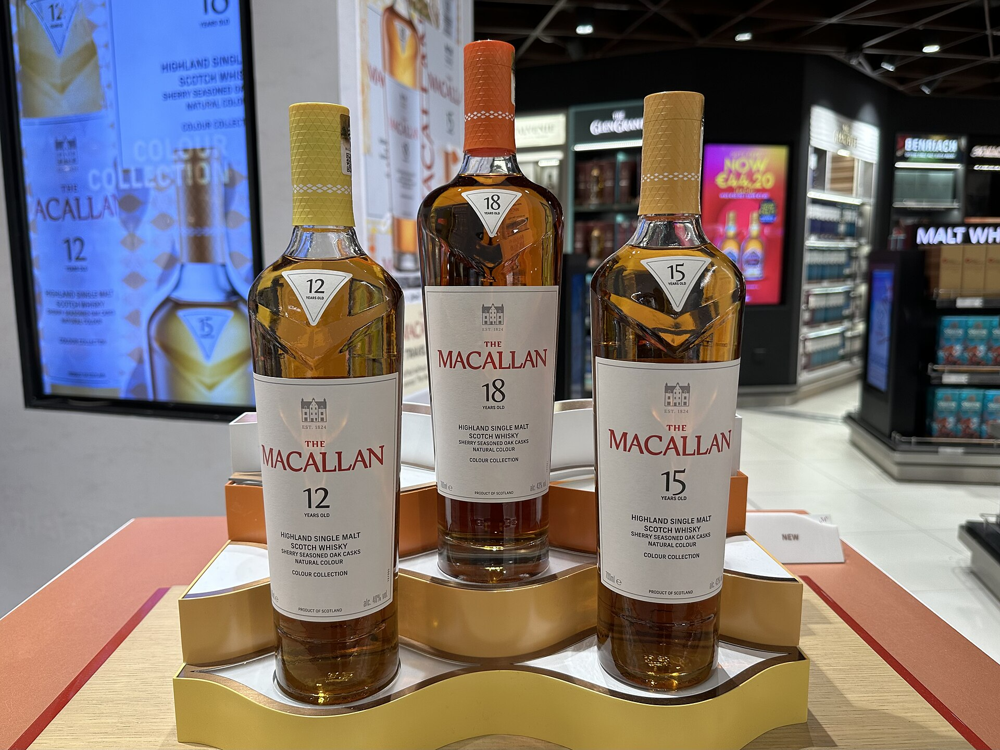

# The Macallan 12

A 12-year-old single malt from Speyside, built around sherry-seasoned oak; dried fruit, orange, vanilla and spice, with several cask versions sold under the same age.

Figure: Related photograph of The Macallan 12. Image: Ssu, CC BY-SA 4.0, via Wikimedia Commons ([source page](https://commons.wikimedia.org/wiki/File:Macallan_whisky,_12-15-18_years.jpg)).

## Definition and position

The Macallan 12 is a specific age-stated single malt from one distillery, not a general name for the brand. Single malt means malted barley from one distillery, without malt from other distilleries blended in; it does not mean single cask, and the 12-year expression is normally a vatting of many casks.

The 12 is the age of the youngest whisky in the bottle, not an average and not the year of distillation. Older whisky may be included. Cask type, batch and bottling version still decide the flavour, and the brand sells several 12-year expressions with different cask mixes.

The main versions are Sherry Oak, Double Cask and Triple Cask. Sherry Oak uses European and American oak seasoned with sherry; Double Cask combines American and European sherry-seasoned oak; Triple Cask adds American oak and a lighter sherry influence. The front label rarely gives the full recipe, so the version name matters.

## Origin and ingredients

The Macallan distillery is at Craigellachie in Speyside, on the Easter Elchies estate. It was licensed in 1824, and the modern site opened a new distillery and visitor centre in 2018. Speyside is a whisky region, not a protected appellation in the same sense as a wine AOC; the name describes a concentration of distilleries in north-eastern Scotland.

The ingredients are water, malted barley and yeast. The Macallan uses unpeated malt, so its smoke is minimal; the character comes from fermentation, distillation and, above all, cask policy. The distillery is known for sherry-seasoned oak, and its cask supply is a major part of the brand’s identity.

Barley is malted and dried without heavy peat, then milled and mashed. The exact barley varieties and mash bill are not disclosed on the label. “Single malt” tells you the cereal and the distillery, not the field or the vintage.

## Mashing and fermentation

Malted barley is mashed with hot water to extract sugar, then cooled and fermented with yeast. The Macallan uses stainless-steel fermenters and a relatively long fermentation, which encourages fruity esters. The wash is then distilled; fermentation length and yeast are process variables that shape the base spirit.

A long fermentation tends to give more pear, citrus and floral notes; a shorter one gives a cleaner, more cereal profile. The distillery does not publish exact timings for every batch, and the practical effect is easier to see in the final bottle than in a technical sheet.

Mashing and fermentation set the base, but they do not explain the house style alone. The Macallan’s sherry-cask policy and small stills are more visible in the glass. For a buyer, the version name, ABV and age are more useful than an undisclosed fermentation schedule.

## Distillation and maturation

The distillery uses small copper pot stills and two distillations, with the spirit cut separated into heads, hearts and tails. Small stills and a slow distillation give a relatively rich, oily spirit that can carry sherry-cask flavour without becoming harsh. The exact cut points are not published.

Maturation is the defining step. Sherry-seasoned European oak gives dried fruit, orange peel, chocolate and spice; American sherry-seasoned oak gives vanilla, citrus and a lighter spice; refill casks give a quieter, more cereal profile. The Macallan’s colour comes largely from the casks, and the standard range does not rely on heavy char.

The 12-year age statement sets a minimum, not a target. A vatting can include older casks, and the proportion of first-fill sherry, refill and American oak changes the sweetness and colour. Two bottles of the same version and age can differ by batch.

## Specification and label

The standard bottle is 700 ml in most markets and 750 ml in some; ABV is usually 40%, with some travel-retail or limited versions higher. The front label carries the brand, age, strength and volume; the back label carries the importer, country of origin and sometimes the version name and batch.

The version name is essential: Sherry Oak, Double Cask and Triple Cask are different products, not different packaging for the same liquid. A gift box or a new label design does not prove a different cask mix. Check the back label for the expression and the lot code.

Scotch whisky labelling is governed by UK and EU rules, including minimum maturation of three years, bottling strength and the definition of single malt. The 12-year statement is legal information, not marketing language; “vintage” is not a permitted substitute for age.

## Flavour and tasting

Sherry Oak typically shows dried fruit, orange peel, dark chocolate, vanilla and ginger, with a rich amber colour and a medium-to-full body. Double Cask is usually softer and more citrus-vanilla led, with less dried fruit. Triple Cask is lighter and more cereal-forward, with a gentler sherry influence.

The entry is soft, the body medium, and the finish carries dried fruit, oak and spice. Alcohol is present but not sharp at 40%. Compared with a bourbon-cask Speyside, The Macallan 12 is more dried-fruit and spice driven; compared with a heavily peated Islay, it has almost no smoke.

Batch and version variation is real. A first-fill sherry-heavy batch can taste darker and sweeter; a refill-heavy batch can taste leaner and more cereal. Tasting notes describe a range, not a fixed specification. The colour can also vary with cask mix, so a darker bottle is not automatically older or better.

## Drinking and pairing

Serve at 18–20°C in a tulip glass, with 30–40 ml. A few drops of water can open the dried fruit and reduce the alcohol edge; ice suppresses aroma and cools the body. The 40% ABV standard is gentle enough to drink neat, but water is still a legitimate choice.

Neat, it pairs with dark chocolate, dried fruit, nuts, hard cheese and baked goods. The sherry notes echo fruitcake and chocolate; the vanilla and citrus suit lighter cheeses. Avoid very spicy food, which can make the sweet sherry notes taste syrupy.

After opening, keep the bottle upright, tightly stoppered and away from light. A half-full bottle oxidises faster; decanting into a smaller bottle reduces headspace. Whisky does not improve indefinitely after opening, and a bottle kept for years may lose freshness.

## Buying and storage

Buy from a licensed retailer or a trusted auction house and check the version, ABV, bottle code and importer. The 12-year range is widely produced, but older batches and travel-retail versions can differ. A high price may reflect packaging or collectability, not necessarily a better liquid.

For The Macallan 12, store unopened bottles upright, cool and dark, away from heat and strong odours. Whisky is high in alcohol and does not need refrigeration. Keep the cap tight and avoid long exposure to sunlight, which can fade the label and degrade the spirit.

Gift boxes and limited labels are packaging, not a separate grade. For drinking, the version and seal matter more than the box. For collecting, verify the bottle code, fill level and provenance, and do not assume that every old bottle has increased in value.

## Common misconceptions

First, age is not vintage. Twelve years is the minimum maturation, not the harvest year. Second, single malt is not single cask. The 12-year expression is normally a vatting of many casks. Third, sherry-seasoned casks are not “added sherry”; the flavour comes from the cask’s previous use, not from wine poured into the bottle.

Fourth, darker colour is not proof of older age or higher quality. Colour depends on cask type, first-fill proportion and sometimes caramel colouring. Fifth, a higher age is not automatically better; cask quality and warehouse conditions matter. Sixth, “Sherry Oak” and “Double Cask” are different expressions, not the same whisky in different boxes.

**Key facts.**

| Item | Detail |
| --- | --- |
| In one line | A single malt whisky from Speyside, Scotland, known for sherry-seasoned cask maturation, with a stated age of 12 years; commonly 700 mL or 750 mL at about 40% ABV, with version and batch to be checked on the label. |
| Style | Whisky |
| Region | Scotland |

**Sources and limits.** The key claims about The Macallan 12 are checked against the following sources: Scotch Whisky Association (the legal definition, regions and labelling rules for Scotch whisky), The Macallan (The Macallan product range, sherry-cask maturation and distillery information), Unattributed (Migrated from the former reference list at the end of the article; access date not re-verified) and 5 sources in total. Prices, batches and status change; the body is project-written and does not reproduce source text.

## Further reading

- [Whisky](ref:whisky): the broad category and production steps.
- [Scotland](ref:scotland): the Scottish whisky-region landscape.
- [Barley](ref:barley): the cereal base of malt whisky.
- [Water](ref:water): mashing, dilution and site selection.
- [Distillation](ref:distillation): pot stills and spirit cuts.
- [Oak ageing](ref:oak-ageing): cask type and flavour direction.
- [The Macallan 18](ref:macallan): another age from the same brand.

This page offers no price ranking, investment advice or shopping links. Version, cask and batch are the useful variables; a single tasting note is not a specification.
