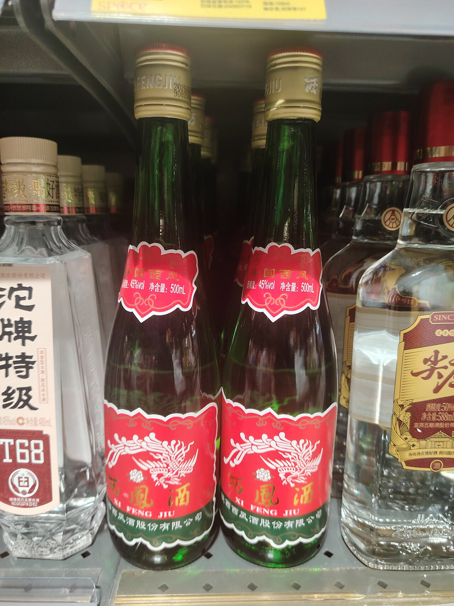

# Xifengjiu

Xifengjiu is produced in Fengxiang, Shaanxi, and is the leading phoenix-aroma baijiu. It uses sorghum with a barley, wheat and pea qu, ferments in earthen pits and stores the spirit in traditional wine-sea containers. A common strength is 55% ABV.

Figure: Xifengjiu. Image: Lhzss8, CC BY-SA 4.0, via Wikimedia Commons ([source page](https://commons.wikimedia.org/wiki/File:%E5%B0%8F%E7%93%B6%E8%A3%85%E8%A5%BF%E5%87%A4%E9%85%92.jpg)).

## Definition and position

Xifengjiu is a brand within [baijiu](ref:baijiu) and the main representative of phoenix aroma. Phoenix aroma sits between light and strong aroma: it has the crispness of light aroma and the pit aroma and fullness of strong aroma. It is not a simple blend of the two but a separate tradition of qu making, fermentation and storage.

The product is distilled, with strength stated as [alcohol by volume](ref:abv), commonly 55% ABV. Higher-strength versions are more sensitive to serving method, and comparison should not rest on strength alone.

## Origin and environment

Fengxiang lies in western Guanzhong, Shaanxi, in a warm temperate continental monsoon climate with four distinct seasons, concentrated rainfall and relatively dry air. Dry conditions help qu making and storage and affect the seasonal changes of pit microbes. Local sorghum and water are basic conditions for the phoenix style.

Xifengjiu ferments in earthen pits, whose microbial environment differs from mud pits and produces a different aroma structure. Pits need long maintenance, and the state of the pit earth changes with use and season. Regional style is not created by a place name alone; it is the accumulation of climate, pits, raw materials and process.

Fengxiang was called Yong in ancient times and is an important town in western Guanzhong, with a brewing tradition long linked to local agriculture and trade. Xifengjiu moved from workshops to factories in modern times, and traditional steps such as wine-sea storage were retained in some products.

## Raw materials and qu

The main material is sorghum, with full grains, high starch and low impurities. Qu uses barley, wheat and peas, and the ratio and culturing temperature of different qu types affect saccharifying power and aroma precursors. [Qu making](ref:qu-making) is a foundational stage of phoenix aroma: too much qu aroma covers grain notes, while too little leaves the body thin.

The proportion of branched starch in sorghum, the looseness after cooking, and the match of qu and water all affect fermentation evenness. Batch variation in raw materials is normal, and producers stabilise style through proportion and process adjustment.

## Production

The typical flow is: crush the grain, mix, cook, cool, add qu, ferment in the pit, remove, distil, grade and store, blend and bottle. Earthen-pit fermentation lets the mash complete saccharification and fermentation in a relatively closed environment, and distillation cuts the spirit by segment to separate heads and tails.

Storage uses the wine sea: a basket-like vessel woven from willow and lined with traditional materials, in which the spirit changes slowly. Its permeability and lining affect oxidation and aroma integration and form part of the phoenix style. Storage time, vessel condition and blending aims together decide the finished style.

## Flavour and tasting

Phoenix aroma sits between light and strong aroma, often showing a composite of ethyl hexanoate and ethyl acetate, a firm entry, clear acidity and a long finish. It is neither as simply crisp as light aroma nor as pit-led as strong aroma, and evaluation should check whether the two sides are in proportion.

Taste in a small cup: smell the resting aroma and judge whether it is clean and whether the acidity and pit aroma clash; then sip and feel the firm entry and the finish. High strength brings noticeable alcohol heat; water opens the aroma but changes the structure, so add it drop by drop and compare.

## Product lines and labels

Xifengjiu has series such as Red Xifeng and Xifeng 1964 with different positioning and body design. The producer, aroma type, strength, standard and volume on the label are the basics for identity. Counterfeits and similar names exist, so buy through official channels and check anti-counterfeit marks.

Terms such as "vintage" and "wine-sea storage" must be read with company standards and labels. The wine sea is a storage vessel, not the exact age of the liquid; specific age, blending ratio and base composition should come from official information.

## Drinking and pairing

Serve neat in a small cup with northwestern Chinese meat and wheat dishes, such as mutton paomo, cured beef, barbecue and hand-pulled noodles. High strength rewards small sips; the firm acidity and alcohol can seem sharp at first. Very spicy dishes amplify the heat and cover the composite aroma, so avoid very spicy food before tasting.

Xifengjiu can be used in mixed drinks, but 55% ABV significantly changes the balance. Ice or a large amount of water is not traditional and dilutes the aroma and the texture built by wine-sea storage. After opening, store away from light in a cool place and finish within a reasonable time.

## Common misconceptions

First, treating phoenix aroma as a simple middle ground between light and strong. It is a separate process.
Second, thinking the wine sea is only packaging. It takes part in storage and flavour formation.
Third, that higher strength is more authentic. Strength serves product design, and each version has its own aim.
Fourth, equating "wine-sea storage" with a specific age. The vessel is not the vintage.
Fifth, judging authenticity by packaging or price. Anti-counterfeit checks, channels and labels are reliable.

**At a glance:** A phoenix-aroma baijiu from Fengxiang, Shaanxi, made with sorghum and a barley, wheat and pea qu. 

Start with the base and the stated strength. From there, consider the sweetness or bitterness, then how it is served. That is how a practical judgment about Xifengjiu is built.

[Baijiu](ref:baijiu) and [Qu making](ref:qu-making) are the nearest useful comparisons: one clarifies style, the other tests region and vintage.

**Key facts.**

| Item | Detail |
| --- | --- |
| In one line | A phoenix-aroma baijiu from Fengxiang, Shaanxi, made with sorghum and a barley, wheat and pea qu. |
| Style | Baijiu |
| ABV | 55–55% vol |

**Sources and limits.** The key claims about Xifengjiu are checked against the following sources: Industry body (origin, ingredients and product lines; phoenix-aroma baijiu and wine-sea storage terms), Oxford University Press (Consulted for entries on Chinese baijiu aroma types and storage vessels). Prices, batches and status change; the body is project-written and does not reproduce source text.

**Read alongside.** Put Xifengjiu next to Baijiu, Strong-aroma baijiu, Qu making: the first fixes identity and boundary, the others provide a region, process or peer comparison. Read this entry first, then return to those entries; the links become coordinates, not decoration.

## Further reading

- [Baijiu](ref:baijiu): the broad category and aroma-type system behind Xifengjiu.
- [Strong-aroma baijiu](ref:strong-aroma): a reference for the pit-aroma component of phoenix aroma.
- [Qu making](ref:qu-making): how barley-pea qu shapes phoenix aroma.
- [Alcohol by volume](ref:abv): the measure for comparing product strengths.
