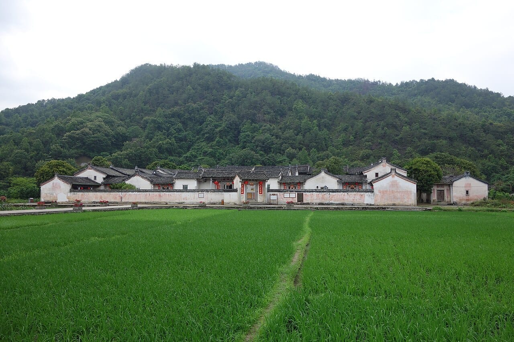

# Changyu Wine

Changyu wine comes from Yantai, Shandong. The company was founded in 1892 by Zhang Bishi and is one of China's earliest modern wineries. Its range covers red and white wines and brandy, with varieties such as Cabernet Gernischt, Cabernet Sauvignon and Chardonnay.

Figure: Changyu Wine. Photograph: Guang Lu Di in Dabu. Built in 1908, former residence of Cheong Fatt Tze who was the founder of Changyu Wine (19324457523). Credit: Yun Huang Yong from Harbord, Australia, CC BY 2.0, via Wikimedia Commons ([source](https://commons.wikimedia.org/w/index.php?curid=140102273)).

## Definition and position

Changyu is both a company name and a wine brand. It is not a wine region and not a grape variety. Understanding it as a [wine](ref:wine) brand is what allows "Changyu", "the Yantai region" and "the Cabernet Gernischt variety" to be kept at their proper levels.

Changyu's business is not limited to wine and also includes brandy and other spirits; this entry covers only the wine side. A long company history and a wide product range mean that price, process and style can differ greatly between series under one brand, so the brand name alone is not enough to place a bottle.

## Origin and environment

Yantai lies in northern Shandong Peninsula, facing the Bohai Sea to the north and the Yellow Sea to the east, with a warm temperate monsoon climate strongly moderated by the sea: spring warms slowly, summers are not extremely hot and autumns are relatively long. The growing season is mild, and sea breezes and day-night temperature swings during ripening affect the balance of sugar and acid.

The maritime climate brings higher humidity and with it disease pressure, which demands careful canopy management and harvest decisions. Yantai is one of China's important wine regions, and Changyu's vineyards are distributed in and around Yantai. A region's value lies in accumulated climate, soil and viticultural experience, but a specific wine still depends on site, vintage and winemaking.

## Raw materials and varieties

The main raw material is [grape](ref:grape). Changyu uses varieties including Cabernet Gernischt, Cabernet Sauvignon, Chardonnay and Italian Riesling. Cabernet Gernischt is a distinctive Chinese name, and research suggests a relationship with Carmenère; the variety stated on the label should follow the producer's testing and the label itself.

Variety sets the ceiling for colour, acidity, tannin and aroma precursors. Red grapes need full ripeness for colour and tannin, while white grapes are often picked earlier to retain acidity. The same variety performs very differently across vintages and sites, so variety is a starting point for understanding a wine, not a conclusion.

## Production

The typical red-wine flow is: destem and crush, macerate, alcoholic fermentation, press, malolactic fermentation, ageing, clarification and bottling. Whites are pressed first to obtain juice and then fermented cool to retain aroma. [Chardonnay](ref:chardonnay) is strongly shaped by fermentation temperature, whether oak is used and whether the wine is stirred on its lees.

The ageing vessel changes the flavour direction directly. Oak adds vanilla and toast notes and softens tannin, while stainless steel preserves fruit better. Changyu's range runs from everyday wines to estate bottlings, and the proportion and duration of [oak ageing](ref:oak-ageing) vary with product positioning, so one process template cannot describe every product.

## Flavour and tasting

Changyu reds commonly show black fruit, spice and oak, whites lean toward citrus, stone fruit and florals, and brandy belongs to a separate tasting system. Judge wine by balance: whether acidity supports the body, whether tannin is fine-grained, whether the aroma is clean and whether the finish is complete, rather than by aroma intensity alone.

Look at the colour, smell the wine, then taste. Temperature matters a great deal: reds taste closed when too cold, whites taste loose when too warm. Contact with air changes the aroma after opening, and a clear oxidative note means something went wrong in storage or timing.

## Product lines and labels

Changyu's range includes the Cabernet (Jiebenna) series, estate wines and brandy. The variety, vintage, origin, strength, sugar level and standard on the label are the basics for identity. "Jiebenna" is a product and brand name and should not be read as a grape variety.

Vintage means the year the grapes were harvested, not the time spent ageing; differences between vintages of one series can be larger than differences between series. Single-variety and blended wines have different aims: single varieties highlight variety character, while blends pursue structural completeness. Buy on the label and official information rather than packaging or price alone.

## Drinking and pairing

Reds suit red meat, sauce-based dishes and strongly flavoured Chinese food at about 16–18°C; whites suit seafood, steamed dishes and lighter food at about 8–12°C. The core of pairing is matching weight: a full-bodied wine with a rich dish, a light wine with a delicate one.

Drink an opened bottle reasonably soon; leftovers can be decanted into a smaller container and kept cool and dark. Ice dilutes aroma and structure and is not traditional for wine; sweet or sparkling products have their own serving advice on the label. Drink in moderation and avoid rapid drinking on an empty stomach.

## Common misconceptions

First, treating Changyu as a region or a variety. It is a company and a brand.
Second, that older is always better. Most wines have a drinking window, and overlong storage can decline.
Third, treating "Jiebenna" as a grape variety. It is a product name.
Fourth, that imported wine is always better than Chinese wine. Origin and price cannot replace actual tasting.
Fifth, judging quality by price alone. Label information, vintage and storage condition matter just as much.

**At a glance:** A wine brand from Yantai, Shandong; Changyu was founded in 1892 and makes red, white and brandy products from varieties such as Cabernet Gernischt, Cabernet Sauvignon and Chardonnay. 

Start with the base and the stated strength. From there, consider the sweetness or bitterness, then how it is served. That is how a practical judgment about Changyu Wine is built.

**Key facts.**

| Item | Detail |
| --- | --- |
| In one line | A wine brand from Yantai, Shandong; Changyu was founded in 1892 and makes red, white and brandy products from varieties such as Cabernet Gernischt, Cabernet Sauvignon and Chardonnay. |
| Style | Wine |

**Sources and limits.** The key claims about Changyu Wine are checked against the following sources: Industry body (brand history, origin and product lines; wine's position in beverage-alcohol classification), OIV (international technical definitions for wine), Oxford University Press (Consulted for entries on Chinese wine regions and Cabernet Gernischt). Prices, batches and status change; the body is project-written and does not reproduce source text.

## Further reading

- [Wine](ref:wine): the broad category and basic classification of wine.
- [Grape](ref:grape): how the raw material and ripeness shape style.
- [Chardonnay](ref:chardonnay): a white variety and the winemaking choices around it.
- [Oak ageing](ref:oak-ageing): how the vessel changes aroma and tannin.
