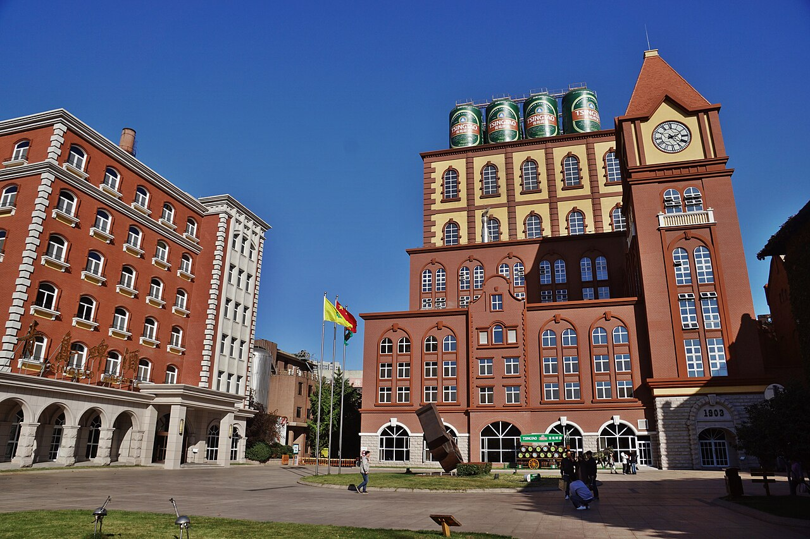

# Tsingtao Beer

Tsingtao Beer is produced in Qingdao, Shandong, and is one of China's oldest beer brands, founded in 1903 by German and British merchants. Its flagship is a bottom-fermented lager, commonly about 4% ABV.

Figure: Tsingtao Beer. Image: Lennartbj, CC BY-SA 4.0, via Wikimedia Commons ([source page](https://commons.wikimedia.org/wiki/File:Tsingtao_Brewery_in_Qingdao.jpg)).

## Definition and position

Tsingtao is a brand and company name, and its products belong to lager within [beer](ref:beer). It is not a simple copy of a German beer but an industrial system formed after German brewing technology arrived in China and combined with local materials and markets.

Brand and product lines need separating: Classic, Pure Draft, white beer and dark beer differ in style, strength, original gravity and raw materials. One description cannot cover the whole brand, and the label is the guide for a specific product.

## Origin and environment

Qingdao lies on the southern Shandong Peninsula facing the Yellow Sea, with a warm temperate monsoon climate moderated by the sea: mild summers, colder winters and humid air. Good water was important in the early site choice, and water from the Laoshan area has long been used for brewing.

Port and rail links also shaped early development: the transport and industrial base built during the German concession allowed scale production and export. Origin advantage is a result of history and industry, not a guarantee that every bottle comes from the same plant; the label gives the actual origin.

The port made imported barley and hops and outgoing finished beer easier, a locational advantage for early industrial brewing. Today the company has plants in several parts of China, and origin and brand no longer correspond one-to-one, so consumers should check the plant address on the label.

## Raw materials

The main materials are barley malt, water, hops and yeast. Some products use rice or starch adjuncts to adjust cost and flavour, a common practice in industrial lager; adjunct proportion affects malt aroma and body. Hops provide bitterness and aroma, and amount and variety set the style.

Water quality matters for lager. Moderate minerals help saccharification and yeast, while very hard or very soft water changes the palate. Ingredient quality and ratio are company process, and the ingredient list on the label is the consumer's first-hand information. Water is used heavily in mashing, boiling and cleaning, so a stable supply is a long-term condition for a brewery site.

## Production

The typical flow is: milling, mashing, lautering, boiling, cooling, pitching yeast, primary fermentation, secondary fermentation and cold conditioning. Lager uses bottom yeast at lower temperatures and longer conditioning to achieve a clean, stable body.

Pure Draft beer often uses membrane filtration and less heat treatment to retain more aroma, while regular beer is pasteurised for a longer shelf life. Different processes suit different packages and sales radii. Specific process details are company information; this page describes the public general route.

## Flavour and tasting

Tsingtao is usually clean and refreshing, with moderate bitterness, light malt sweetness and hop aroma, and a clean finish. Classic lager is light-bodied and suited to chilling; white and dark series have different raw materials and goals.

Look at foam and colour, smell malt and hops, then taste how bitterness appears and fades. Too cold suppresses aroma, too warm makes it loose. When comparing with imported lagers, note differences in original gravity and strength rather than judging by brand impression.

Industrial lager stresses consistency and shelf stability, with flavour complexity not the first goal. Separate "clean and refreshing" from "watery": the first is the result of process control, the second may indicate insufficient raw materials or process.

## Product lines and labels

Tsingtao covers Classic, Pure Draft, white, dark and IPA series, from mass to mid-high price. The product name, strength, original gravity, ingredients and origin on the label are the basics for identity. [Beverage-alcohol classification](ref:gbt-17204) places beer among fermented drinks, which helps avoid confusing it with baijiu.

"Pure Draft", "original pulp" and "craft" each have process meanings and should not be treated as marketing words alone. Check the label and production date, and avoid expired or poorly stored products.

## Drinking and pairing

Chill well before serving; a clean glass helps show foam and aroma. Seafood, barbecue and neutral dishes suit it; Qingdao's local seafood-and-beer combination is common, but high-purine diets should be moderated.

Long storage or repeated warming accelerates oxidation, so finish an opened bottle soon. Bottle and can flavours differ partly because of packaging oxygen barrier. Drink beer in moderation and avoid rapid drinking on an empty stomach; do not drink while driving or taking medication.

## Common misconceptions

First, that Tsingtao has only one product. The series differ greatly.
Second, treating "Pure Draft" as higher strength. It describes process, not strength.
Third, that domestic beer is always inferior to imported. Original gravity and freshness are the key.
Fourth, that colour indicates nutrition. Colour comes from malt roasting.
Fifth, using very cold serving to hide flavour defects. Over-chilling suppresses aroma.

To read Tsingtao Beer, start with the base and the stated strength, then the sweetness or bitterness, then how it is served; no single check settles it.

[Beer](ref:beer) and [China](ref:china) are the nearest useful comparisons: one clarifies style, the other tests region and vintage.

**Short definition:** A lager brand from Qingdao, Shandong, founded in 1903; its flagship is about 4% ABV and it is one of China's oldest beer brands. 

A common misreading treats Tsingtao Beer as a drink style or a brand. The correction is to ask which style it belongs to, then who makes it and which vintage or batch, and keep the answers apart.

Tsingtao is a pale lager from Qingdao, founded in 1903 by German settlers; its flagship is about 4% ABV, and the brand also makes a stronger Classic version for some markets.

The brand's flagship lager is sold in green bottles and is one of China's best-known beer exports.

**Key facts.**

| Item | Detail |
| --- | --- |
| In one line | A lager brand from Qingdao, Shandong, founded in 1903; its flagship is about 4% ABV and it is one of China's oldest beer brands. |
| Style | Beer |
| ABV | 4–4% vol |

**Sources and limits.** The key claims about Tsingtao Beer are checked against the following sources: Industry body (brand history, origin and product information; beer's position in beverage-alcohol classification), Oxford University Press (Consulted for entries on lager and the Chinese beer industry). Prices, batches and status change; the body is project-written and does not reproduce source text.

The beverage-alcohol classification standard cited is GB/T 17204-2021.

## Further reading

- [Beer](ref:beer): the broad category, raw materials and basic process.
- [Beverage-alcohol classification](ref:gbt-17204): where beer sits in the drinks system.
- [China](ref:china): China's drinks map and regional organisation.
- [Alcohol by volume](ref:abv): what the roughly 4% ABV label means.
