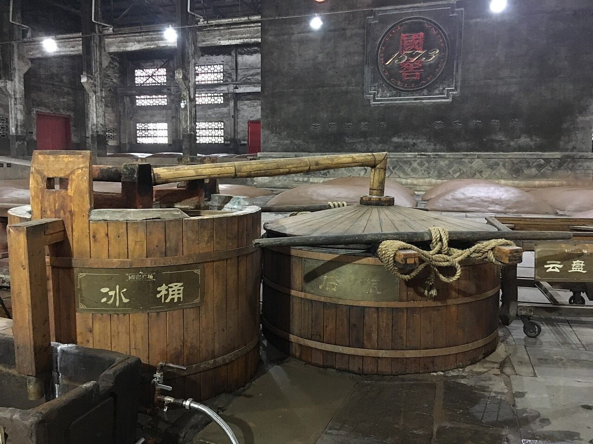

# Luzhou Laojiao

Luzhou Laojiao is produced in Luzhou, Sichuan, and is a leading strong-aroma baijiu. Its old mud pits have been used for long periods, and the combination of continued mash recycling and mixed steaming and boiling produces a pronounced pit aroma. A common strength is 52% ABV.

Figure: Luzhou Laojiao. Image: Xiaomage de, CC BY-SA 4.0, via Wikimedia Commons ([source page](https://commons.wikimedia.org/wiki/File:Traditioneller_chinesischer_Destillationsapparat_in_der_Brennerei_Luzhou_Laojiao.jpg)).

## Definition and position

Luzhou Laojiao is a brand within [baijiu](ref:baijiu) and a typical representative of [strong-aroma baijiu](ref:strong-aroma). The "old pit" in the name points to a process fact: mud pits are used continuously, not as single-use containers, but as a microbial habitat that keeps taking part in fermentation. That is why strong-aroma baijiu stresses pit age.

The product is distilled, with strength stated as [alcohol by volume](ref:abv), commonly 52% ABV, and lower-strength versions also exist. Different products have different body design and blending aims, so strength alone cannot compare them.

## Origin and environment

Luzhou lies in southern Sichuan, where the Yangtze and Tuo rivers meet. The warm, humid climate suits open qu making and long pit fermentation. Local water, grain and airborne microbes together form the brewing environment. The regional style of strong-aroma baijiu is often tied to the history of the pit group, raw-material supply and climate.

Luzhou Laojiao's old pit group is treated as an important brewing heritage. The longer a pit is used continuously, the more stable the microbial ecology in the pit mud and the more mature its aroma-producing capacity. Note that "older pit, better liquor" is an empirical judgment; the specific product still depends on raw materials, process control and blending.

## Raw materials and qu

Luzhou Laojiao uses sorghum as its main material, following a single-grain strong-aroma route. Sorghum supplies starch and a moderate amount of tannin, and the tannin converts during fermentation to bring structure and a lingering finish. After crushing, the grain is combined with qu and water and enters the continued mash recycling flow.

Qu is made mainly from wheat and cultured into medium-to-high-temperature bricks. [Qu making](ref:qu-making) decides saccharifying power and aroma precursors, and qu quality directly affects yield and the depth of pit aroma. The pit mud is rich in microbes such as caproic-acid bacteria, which together with qu form the main strong-aroma notes.

## Production

The typical flow is: prepare the grain, mix, cook, cool, add qu, ferment in the pit, remove, distil, grade and store, blend and bottle. Continued mash recycling means each round keeps part of the old mash and mixes it with new grain and new qu, so aromatic compounds accumulate round by round; mixed steaming and boiling means grain cooking and spirit distillation happen in one operation.

Fermentation usually runs for months. After removal, spirit is drawn by layer and cut by segment, and different segments have different styles. New spirit is stored by grade and then blended. Storage lets harshness fade and aromas integrate, but longer is not always better: base-spirit structure and the target style are the real criteria.

## Flavour and tasting

Luzhou Laojiao's aroma is led by pit aroma, grain aroma and the sweet note of ethyl hexanoate, with a sweet, mellow entry, a full body and a clean finish. The "pit aroma" of strong-aroma baijiu is not an abstract word: it comes from pit-mud metabolism and long accumulation through mash recycling. Different pits and rounds create clear differences.

Taste in a small cup: smell the resting aroma, then swirl and smell again. Let the liquid cover the tongue and follow sweet, sour, bitter and umami, and whether the body carries the alcohol. Water lowers the heat but changes the aroma balance; if you try it, add drop by drop and compare.

Another often ignored variable is temperature. Strong-aroma spirit smells different in winter and summer: low temperatures make pit aroma seem reserved, while warmth brings out the sweet notes. Recording the room temperature makes tasting notes more reliable than a single impression.

## Product lines and labels

Luzhou Laojiao has product lines such as Guojiao 1573 and Tequ, with different positioning and body design. "1573" refers to the construction year of the Ming-dynasty pits and is part of the brand story; the vintage, batch and body of a specific product still depend on the label and company information.

The producer, aroma type, strength, standard and volume on the label are the basics for verifying identity. Counterfeits and similar names exist, so buy through official channels and check anti-counterfeit marks. Price movements are market behaviour, and this entry gives no collecting or investment advice.

## Drinking and pairing

The traditional serve is neat in a small cup at room temperature. At the table it suits strongly flavoured Chinese dishes such as braised pork, braised snacks, sauce beef and hotpot; the sweetness and pit aroma of strong-aroma spirit carry the fat, but excessive chilli amplifies the alcohol. Small amounts, sipped slowly, show the layers better.

Luzhou Laojiao can be used in mixed drinks, but high strength changes the balance. Ice is not traditional and dilutes the aroma and the unfolding of pit aroma; for a lighter impression, choose a lower-strength version rather than a lot of ice. After opening, store away from light and heat and finish reasonably soon.

## Common misconceptions

First, treating "old pit" as an absolute quality guarantee. Pit age is one condition, not the only standard.
Second, that strong aroma has only one style. Pits, raw materials and blending create clear differences.
Third, reading "1573" as the vintage of the liquid. It refers to the pit construction year, not the spirit's age.
Fourth, that lower-strength versions are simply diluted. They need dedicated body design.
Fifth, judging authenticity by packaging or price. Anti-counterfeit checks, channels and labels are reliable.

Start with [Baijiu](ref:baijiu) for style, then read [Qu making](ref:qu-making) for region and vintage. Seeing both keeps Luzhou Laojiao from being confused with a neighbouring idea.

**Short definition:** A strong-aroma baijiu from Luzhou, Sichuan, known for long-used mud pits and continued mash fermentation.

Read Luzhou Laojiao through the base and the stated strength, then the sweetness or bitterness, and finally how it is served. The sequence matters.

**Key facts.**

| Item | Detail |
| --- | --- |
| In one line | A strong-aroma baijiu from Luzhou, Sichuan, known for long-used mud pits and continued mash fermentation. |
| Style | Baijiu、Strong-aroma baijiu |
| ABV | 52–52% vol |

**Sources and limits.** The key claims about Luzhou Laojiao are checked against the following sources: Industry body (origin, pits and product-line information; strong-aroma baijiu, mud-pit solid-state fermentation and mash recycling terms), Oxford University Press (Consulted for entries on Chinese baijiu and strong aroma). Prices, batches and status change; the body is project-written and does not reproduce source text.

## Further reading

- [Baijiu](ref:baijiu): the broad category and process background for Luzhou Laojiao.
- [Strong-aroma baijiu](ref:strong-aroma): the key to understanding pit aroma and mash recycling.
- [Qu making](ref:qu-making): how qu and pit mud together shape strong aroma.
- [Alcohol by volume](ref:abv): the measure for comparing strength versions.
