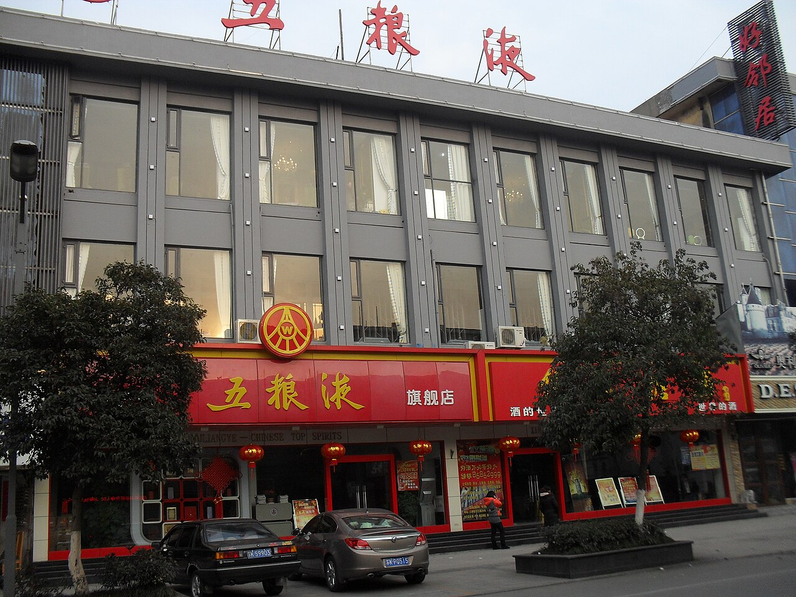

# Wuliangye

Wuliangye is produced in Yibin, Sichuan, from sorghum, rice, glutinous rice, wheat and corn. It is a strong-aroma baijiu. Long-used mud pits, continued mash recycling and mixed steaming and boiling are central to its production. A common strength is 52% ABV.

Figure: Wuliangye. Image: 东京村子, CC BY-SA 3.0, via Wikimedia Commons ([source page](https://commons.wikimedia.org/wiki/File:%E4%BA%94%E7%B2%AE%E6%B6%B2%E6%97%97%E8%88%B0%E5%BA%97_-_panoramio.jpg)).

## Definition and position

Wuliangye is a brand product within [baijiu](ref:baijiu) and a representative of [strong-aroma baijiu](ref:strong-aroma). Its name points directly at the ingredient structure: five grains fermented together. Brand, aroma type and origin are different layers and must be checked separately; not every strong-aroma spirit from Yibin is Wuliangye.

The product is distilled, with strength stated as [alcohol by volume](ref:abv), commonly 52% ABV, and lower-strength versions such as 39% ABV also exist. The difference affects the entry heat and aroma release but is not a quality ranking.

## Origin and environment

Yibin lies in southern Sichuan, where the Min and Jinsha rivers meet before joining the Yangtze. The humid valley climate and relatively mild temperature swings suit open qu making and long pit fermentation. Local water and airborne microbes are treated as part of the environment for the strong-aroma style. The advantage is not one factor but the combined accumulation of climate, grain, pits and process.

Old pits are an important asset of Yibin strong-aroma production. The longer a pit is used continuously, the more stable the microbial community in the pit mud and the more mature the ecology of aroma-producing microbes such as caproic-acid bacteria. A pit is not merely a container: it participates in flavour formation, so "old pit" has real meaning in strong-aroma baijiu rather than being only marketing language.

## Raw materials and qu

The five grains each play a role: sorghum gives the frame and a structural feel from tannins, rice and glutinous rice add sweetness and roundness, wheat brings qu aroma and fermentation power, and corn adds sweetness and body. The proportions are not fixed, and different product lines adjust them to create style differences.

Qu is the saccharification and fermentation agent. Strong-aroma baijiu usually uses medium-to-high-temperature qu made mainly from wheat, with the bricks cultured and stored before use. Continued mash recycling means each fermentation retains part of the old mash, mixed with new grain and new qu, so flavour accumulates round by round. [Qu making](ref:qu-making) and pit management together decide the depth and cleanliness of the aroma.

## Production

The typical strong-aroma flow is: crush the grain, mix, cook, cool, add qu, ferment in the pit, remove from the pit, distil, grade and store, blend and bottle. Mixed steaming and boiling means grain cooking and mash distillation happen in the same operation, extracting alcohol and aroma while the new grain absorbs flavour from the mash.

Fermentation usually runs for months. After removal, spirit is drawn by layer and cut by segment. New spirit is stored separately by grade and round, then blended into the finished product. Blending solves the balance of aroma, body and finish rather than simply adding spirits together. The storage vessel and time affect how quickly harshness fades.

## Flavour and tasting

Wuliangye's aroma is led by pit, grain and sweet notes, often with the composite aroma of multi-grain fermentation. The entry is mellow and sweet, the body is full, the aroma opens mid-palate, and the finish is clean. Ethyl hexanoate is associated with strong-aroma baijiu, but pit, vintage and blending create noticeable differences.

Taste in a small cup: smell the resting aroma, then swirl gently and smell again. Let the liquid stay in the mouth and follow sweet, sour, bitter and umami in sequence, along with the body's thickness. A little water lowers the heat but changes the aroma balance; if you try it, add drop by drop and compare.

## Product lines and labels

Wuliangye has core products and series products with different prices and body designs. The producer, aroma type, strength, standard and volume on the label are the basic information for verifying identity. Counterfeits and look-alike names exist, so buy through official channels and check anti-counterfeit information.

Words such as "vintage" and "aged" must be read together with company standards and label statements, not packaging alone. Bottle ageing and jar ageing change at different rates, and home storage cannot easily reproduce a distillery's temperature and humidity, so purchase year is not the same as quality.

## Drinking and pairing

The traditional serve is neat in a small cup at room temperature. At the table it suits savoury, sauce-flavoured and mildly spicy Sichuan dishes, such as twice-cooked pork, camphor-smoked duck, braised dishes and braised snacks; excessive heat amplifies the alcohol and excessive sweetness covers the pit aroma. Small amounts, sipped slowly before a meal, show the layers better.

Wuliangye can be used in mixed drinks, but 52% ABV significantly changes the balance, and sugar and acid in a recipe need rebalancing. Ice is not traditional and lowers aroma release while diluting the body; for a lighter impression, choose a lower-strength version rather than a lot of ice.

## Common misconceptions

First, that "five grains" is necessarily better than single grain. Multi-grain and single-grain are style routes, not quality grades.
Second, equating strong aroma with "the stronger the better". Aroma needs cleanliness and layering, and excessive pit aroma can cover grain notes.
Third, that a lower-strength version is "watered down". Lower-strength spirit needs dedicated body design and blending, not simple dilution.
Fourth, that an old pit can be replicated quickly. The pit-mud community takes long cultivation, and time cannot be compressed.
Fifth, judging authenticity by packaging or price. Anti-counterfeit checks, channels and labels are the reliable methods.

For Wuliangye, begin with the base and the stated strength, then the sweetness or bitterness, and finish with how it is served; that order keeps the account grounded.

[Baijiu](ref:baijiu) explains style; [Qu making](ref:qu-making) adds region and vintage. Put Wuliangye between them before deciding what it is.

**Short definition:** A strong-aroma baijiu from Yibin, Sichuan, made from five grains and commonly bottled at 52% ABV.

**Key facts.**

| Item | Detail |
| --- | --- |
| In one line | A strong-aroma baijiu from Yibin, Sichuan, made from five grains and commonly bottled at 52% ABV. |
| Style | Baijiu、Strong-aroma baijiu |
| ABV | 52–52% vol |

**Sources and limits.** The key claims about Wuliangye are checked against the following sources: Industry body (origin, ingredients and product lines; strong-aroma baijiu, continued mash recycling and mixed steaming and boiling terms), Oxford University Press (Consulted for entries on Chinese baijiu and strong aroma). Prices, batches and status change; the body is project-written and does not reproduce source text.

## Further reading

- [Baijiu](ref:baijiu): the broad category and basic process behind Wuliangye.
- [Strong-aroma baijiu](ref:strong-aroma): the key to understanding pit aroma and mash recycling.
- [Qu making](ref:qu-making): how qu shapes strong-aroma fragrance.
- [Alcohol by volume](ref:abv): the measure for comparing strength versions.
