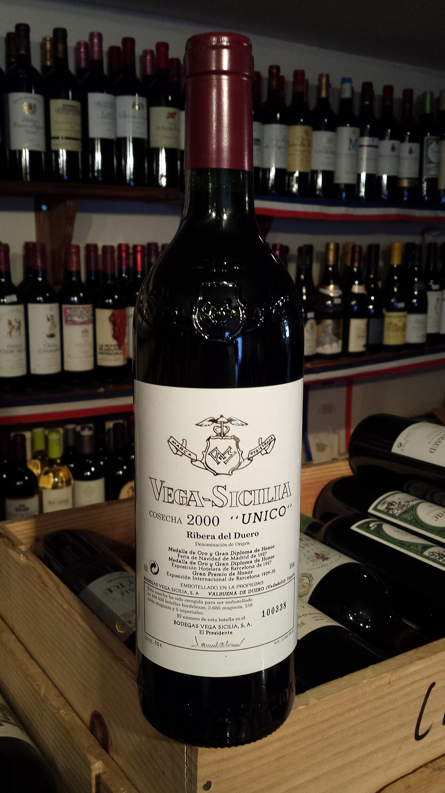

# Vega Sicilia

Vega Sicilia is a historic estate in Spain's Ribera del Duero, founded in 1864. The wine belongs to [red wine](ref:red-wine), a blend led by [Tempranillo](ref:tempranillo), and its flagship Único is known for long ageing and complexity. The common format is 750 mL at about 14% ABV; vintage, bottling batch and label details should be checked on the bottle.

Figure: Vega Sicilia. Image: Dominic Lockyer, CC BY 2.0, via Wikimedia Commons ([source page](https://commons.wikimedia.org/wiki/File:Vega_Sicilia_%C3%9Anico_2000.jpg)).

## Definition and position

Vega Sicilia is both the name of the estate and the brand name of its wines. The estate lies in the Ribera del Duero in northern Spain and sells its wine under a protected designation of origin in the EU AOC/AOP system. Besides the flagship Único there are products such as Valbuena, coming from different parcels and selection standards and not to be confused with one another.

Within the classification of [wine](ref:wine), it is a still red wine. A historic estate is a market identity built over time, not a legal grade; vintage, parcel and bottling batch remain the basis for judging a specific wine.

## Origin and climate

Ribera del Duero lies on the high plateau of northern Spain, with a markedly continental climate: hot and dry summers, cold winters and large day-night temperature swings. These conditions suit varieties such as Tempranillo, allowing flavour to accumulate over a long ripening period while retaining acidity.

The soils mix limestone, clay and gravel, and parcels differ in drainage and warming. Altitude and aspect affect the pace of ripening, and the estate must harvest in parcels. High altitude and a continental climate are not a quality guarantee, and vintage differences remain obvious.

## Varieties and blend

The wines are based on Tempranillo, often with [Cabernet Sauvignon](ref:cabernet) and other varieties. Tempranillo provides fruit, acidity and ageing potential, Cabernet Sauvignon adds structure and tannin, and other varieties adjust aroma and body. The proportions differ between wines, and the exact formula is usually not fully declared on the label.

Proportions shift with vintage and parcel. The proportion is not itself a quality marker; balance is what matters. Blending is the estate's process decision, and the details are company process information that labels may not fully disclose.

## Production

Harvesting is usually done by hand, and after sorting, destemming and crushing the fruit undergoes temperature-controlled [fermentation](ref:fermentation). Maceration time and temperature affect the extraction of colour, tannin and aroma; different parcels and varieties are often handled in separate tanks before [blending](ref:blending).

After fermentation the wine goes into [oak ageing](ref:oak-ageing). The share of new barrels, the ageing period and the frequency of racking are estate process decisions. The flagship is known for long ageing, and bottle ageing also shapes the final style; public material may not disclose exact periods year by year.

## Specification and label

The common format is a 750 mL bottle at about 14% ABV, as a dry red wine. The label usually carries the estate name, wine name, vintage, appellation, strength and net volume; Spanish protected-designation wines also declare the appellation.

When imported into China there is also a Chinese back label, and the Chinese label should correspond to the original information. Different wines and vintages may use different packaging, and packaging differences do not equal differences in the liquid.

## Flavour and tasting

When young the wine often shows black cherry, plum, spice and tobacco, with fine but supportive tannin and good acidity. After long ageing it develops cedar, leather, cocoa and dried-flower notes, and the body moves from firm to supple with a fairly long finish.

Serve at about 16-18°C. Too warm accentuates alcohol, too cold suppresses aroma. Older wines should spend less time in contact with air so that aroma is not lost too quickly; younger wines can be left to breathe moderately.

## Drinking and pairing

Vega Sicilia suits roasted lamb, steak, Iberian ham and hard cheese. Tannin binds with protein to soften astringency, while acidity cuts through fat. Dishes with mushroom and truffle, carrying earthy notes, also echo the aromas of an aged wine.

For Vega Sicilia, if a bottle is not finished, cork it tightly, refrigerate and drink within a few days. Red wine oxidises with prolonged air contact, and fruit aroma turns to sour and nutty notes; decanting into a smaller bottle or using a vacuum stopper slows the process.

## Buying and storage

Products from historic estates circulate mainly through merchants, auctions and the estate's channels, with prices shaped by vintage, yield and market expectations. Buyers should check the estate name, wine name, vintage, appellation, strength and anti-counterfeit information, and consider whether the channel is reliable.

For Vega Sicilia, unopened wine should be stored on its side, away from light, at a steady temperature, ideally 12-16°C, avoiding sharp temperature swings and strong odours. Home storage cannot replicate cellar conditions, and long ageing needs stable temperature and humidity, so the year of purchase should not be equated simply with an improvement in quality.

## Common misconceptions

First, treating a historic estate as a fixed quality guarantee for every year. Vintage differences remain obvious.

Second, confusing the flagship with the entry-level wines. They come from different parcels and selection standards.

Third, treating Tempranillo as the only variety. The blend also includes Cabernet Sauvignon and other varieties.

Fourth, judging quality by price alone. Channel, vintage and storage condition matter equally.

For Vega Sicilia, a common mistake is treating ageing potential as indefinite storage. Past its drinking window, aroma and structure decline.

[Red wine](ref:red-wine)'s style and [Spain](ref:spain)'s region and vintage form a useful pair: the contrast shows where one ends and the other begins.

**Short definition:** A historic estate in Spain's Ribera del Duero, founded in 1864; a Tempranillo-led blend whose flagship Único is known for long ageing and complexity, commonly 750 mL at about 14% ABV, with vintage and batch to be checked on the label.

**Key facts.**

| Item | Detail |
| --- | --- |
| In one line | A historic estate in Spain's Ribera del Duero, founded in 1864; a Tempranillo-led blend whose flagship Único is known for long ageing and complexity, commonly 750 mL at about 14% ABV, with vintage and batch to be checked… |
| Style | Red wine |
| Region | Spain |

**Sources and limits.** The key claims about Vega Sicilia are checked against the following sources: International Organisation of Vine and Wine (OIV) (basic statements on wine definitions, categories and labelling), European Union (EU wine categories, geographical indications and labelling rules), Industry body (wine classification, labelling and technical requirements) and 7 sources in total. Prices, batches and status change; the body is project-written and does not reproduce source text.

## Further reading

- [Red wine](ref:red-wine): category and basic process.
- [Wine](ref:wine): the broad category and classification system.
- [Spain](ref:spain): the Spanish wine-region landscape.
- [Tempranillo](ref:tempranillo): variety characteristics and style.
- [Cabernet Sauvignon](ref:cabernet): structure and tannin in the blend.
- [Fermentation](ref:fermentation): skin fermentation and maceration.
- [Oak ageing](ref:oak-ageing): shaping aroma and tannin.
- [Blending](ref:blending): balancing varieties and parcels.
