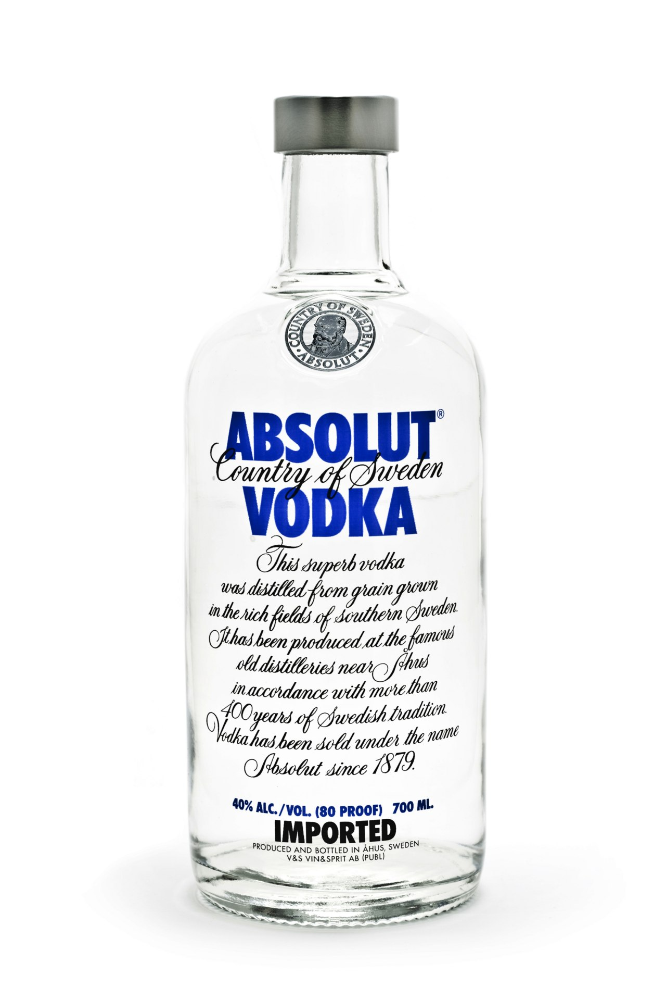

# Absolut Vodka

Absolut Vodka is a Swedish [vodka](ref:vodka) made from winter wheat in Åhus, in the southern province of Skåne, using continuous [distillation](ref:distillation). The brand was launched in 1979 and is commonly 40% ABV, with a clean, soft cereal sweetness.

Figure: Absolut Vodka. Photograph: Absolut vodka bottle. Credit: Justus Blümer, CC BY 3.0, via Wikimedia Commons ([source](https://commons.wikimedia.org/w/index.php?curid=43012114)).

## Definition and identity

Vodka is a high-strength spirit distilled from agricultural raw material, and EU regulation requires a bottling strength of at least 37.5% ABV. It can be neutral in flavour or carry a light cereal or potato character from its raw material. Absolut is an unflavoured vodka, not a flavoured vodka and not a liqueur.

"Absolut" is both a brand name and the name of a product line. The brand also sells lemon, citrus and vanilla variants, which take the unflavoured vodka as a base and add flavour; they should not be confused with the plain product. Check the version name and strength on the label rather than judging plain vodka by the sweetness of a flavoured variant.

## History

Distilling in Åhus goes back to 1879, when the town built a distilling tradition on local wheat and water. In 1979 Absolut Vodka was launched as a Swedish vodka brand aimed at the international market, and its simple bottle and advertising design quickly made it recognisable. The brand then expanded into many countries and released flavoured and limited editions.

Ownership changed in the 21st century and the brand is now held by an international drinks group. The brand maintains uniform raw material and distillation standards across markets, which keeps its flavour relatively stable. A historical year and the production date of a particular bottle are not the same thing: "1879" in the brand story refers to the distilling tradition, while "1979" refers to the launch of the modern product. When reading brand history, separate tradition, product launch and marketing.

## Region and ingredients

Åhus lies in southern Sweden, where the climate is comparatively mild and suited to winter wheat. Winter wheat is sown in autumn, overwinters and matures in the following season; the longer growing period affects protein and starch structure and therefore fermentation and distillation. Absolut emphasises a single-source raw material system, with wheat drawn from a specific area to reduce batch variation.

Vodka can be made from grain, potato, molasses and other materials; EU regulation requires agricultural raw material and distillation to a high purity. Grain tends to give a light sweetness and a soft body, while potato can be fuller and more neutral. Raw material difference is a matter of style rather than a ranking, and Absolut chooses winter wheat for a stable, clean body.

## Production and distillation

Absolut uses continuous distillation: the liquid enters a column still, is heated, evaporates and condenses continuously, which gives high efficiency and large volumes suited to stable, large-scale production. Continuous distillation can reach high purity, after which filtration and water adjustment bring the spirit to its target strength. Compared with batch pot distillation, continuous distillation emphasises consistency and purity.

"More distillations are better" is a simplification. The number of distillations affects purity and how much flavour survives: over-purification loses cereal character, while under-purification leaves fusel oils and harshness. Absolut's goal is a clean, soft vodka suited to mixing, so the process serves that style rather than chasing flavour complexity. Flavoured variants add flavour on top of the base, but the plain vodka remains the skeleton.

## Flavour and tasting

Absolut's typical aromas are a light cereal sweetness, a little citrus and alcohol; it enters soft with a light body and a clean finish. It is not a completely flavourless vodka: at low temperature the cereal sweetness is clearer, and as it warms the alcohol becomes more prominent. Variation between batches is usually small, which is the result of continuous distillation and raw material control.

Taste it well chilled, neat, in a small glass and in small amounts; you can also nose it at room temperature first and then compare it chilled to see how temperature changes sweetness and pungency. Do not evaluate vodka in large swallows, because high strength quickly numbs the palate. For mixing, understand the sugar, acid and dilution in the recipe before deciding whether the base suits it.

## Drinking and pairing

Neat vodka is usually served well chilled with savoury snacks, caviar, pickles or smoked fish. For mixing, the Moscow Mule (vodka, ginger beer, lime), the Bloody Mary (vodka, tomato juice, spices), the vodka martini and the Cosmopolitan are all common. Because the flavour is neutral it acts more as structure in a cocktail, but its strength markedly changes the balance of the finished drink.

As a base, Absolut suits recipes that need a clean background; if a recipe relies on the base for aroma, it can seem too neutral. With very sweet mixers, watch total sugar and strength so the drink does not become cloying or too strong. With food it suits salty, sour and fatty dishes rather than delicate desserts.

## Common misconceptions

First, that all vodka is completely tasteless. Raw material and distillation leave slight differences in cereal, potato or sweetness.
Second, treating the number of distillations as a quality ranking. The number affects purity and style, not whether it tastes better.
Third, treating Absolut as a Russian brand. It originates in Sweden and is produced in Åhus.
Fourth, treating a flavoured variant as the plain vodka. Flavoured products carry extra sugar and flavour, and the label says so.
Fifth, ignoring strength and volume. 40% ABV is a common specification, but markets and versions differ.

**Short definition:** A Swedish vodka made from winter wheat in Åhus with continuous distillation, launched in 1979 and commonly 40% ABV. 

Read Absolut Vodka through the base and the stated strength, then the sweetness or bitterness, and finally how it is served. The sequence matters.

Absolut is made in Åhus, Sweden, from winter wheat and continuous distillation.

**Key facts.**

| Item | Detail |
| --- | --- |
| In one line | A Swedish vodka made from winter wheat in Åhus with continuous distillation, launched in 1979 and commonly 40% ABV. |
| Style | Vodka |
| ABV | 40–40% vol |

**Sources and limits.** The key claims about Absolut Vodka are checked against the following sources: Absolut (raw material, origin, continuous distillation and product information), European Union (the vodka definition, raw materials and minimum bottling strength), Oxford University Press (Consulted for entries on vodka, continuous distillation and Swedish distilling traditions) and 4 sources in total. Prices, batches and status change; the body is project-written and does not reproduce source text.

**Read alongside.** Put Absolut Vodka next to Vodka, Distillation, Wheat: the first fixes identity and boundary, the others provide a region, process or peer comparison. Read this page first, then return to those entries; the links become coordinates, not decoration.

## Further reading

- [Vodka](ref:vodka): the category and regulatory framework to which Absolut belongs.
- [Distillation](ref:distillation): the link between continuous distillation and a clean body.

Further reading: [Wheat](ref:c-extra-1).
